<p align="center">
  <picture>
    <source media="(prefers-color-scheme: dark)" srcset=".github/assets/logo-dark.png">
    
  </picture>
</p>

<p align="center"><a href="README.md">English</a> &nbsp;·&nbsp; <b>Deutsch</b></p>

<h3 align="center">Die Sims fürs echte Leben: Räume erfassen, in 3D ansehen, einrichten.</h3>

<p align="center">
  <a href="https://github.com/xc4pr/roomx/releases"></a>
  <a href="https://github.com/xc4pr/roomx/actions/workflows/ci.yml"></a>
  <a href="LICENSE"></a>
  
  
  
  
  
</p>

<p align="center">
  <a href="https://xc4pr.github.io/roomx/"><b>App öffnen</b></a>
  &nbsp;·&nbsp;
  <a href="#handbuch"><b>Handbuch</b></a>
  &nbsp;·&nbsp;
  <a href="https://xc4pr.github.io/roomx/rechtliches"><b>Datenschutz</b></a>
</p>

<p align="center">
  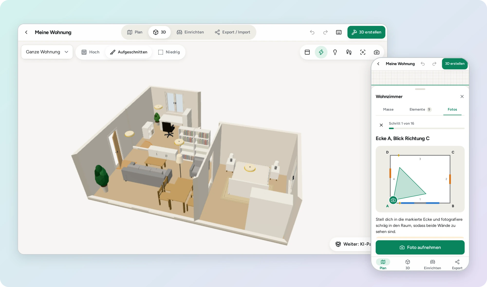
</p>

---

## Was ist RoomX?

RoomX ist die Sims fürs echte Leben. Du misst deine Räume ein, baust sie in 3D nach und richtest sie mit Möbeln ein. Auf Wunsch macht dir ein KI-Assistent Einrichtungsvorschläge, die RoomX wieder in deinen Plan übernimmt.

Die App läuft im Browser auf Computer, Laptop, Tablet und Smartphone und lässt sich wie eine App installieren. Du brauchst kein Konto: Alle Projekte und Fotos bleiben auf deinem Gerät.

> [!NOTE]
> RoomX gibt es auf Deutsch und auf Englisch. Die Sprache stellst du in den Einstellungen um. Dieses Handbuch ist auf Deutsch.

> [!NOTE]
> **Lizenz:** Die veröffentlichte App unter <https://xc4pr.github.io/roomx/> darf jede Person nutzen, privat und beruflich. Der Quellcode steht unter der PolyForm Noncommercial License 1.0.0 mit einer Zusatzerlaubnis, siehe [Lizenz](#lizenz).

## Das kann RoomX

<table>
  <tr>
    <td width="33%" valign="top">
      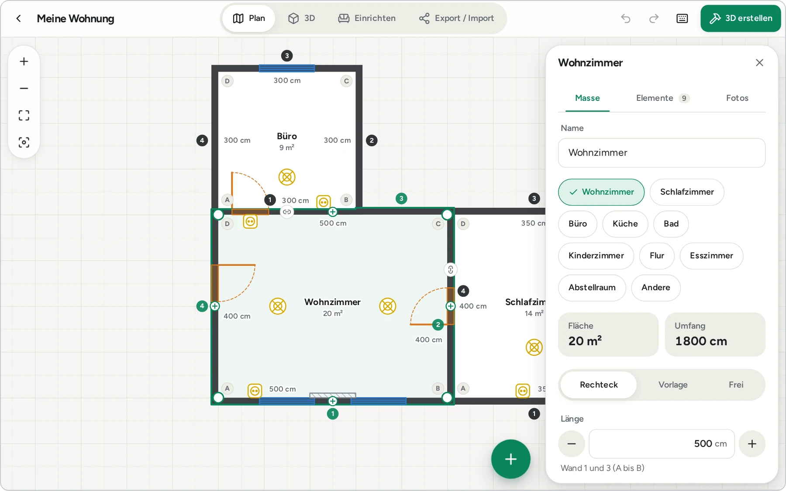<br>
      <b>Räume erfassen</b><br>
      Rechteck, Vorlagen (L, U, T, Erker, Nische), freie Formen mit Wänden und Winkeln, Dachschrägen. Räume rasten wie ein Magnet aneinander ein.
    </td>
    <td width="33%" valign="top">
      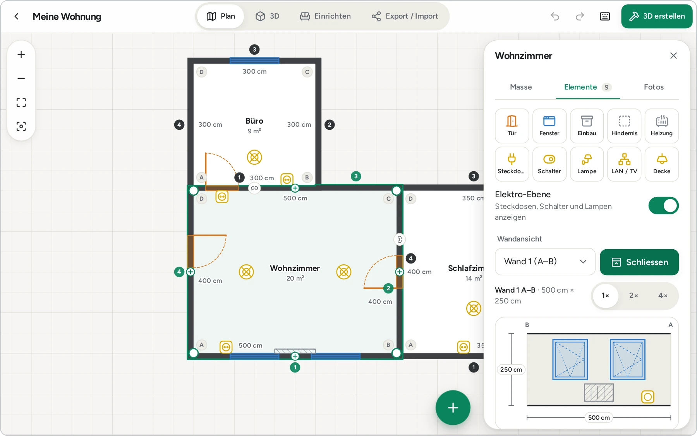<br>
      <b>Türen, Fenster, Elektro</b><br>
      Elemente aus der Palette auf die Wand setzen, in der Wandansicht auf den Zentimeter genau ausrichten, Steckdosen und Schalter einblenden. Auch Bad, Küche und Feuerstellen.
    </td>
    <td width="33%" valign="top">
      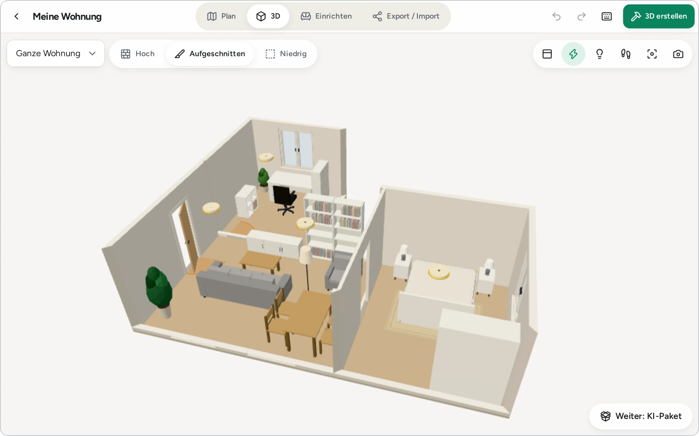<br>
      <b>Wohnung in 3D</b><br>
      Aufgeschnitten, hoch oder niedrig ansehen, Licht an und aus, durch die Räume gehen, Bild speichern.
    </td>
  </tr>
  <tr>
    <td width="33%" valign="top">
      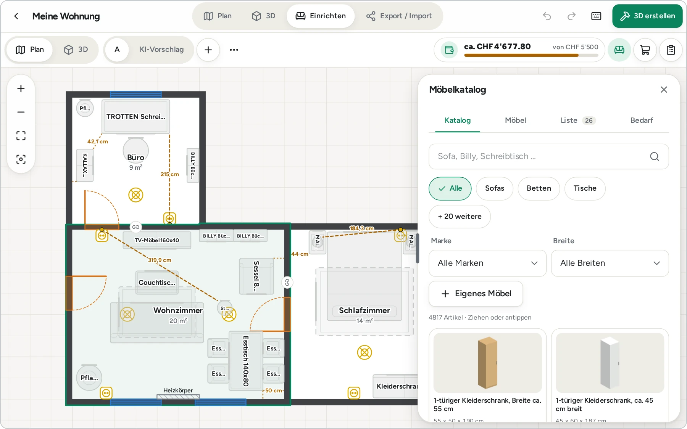<br>
      <b>Einrichten</b><br>
      Über 450 geprüfte Möbel und ein grosser Katalog mit mehreren tausend Artikeln von IKEA, JYSK und Tchibo, dazu allgemeine Modelle. Ziehen, drehen, stapeln, eigene Möbel anlegen, Varianten vergleichen.
    </td>
    <td width="33%" valign="top">
      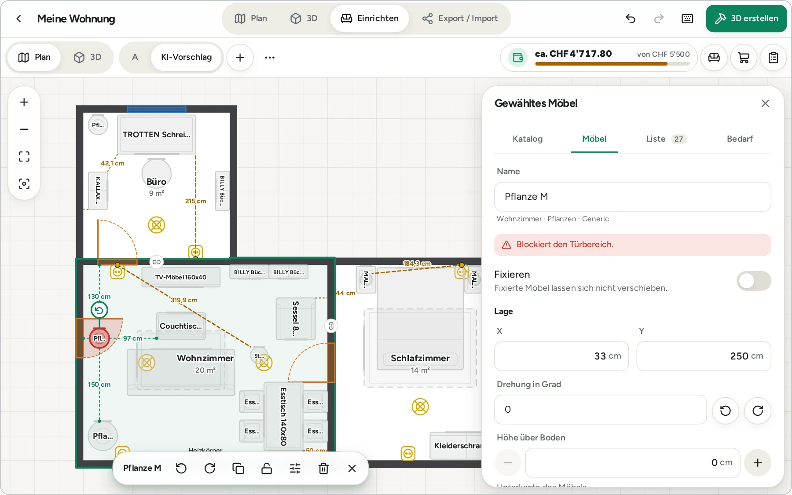<br>
      <b>Prüfungen</b><br>
      Rot markiert, was nicht passt: Kollisionen, Türbereich, Dachschräge, zu weite Wege zur Steckdose.
    </td>
    <td width="33%" valign="top">
      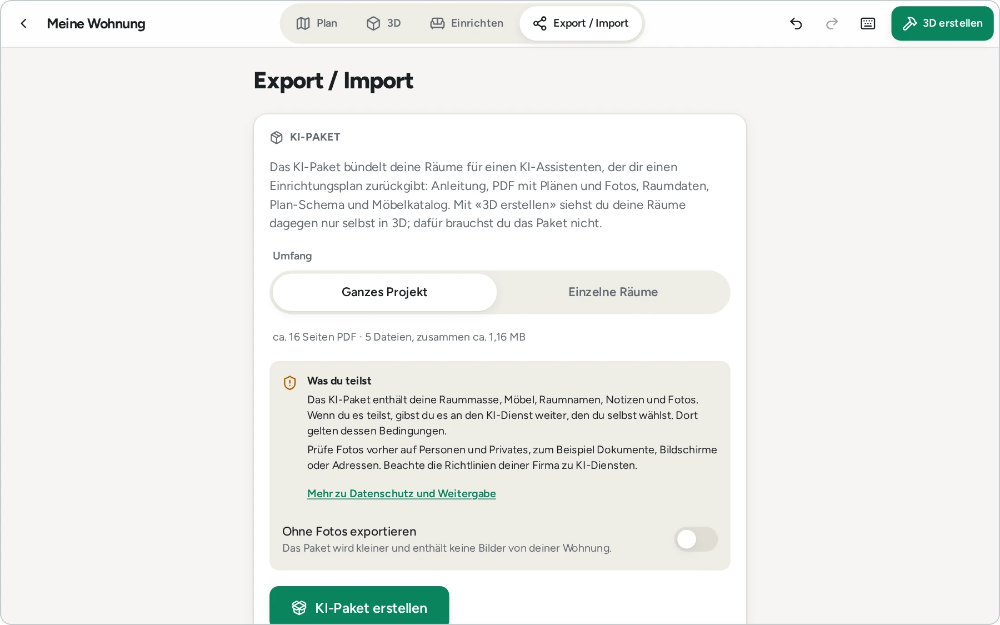<br>
      <b>Mit KI-Assistent einrichten</b><br>
      KI-Paket erstellen, im Chat hochladen, den Plan der KI als Variante importieren. Dazu Budget, Einkaufsliste und Backup.
    </td>
  </tr>
</table>

## Schnellstart

**1. App öffnen.** Gehe auf **<https://xc4pr.github.io/roomx/>**. Beim ersten Start begrüsst dich eine kurze Tour mit dem RoomX-Logo und zeigt dir die wichtigsten Stellen.

**2. Projekt anlegen.** Tippe auf «Neues Projekt» und gib einen Namen ein, zum Beispiel «Meine Wohnung».

**3. Räume erfassen.** Tippe im Plan auf das Plus. Du bekommst einen Raum mit 4 × 3 m. Trage Länge, Breite und Höhe ein und schiebe die Räume zusammen, bis sie einrasten. Setze Türen, Fenster und Steckdosen.

**4. In 3D ansehen.** Tippe oben rechts auf «3D erstellen». RoomX prüft den Plan und baut deine Wohnung nach.

**5. Einrichten.** Wechsle zu «Einrichten» und zieh Möbel aus dem Katalog in die Räume. Oder lass dir von einem KI-Assistenten einen Vorschlag machen (siehe [Mit dem KI-Assistenten einrichten](#mit-dem-ki-assistenten-einrichten)).

### Als App installieren

Du kannst RoomX wie eine normale App auf den Startbildschirm oder in den Programmordner legen. Sie öffnet sich dann ohne Adressleiste und läuft nach dem ersten Laden auch ohne Netz.

| Gerät | Browser | So geht es |
|---|---|---|
| iPhone, iPad | Safari | Unten (iPhone) oder oben (iPad) auf «Teilen» tippen, dann «Zum Home-Bildschirm» wählen. |
| Android | Chrome | Menü (drei Punkte) öffnen, dann «App installieren» (oder «Zum Startbildschirm hinzufügen») wählen. |
| Windows, Linux, ChromeOS, macOS | Chrome oder Edge | In der Adressleiste auf das Installieren-Symbol klicken, oder im Menü «RoomX installieren» wählen. |
| macOS | Safari | Im Menü «Ablage» oder über «Teilen» den Eintrag «Zum Dock hinzufügen» wählen. |

> [!IMPORTANT]
> **iPhone und iPad:** Installiere RoomX unbedingt über «Zum Home-Bildschirm». Safari löscht die Daten von Websites, die man länger nicht geöffnet hat. Bei einer installierten App passiert das viel seltener. Mach zusätzlich ab und zu ein [Backup](#sichern-und-umziehen).

> [!NOTE]
> Jede Adresse und jede installierte App hat ihren **eigenen Speicher**. Projekte, die du im Browser angelegt hast, siehst du in der installierten App nicht automatisch. Zum Umziehen dient das Backup, siehe [Sichern und Umziehen](#sichern-und-umziehen).

---

## Handbuch

- [Projekte](#projekte)
- [Räume erfassen](#räume-erfassen)
- [Räume verbinden](#räume-verbinden)
- [Türen, Fenster und Elektro](#türen-fenster-und-elektro)
- [Foto-Tour](#foto-tour)
- [Mit dem Handy fotografieren](#mit-dem-handy-fotografieren)
- [3D erstellen und ansehen](#3d-erstellen-und-ansehen)
- [Einrichten](#einrichten)
- [Mit dem KI-Assistenten einrichten](#mit-dem-ki-assistenten-einrichten)
- [Sichern und Umziehen](#sichern-und-umziehen)
- [Einstellungen](#einstellungen)
- [Tastaturkürzel](#tastaturkürzel)
- [Tipps](#tipps)
- [FAQ](#faq)
- [Datenschutz](#datenschutz)
- [Haftungsausschluss](#haftungsausschluss)
- [Lizenz](#lizenz)
- [Für Entwickler](#für-entwickler)

### Projekte

Ein Projekt ist eine Wohnung, ein Haus oder ein einzelner Raum, mit allen Räumen, Fotos, Möbeln und Varianten. Die Projektliste ist die Startseite.

<p align="center">
  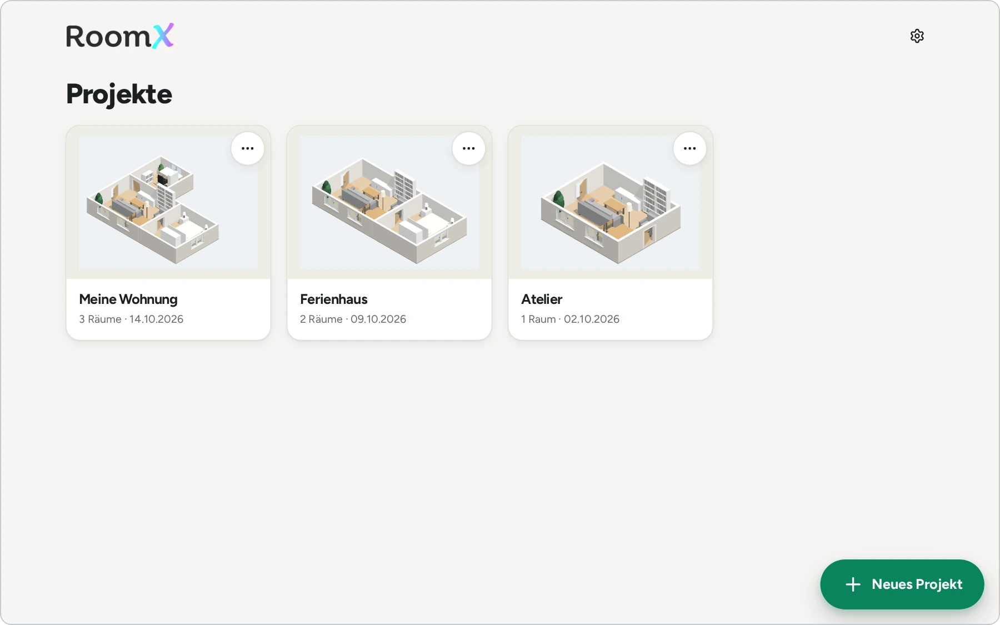
</p>

- **Neues Projekt:** Knopf unten rechts. Vergib einen Namen. Solange die Liste leer ist, siehst du stattdessen das volle RoomX-Logo und ein grosses Plus: Tippe darauf, um dein erstes Projekt anzulegen.
- **Öffnen:** auf die Karte tippen. Das Vorschaubild zeigt dein Projekt in 3D.
- **Menü (drei Punkte) auf der Karte:** Umbenennen, Backup (ZIP) erstellen, Löschen.
- **Löschen landet im Papierkorb.** Ein gelöschtes Projekt ist nicht weg: «In den Papierkorb» legt es in den **Papierkorb** unten in der Projektliste, wo es **30 Tage** bleibt. «Rückgängig» in der Meldung unten holt es sofort zurück. Im Papierkorb holt «Wiederherstellen» es zurück, «Endgültig löschen» entfernt es für immer; nach 30 Tagen entfernt RoomX es von selbst. Dasselbe «Rückgängig» gibt es beim Löschen eines Fotos.
- **Oben im Projekt:** Die Reiter «Plan», «3D», «Einrichten» und «Export / Import» wechseln den Bereich. Daneben stehen «Rückgängig», «Wiederholen» und «3D erstellen».
- **Zahnrad oben rechts:** [Einstellungen](#einstellungen).

<p align="center">
  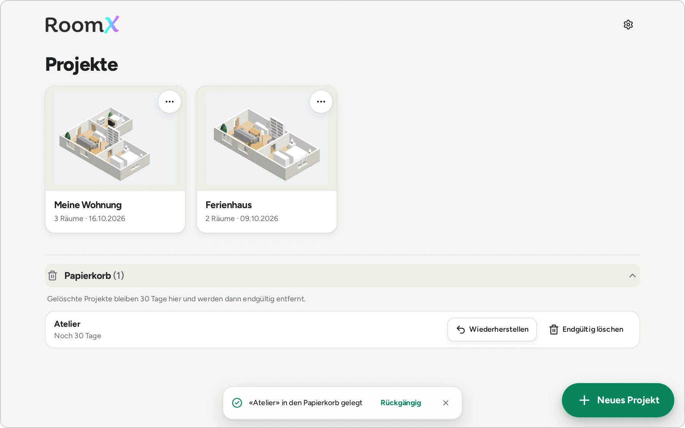
</p>

> [!NOTE]
> In der selbst gehosteten Version mit eingeschaltetem Abgleich erreicht eine Löschung deine anderen Geräte erst, wenn du das Projekt endgültig löschst.

### Räume erfassen

Im Reiter **Plan** zeichnest du den Grundriss. Alles wird in Zentimetern eingegeben (oder in Metern, siehe [Einstellungen](#einstellungen)).

**Raum hinzufügen.** Tippe auf das Plus. Es erscheint ein Raum mit 4 × 3 m, den du an seinen Platz ziehst. Tippen wählt einen Raum aus und öffnet das Panel mit den drei Bereichen **Masse**, **Elemente** und **Fotos**. Doppelt tippen fokussiert den Raum, mit zwei Fingern oder dem Mausrad zoomst du, «Alles zeigen» passt den Ausschnitt an.

**Raumtyp und Name.** Wähle einen Typ (Wohnzimmer, Schlafzimmer, Büro, Küche, Bad, Kinderzimmer, Flur, Esszimmer, Abstellraum, Balkon, Terrasse, Garten, Wintergarten oder Andere) und gib dem Raum einen Namen. Die Typen brechen auf mehrere Zeilen um, sodass du alle auf einen Blick siehst, auch auf einem schmalen Bildschirm.

Unter **Masse** gibt es drei Arten, die Form festzulegen:

| Form | Wofür | So geht es |
|---|---|---|
| **Rechteck** | Die meisten Räume | Länge und Breite eintippen oder mit Plus und Minus anpassen. |
| **Vorlage** | Häufige Sonderformen | Grundform wählen: L-Form, U-Form, T-Form, Schräge Ecke, Erker oder Nische. Danach stellst du die Masse auf den Zentimeter ein. Eine Vorschau zeigt den Grundriss. |
| **Frei** | Alles andere | Wand für Wand die Länge und die Winkel eingeben. Die letzte Wand schliesst sich automatisch. Wände lassen sich teilen oder entfernen, «Gleichmässig verteilen» hilft bei schiefen Eingaben. |

> [!TIP]
> Bei «Frei» kannst du die **Ecken auch direkt im Plan ziehen**. Das Plus mitten auf einer Wand fügt eine Ecke ein. Schliesst der Grundriss nicht, zeigt RoomX an, wie viel fehlt.

**Höhe.** Trage die Raumhöhe ein. Sie gilt für 3D, Prüfungen und das KI-Paket.

<p align="center">
  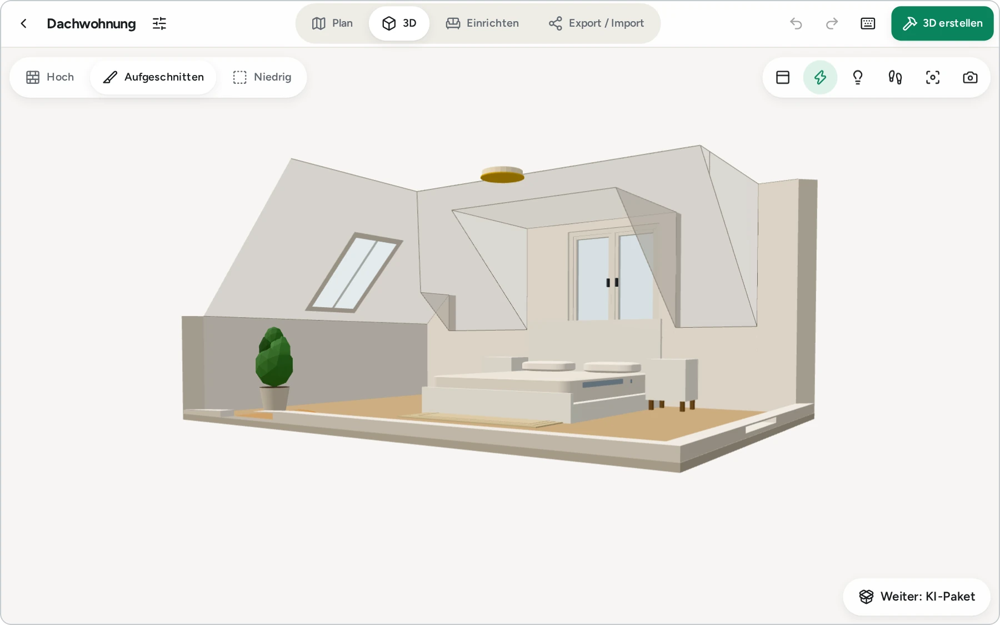
</p>

**Dachschrägen.** Pro Wand kannst du eine Schräge einstellen. Gib die **Kniestockhöhe** (Deckenhöhe direkt an der Wand) an und die Schräge als **Neigung** oder als **Tiefe** (Abstand von der Wand bis zur vollen Raumhöhe). RoomX zeigt beide Werte. Beispiel: Raumhöhe 2,50 m, Kniestock 0,50 m und Tiefe 2 m ergeben 45°. RoomX rechnet aus, ab welchem Abstand die volle Raumhöhe erreicht ist und wo die Stehhöhe von 2 m beginnt. Schrägen erscheinen schraffiert im Plan und in 3D, und Möbel, die nicht darunter passen, werden markiert.

- **Abschnitte:** Eine Schräge kann nur einen Teil der Wand belegen. Trage **Von** und **Bis** ab der Ecke am Wandanfang ein. Je Wand sind mehrere Abschnitte möglich. Ausserhalb ist die Wand normal hoch; an den Enden entstehen senkrechte Wangen, im Plan und in 3D.
- **Gauben:** In einem Abschnitt gibst du **Von**, **Bis** und die **Höhe** an. Dort ist die Decke mindestens so hoch. Der Knopf **Fenster in die Gaube** setzt ein Fenster in die Gaubenfront. Eine Gaube, die so hoch ist wie der Raum, unterbricht die Schräge.
- **Dachfenster:** Das Dachfenster findest du in der Palette in der Gruppe **Öffnungen**, aber nur in Räumen mit Schräge. Du legst die Lage entlang der Wand fest, die **Unterkante über Boden** und Breite × Länge (Standard 78 × 118 cm; die Länge läuft entlang der Schräge). Im Plan ist es ein Symbol in der Schraffur, in 3D eine Öffnung mit Licht. Für den KI-Assistenten ist es ein Fenster.
- Türen und Fenster, die höher sind als die Kniestockwand, schneiden die Schräge sauber aus, wie eine kleine Gaube.

**Weitere Einstellungen im Panel:**

- **Aussehen:** Farbe für Boden (z. B. Eiche hell, Beton, Fliese) und Wände (z. B. Weiss, Sand, Salbei), oder eine eigene Farbe. Sie erscheint in 3D.
- **Notizen** zum Raum, zum Beispiel «Parkett, Heizung links».
- **Duplizieren** und **Löschen.** Über «Rückgängig» holst du einen gelöschten Raum zurück.
- **Raum drehen:** im Menü des Raums «Um 90° drehen».

### Räume verbinden

Eine Wohnung besteht aus mehreren Räumen. Damit RoomX weiss, wie sie zusammenhängen, schiebst du sie im Plan aneinander.

1. Ziehe einen Raum an einen Nachbarraum heran.
2. Er **rastet wie ein Magnet ein**. Zwischen den Räumen liegt dann eine gemeinsame Wand.
3. Auf der gemeinsamen Wand erscheint ein Verbindungssymbol. Im Panel zeigt der Bereich «Nachbarn», welche Wand an welchen Raum grenzt und wie lang das gemeinsame Stück ist. Mit einem Tipp wechselst du in den Nachbarraum.
4. Unter jedem Nachbarn zeigt **«Wandstärke zu …»**, wie dick die gemeinsame Wand ist. Wähle 10, 12, 15, 20, 25 oder 30 cm; RoomX verschiebt den Nachbarraum entsprechend. 3D und Plan zeichnen die Wand mit dieser Stärke.

<p align="center">
  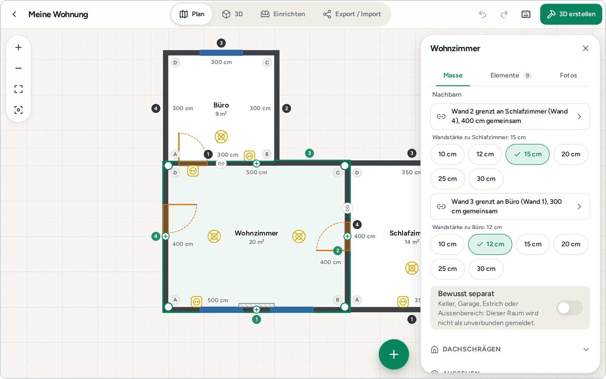
</p>

**Türen und Fenster in der gemeinsamen Wand führen in beide Räume.** Setzt du eine Tür in die Wand zwischen Wohnzimmer und Schlafzimmer, erscheint sie automatisch auch im Schlafzimmer, mit gespiegeltem Anschlag. In der Elementliste des Nachbarraums steht sie mit dem Vermerk «von Wohnzimmer»; geändert wird sie im Raum, zu dem sie gehört.

> [!IMPORTANT]
> **Unverbundene Räume werden gemeldet.** Wenn in einem Projekt mit mehreren Räumen ein Raum keinen Nachbarn hat, weist dich RoomX beim Erstellen der 3D-Ansicht und beim Exportieren des KI-Pakets darauf hin. Du kannst trotzdem weitermachen. Bei Räumen, die bewusst getrennt liegen, etwa Keller, Garage, Estrich oder Aussenbereich, schaltest du unten im Bereich «Nachbarn» des Raum-Panels **«Bewusst separat»** ein: RoomX meldet diesen Raum dann nicht mehr.

#### Aussenbereiche

<p align="center">
  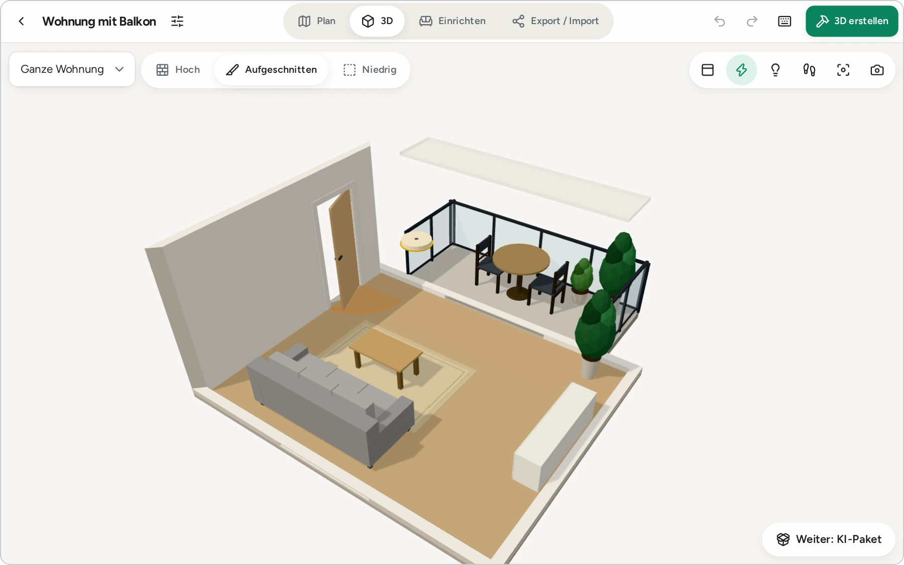
</p>

Balkon, Terrasse und Garten haben keine Wände und keine Decke. Sie bestehen nur aus dem Boden, der mit einem gestrichelten Umriss gezeichnet wird. Sie docken an wie Räume: Die Tür sitzt in der Wand des Innenraums, und die gemeinsame Wand gehört zum Haus.

**Geländer.** Ein Balkon bekommt entlang der freien Kanten ein Geländer. Die Höhe stellst du unter **Geländerhöhe** ein, Standard 1,0 m.

**Überdachung.** Optional bekommt ein Aussenbereich eine **Überdachung**: die **ganze Fläche** oder einen **Streifen** entlang einer Wand. Gib die Höhe an, zum Beispiel für einen Balkon darüber oder eine Pergola. Unter der Überdachung gilt deren Höhe für die Möbel. Sonst gibt es keine Höhengrenze.

**Wintergarten.** Wände und Dach sind aus Glas. Dachschrägen gelten wie sonst, etwa bei einem Pultdach.

**Fläche.** Aussenbereiche zählen nicht zur Wohnfläche. RoomX zeigt Wohnfläche und Aussenfläche getrennt, im Panel, im PDF und im KI-Paket.

**Raumtyp wechseln.** Einen bestehenden Raum stellst du über den Raumtyp um. Türen und Fenster in der gemeinsamen Wand wandern dann in den Innenraum. Alles andere bleibt und ist markiert.

**Foto-Tour.** Bei Balkon, Terrasse und Garten entfallen die Wand- und Eckfotos.

**Einrichten.** Stützen und Hindernisse gibt es auch draussen, zum Beispiel zwei Pfeiler unter einem Balkon darüber. Im Einrichten stehen Gartenmöbel oben, sobald der Katalog sie kennzeichnet.

### Stockwerke und Treppen

<p align="center">
  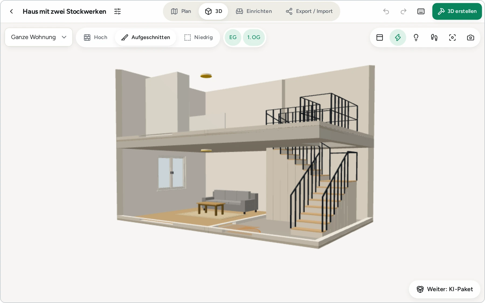
</p>

Ein Haus kann mehrere Stockwerke haben. Ein neues Projekt startet mit einem Stockwerk. Bei einem Stockwerk gibt es keine Stockwerk-Bedienung.

- **Neues Projekt:** RoomX fragt **Wie viele Stockwerke?** Wähle **Ein Stockwerk** oder **Mehrere**.
- **Später:** Öffne die **Projekteinstellungen** (Knopf neben dem Projektnamen) und schalte **Mehrere Stockwerke** ein. Alle bestehenden Räume landen im ersten Stockwerk. Ausschalten geht nur, solange alle Räume im selben Stockwerk liegen und es keine Treppe gibt.
- **Stockwerke:** Jedes Stockwerk hat einen **Name** (zum Beispiel UG, EG, 1. OG, 2. OG oder DG), eine Reihenfolge (**Nach oben**, **Nach unten**), eine **Deckenstärke** (Standard 30 cm) und eine **Lichte Höhe** (leer heisst **Höchster Raum**). **Stockwerk hinzufügen** legt eines an, **Stockwerk löschen** entfernt ein leeres. Jeder Raum gehört zu genau einem Stockwerk. Du änderst es im Raum-Panel unter **Stockwerk**.
- **Plan:** Der Umschalter **Stockwerk wählen** zeigt ein Stockwerk. Das Stockwerk darunter erscheint blass als Vorlage. Neue Räume landen im gewählten Stockwerk, und die Verbindungsprüfung gilt je Stockwerk.
- **Treppen:** **Treppe hinzufügen** legt eine Treppe vom einen ins nächste Stockwerk an. Die Form ist **Gerade**, **L**, **U** oder **Wendel**. Du stellst die **Breite**, die **Laufrichtung** und den **Drehsinn** (**Links** oder **Rechts**) ein. Die Stufenzahl folgt aus der Geschosshöhe: Steigung etwa 17 bis 18 cm, Schrittmass (2 × Steigung + Auftritt) etwa 63 cm. Im oberen Stockwerk entsteht ein Treppenauge mit **Geländer am Treppenauge**.
- **Prüfungen:** Keine Möbel auf der Treppe und im Treppenauge. Die Kopfhöhe muss mindestens 2 m betragen, auch unter Schrägen.
- **3D:** Die 3D-Ansicht stapelt die Stockwerke. Blende jedes einzeln mit **Stockwerk einblenden** und **Stockwerk ausblenden** ein oder aus. Begehen geht je Stockwerk mit **Begehen**; mit **Ein Stockwerk höher** und **Ein Stockwerk tiefer** wechselst du das Stockwerk.
- **KI-Paket und PDF:** Beide enthalten jedes Stockwerk separat, und der Plan-Import kennt die Stockwerke.

### Türen, Fenster und Elektro

Im Panel des Raums, Bereich **Elemente**, findest du die Palette:

| Gruppe | Elemente |
|---|---|
| Öffnungen | Tür, Fenster, Dachfenster |
| Elektro | Steckdose, Schalter, Wandlampe, LAN / TV, Deckenlampe |
| Heizung und Klima | Heizkörper, Klima-Wandgerät, Klima-Standgerät, Cheminée, Kaminofen, Kachelofen |
| Sanitär | WC, Waschtisch, Dusche, Badewanne |
| Küche | Küchenzeile |
| Hindernisse | Einbau, Hindernis, Stütze, Freies Hindernis |

Die Palette zeigt nur, was zum Raumtyp passt: Sanitär nur im Bad, Küche nur in der Küche oder in einem Wohn- oder Essraum mit **Offene Küche**. Die Namen der Bedienelemente stehen unten.

<p align="center">
  
</p>

**Platzieren.** Wähle ein Element in der Palette und tippe auf eine Wand (bei der Deckenlampe in den Raum). Zieh es danach an die richtige Stelle. «Platzieren abbrechen» oder die Taste `Esc` bricht ab.

**Eigenschaften.** Wähle ein Element in der Liste oder im Plan. Je nach Art stellst du ein:

- Wand, Abstand von der Ecke, Breite, Höhe und Unterkante ab Boden,
- **Tür:** Anschlag und Öffnungsrichtung (nach innen, nach aussen, Schiebetür). Der Schwenkbereich ist im Plan sichtbar und muss frei bleiben.
- **Fenster:** Dreh-Kipp, Schiebefenster, Festverglasung oder Balkontür,
- **Steckdose:** Anzahl Plätze und USB-Anschluss, **LAN / TV:** Netzwerk, TV oder beides,
- **Status:** «Bestehend» oder «Geplant», dazu eine Notiz.

Praktisch sind «Unter Fenster zentrieren» (zum Beispiel für den Heizkörper) und «Über Arbeitsfläche» (Mitte 115 cm) für Steckdosen in der Küche.

**Wandansicht.** Wähle eine Wand und tippe auf «Öffnen». Du siehst die Wand von innen, mit allen Elementen und ihren Höhen. Zieh Elemente an die richtige Stelle oder verschiebe sie mit den Pfeiltasten (`Umschalt` für 10 cm). Mit 1×, 2× und 4× vergrösserst du die Ansicht.

**Elektro-Ebene.** Der Schalter «Elektro-Ebene» blendet Steckdosen, Schalter und Lampen im Plan ein oder aus. Elektro-Elemente sind gelb, Fenster blau und Türen orange.

**Vorschläge annehmen.** Elektro-Elemente mit dem Status «Vorschlag» sind gestrichelt gezeichnet. Das sind zum Beispiel Steckdosen, die ein KI-Assistent in seinem Plan vorschlägt. Im Panel erscheint der Bereich «Vorschläge»: Du kannst jeden Vorschlag einzeln **annehmen** oder **ablehnen**, oder mit «Alle annehmen» alles übernehmen.

> [!NOTE]
> RoomX ersetzt keine Elektroplanung. Lass Steckdosen und Leitungen von Fachleuten planen und ausführen.

#### Bad

<p align="center">
  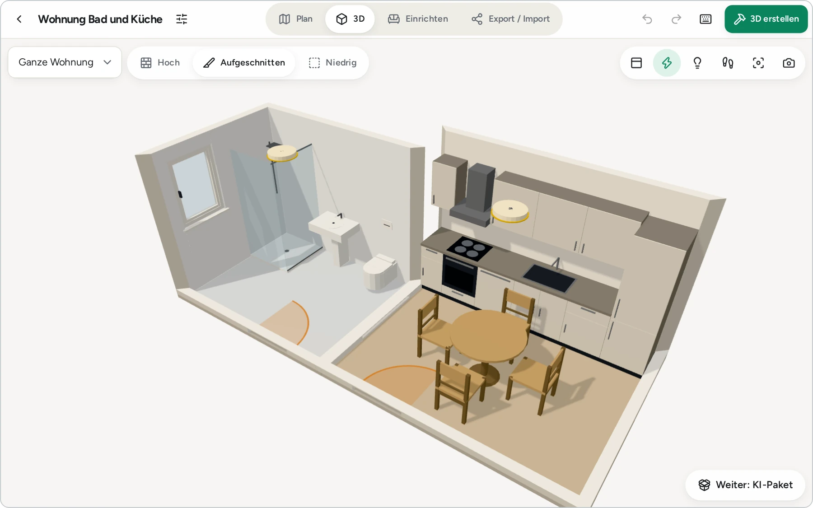
</p>

Ein WC (Standard 37 × 55 cm, wandhängend), ein Waschtisch (60 × 45 cm), eine Dusche (90 × 90 cm; der Schalter **Trennwand** zeichnet Glas auf die offenen Seiten) und eine Badewanne (170 × 75 cm). Alle stehen an einer Wand. Dusche und Wanne stellst du mit **In die Ecke …** in eine Ecke.

#### Küche

Eine **Küchenzeile** steht entlang einer Wand. Du wählst das Raster **SMS 55** (Schweiz) oder **EURO 60** und stellst Länge, Tiefe (Standard 60 cm), Arbeitshöhe (90 cm) und Hochschrank-Höhe ein. **Oberschränke** schaltest du ein oder aus und legst Tiefe, Höhe und Unterkante fest. Die **Module** setzt du nebeneinander: Unterschrank, Spüle, Kochfeld, Geschirrspüler, Hochschrank, Einbautisch. Dazu kommen die Geräte Backofen, Steamer, Mikrowelle und Kühlschrank. Was ohne Modul bleibt, ist ein Unterschrank. Plan, Wandansicht, 3D und PDF zeigen die Zeile.

#### Eingebaut oder aus dem Katalog

Im Raum-Panel wählst du bei einer Küche **Eingebaut** (feste Elemente, die der KI-Assistent nicht verschiebt) oder **Aus dem Katalog** (Küchenmöbel frei planbar). Im Einrichten steht die Kategorie Küche dann oben. Wohn- und Essräume haben den Schalter **Offene Küche**.

#### Heizung, Klima und Feuerstellen

Klima-Wandgerät und Klima-Standgerät brauchen eine **freie Zone vor dem Auslass**. Möbel dort ergeben eine Warnung. Cheminée, Kaminofen und Kachelofen stehen frei oder an der Wand (Knöpfe **An die Wand**, beim Cheminée **In die Ecke (45°)**). Sie haben eine **Sperrzone vor dem Feuerraum**, Standard 80 cm, sonst nach Herstellerangabe einstellbar. Möbel darin werden **rot**.

#### Stützen und freie Hindernisse

Eine Stütze ist rund oder eckig, ein freies Hindernis ist ein Quader. Beide stehen frei im Raum. Du stellst Position, Drehung (in 15°-Schritten oder 90°), Masse und Höhe ein. **Bis zur Decke** folgt dem Verlauf der Decke, auch unter Schrägen. Für Möbel und den KI-Assistenten sind sie gesperrte Flächen.

#### Raumtyp wechseln

Elemente bleiben immer erhalten. Passen sie nicht mehr zum Raumtyp (zum Beispiel ein WC, wenn aus dem Bad ein Büro wird), steht bei ihnen «**Passt nicht zum Raumtyp**». Du kannst sie bearbeiten oder löschen.

### Foto-Tour

Die Foto-Tour führt dich Schritt für Schritt durch einen Raum, damit später kein Blickwinkel fehlt. Die Fotos landen im KI-Paket und helfen dem Assistenten, deinen Raum zu verstehen.

<table>
  <tr>
    <td valign="top">

1. Öffne den Raum und wechsle im Panel zu **Fotos**.
2. Tippe auf «Tour starten».
3. Folge den Schritten. Eine kleine Karte zeigt, wo du stehen sollst und wohin du fotografierst: erst die Ecken, dann Wände, Decke, Boden, Details und die Elektro-Elemente der Wand.
4. «Foto aufnehmen» öffnet die Kamera, «Aus Mediathek» nimmt ein vorhandenes Bild. Optionale Schritte kannst du **überspringen**.
5. Am Ende zeigt die Galerie die Pflichtfotos. Fehlende Fotos sind markiert, «Tour fortsetzen» holt sie nach.

Zusätzlich kannst du jederzeit ein **freies Foto** mit Notiz machen, zum Beispiel von Problemstellen.

Fotos werden direkt auf dem Gerät verkleinert und ohne Metadaten gespeichert. Hast du ein Foto aus Versehen gelöscht, holt «Rückgängig» in der Meldung unten es zurück.

    </td>
    <td valign="top" width="260">
      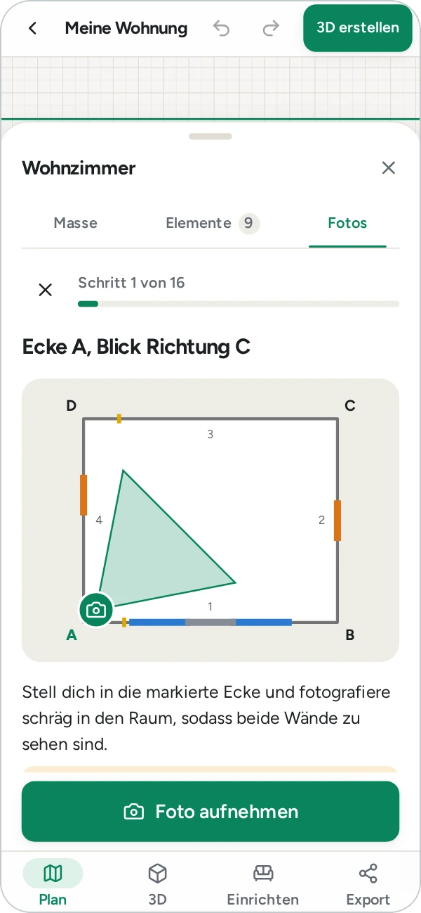
    </td>
  </tr>
</table>

> [!TIP]
> Mit der Ultraweitwinkel-Kamera (0,5×) passt mehr von den Wänden ins Bild. Bei den Ecken stellst du dich in die markierte Ecke und fotografierst schräg in den Raum.

> [!NOTE]
> Manche Browser können Bilder im HEIC-Format nicht lesen. Stelle dann die Kamera auf «Maximale Kompatibilität» (iPhone: Einstellungen, Kamera, Formate) oder wähle ein JPEG. Ein einzelnes Bild darf höchstens 80 MB gross sein.

### Mit dem Handy fotografieren

Die meisten planen am PC oder Laptop, fotografieren aber mit dem Handy. «Mit dem Handy fotografieren» schickt die Foto-Seiten der gewählten Räume aufs Handy. Du fotografierst dort, jetzt oder erst Tage später, und die Fotos kommen von selbst am richtigen Raum und Schritt an. Ein Konto brauchst du nicht.

1. Öffne am PC den Tab **Fotos** eines Raums oder die Planansicht für mehrere Räume und tippe auf «Mit dem Handy fotografieren». Es erscheinen ein QR-Code und ein Link.
2. Scanne den QR-Code mit der Kamera des Handys. Wähle «Jetzt fotografieren» oder «Später». Der Auftrag liegt auf dem Handy, deshalb geht das Fotografieren auch offline.
3. Die Live-Kamera öffnet sich mit einem kleinen Plan, der zeigt, wo du stehst und wohin du zielst. Nach jedem Foto geht es zum nächsten Schritt weiter.
4. Sind RoomX am PC und auf dem Handy gleichzeitig offen, verbindet sich das Handy von selbst und die Fotos kommen automatisch an. Beide Geräte zeigen zum Beispiel «Verbunden, 7 von 14 übertragen». Das Handy löscht ein Foto erst, nachdem der PC es bestätigt hat.

**Keine Verbindung?** Nach etwa 30 Sekunden bietet das Handy «Fotos stattdessen senden» an. Teile die JPEG-Dateien per AirDrop, Quick Share, E-Mail oder Cloud. Am PC öffnest du «Fotos aus Dateien» und wählst die Dateien aus (oder ziehst sie in dieses Fenster): RoomX ordnet sie den richtigen Räumen und Schritten zu und überspringt Duplikate.

**Dauer und Beenden:** Ein Auftrag gilt 7 Tage. «Auftrag beenden» am PC macht ihn sofort ungültig; Fotos, die noch auf dem Handy liegen, lassen sich dann nicht mehr übertragen. Offene Aufträge bleiben im Projekt sichtbar, mit QR-Code und Status. Ein abgelaufener Auftrag mit ungesendeten Fotos bleibt noch 30 Tage auf dem Handy, damit du sie von Hand senden kannst; ohne Fotos verschwindet er aus der Liste.

**iPhone und iPad:** Der Link öffnet sich in Safari, nicht in der installierten App, und beide haben getrennten Speicher. Zum Weitermachen öffnest du denselben Link wieder (QR-Code erneut scannen) oder RoomX in Safari und wählst «Offene Foto-Aufträge». Safari löscht Daten einer Webseite nach 7 Tagen ohne Besuch. Übertrage die Fotos deshalb bald.

**Mit dem eigenen Server:** Nutzt du RoomX von deinem eigenen Server und ist der Abgleich eingerichtet, lädt das Handy jedes Foto zusätzlich dorthin hoch. Die Fotos werden schon auf dem Handy verschlüsselt; der Server speichert nur versiegelte Daten, die er nicht lesen kann. Der PC holt sie ab, solange das Projekt in RoomX offen ist, auch wenn er beim Fotografieren ausgeschaltet war. Beide Geräte müssen dann nicht gleichzeitig offen sein. Die direkte Verbindung läuft daneben weiter, doppelte Fotos werden übersprungen. Ein Foto wird vom Server gelöscht, sobald der PC es abgeholt hat; der Rest bei «Auftrag beenden» oder wenn der Auftrag abläuft. Das Handy muss deinen Server erreichen können.

**Grenzen:** Beide Geräte müssen gleichzeitig offen sein (ausser mit dem eigenen Server, siehe oben); eine Übertragung im Hintergrund ist nicht möglich. Firmennetze oder Mobilfunk können die direkte Verbindung verhindern. Dann hilft «Fotos stattdessen senden». Ein Auftrag fasst höchstens 500 Fotos und 50 Räume, ein Import höchstens 200 Dateien. Welche Dienste den Geräten beim Finden helfen, steht unter [Datenschutz](#datenschutz).

### 3D erstellen und ansehen

Tippe oben rechts auf **«3D erstellen»**. RoomX prüft zuerst deinen Plan und nennt Probleme, zum Beispiel ungültige Grundrisse, Elemente, die über die Wand hinausragen, fehlende Pflichtfotos oder [unverbundene Räume](#räume-verbinden). Mit «3D trotzdem erstellen» geht es weiter, mit «Zurück zum Plan» korrigierst du zuerst.

<p align="center">
  
</p>

**Ansicht steuern.** Ziehen dreht die Ansicht, Mausrad oder zwei Finger zoomen. Oben links wählst du **Ganze Wohnung** oder einen **einzelnen Raum**.

| Bedienelement | Wirkung |
|---|---|
| **Wände: Hoch, Aufgeschnitten, Niedrig** | Wände in voller Höhe, nur die hinteren Wände hoch oder alle niedrig. Aufgeschnitten zeigt am meisten. |
| **Decke** | Decke ein- oder ausblenden. |
| **Elektro** | Steckdosen, Schalter und Lampen anzeigen. |
| **Licht** | Deckenlampen ein- und ausschalten. |
| **Begehen** | Durch den Raum gehen, siehe unten. |
| **Kamera zurücksetzen** | Zurück zur Startansicht. |
| **Bild speichern** | Die aktuelle Ansicht als Bild sichern (auf dem Handy «Bild teilen»). |

**Begehen.** In diesem Modus stehst du im Raum, auf Augenhöhe. Am Computer gehst du mit `W` `A` `S` `D`, schaust mit den Pfeiltasten oder gezogener Maus um und beendest mit `Esc`. Auf Tablet und Handy gehst du mit dem Steuerkreuz links und wischst zum Umsehen.

<p align="center">
  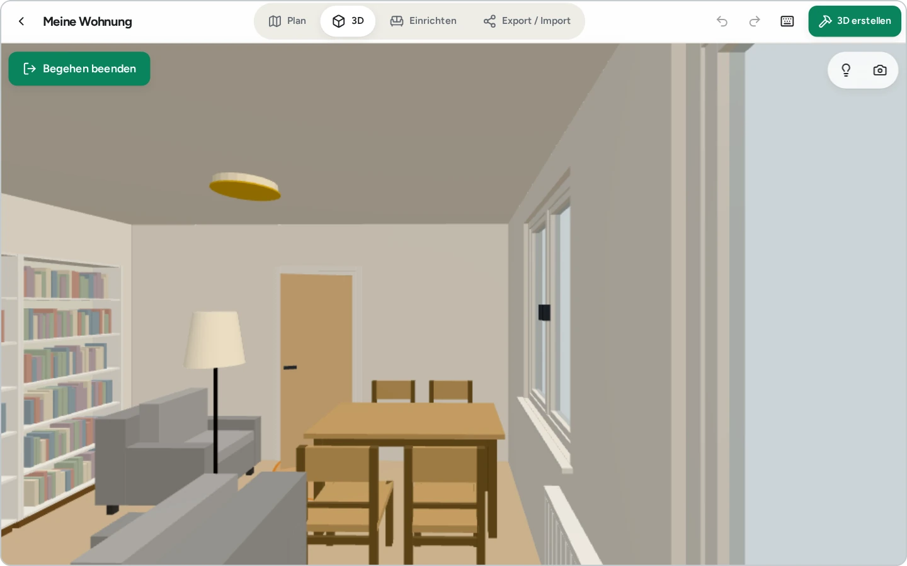
</p>

> [!NOTE]
> 3D braucht einen Browser mit WebGL. Zeigt die App «3D ist hier nicht verfügbar», lade die Seite neu oder probiere einen anderen Browser.

### Einrichten

Im Reiter **Einrichten** stellst du Möbel in deine Räume. Oben links wechselst du zwischen Plan und 3D und wählst die Variante. Über die Knöpfe oben rechts öffnest du das Panel mit den Bereichen **Katalog**, **Möbel**, **Liste** und **Bedarf**.

<p align="center">
  
</p>

**Katalog.** Er enthält über 450 Artikel in den Marken **IKEA**, **JYSK**, **Tchibo** (Serie CN3, alle Varianten: Regale, Kommoden, Sideboards, Lowboards, Schränke, Tische und Schreibtische) und **Allgemein** (neutrale Möbel, Geräte, Deko, Lampen). Die Artikel von IKEA, JYSK und Tchibo sind **geprüft**: Masse, Artikelnummer und regulärer Preis stammen vom Schweizer Online-Shop (Stand Oktober 2026). Betten gibt es in den Schweizer Grössen 90, 140, 160 und 180 × 200 cm, PAX-Kombinationen enthalten Türen. Neben diesen kuratierten Artikeln gibt es einen **grossen Katalog** mit mehreren tausend Artikeln der drei Händler. Er wird beim ersten Bedarf als eigene Datei geladen und ist danach auch offline verfügbar. Die Liste bleibt auch bei dieser Länge flott. Suche und Filter für Marke, Kategorie und Breite gelten für alle Artikel. Stauraummöbel (Kommoden, Nachttische, Regale, Schränke, Sideboards, TV-Möbel und die Serie CN3) sehen in Plan und 3D aus wie das Original, mit Sockel, Füssen oder Beinen, Griffen, Tür- und Schubladenraster, Rahmenfronten, Deckplatte und Büchern. Tische und Schreibtische zeigen ihr Gestell und ihre Schubladen, Sofas und Sessel Armlehnen, Rücken und Sitzkissen, Betten Kopfteil und Bettkästen, Spiegel Form und Rahmen, Lampen Schirm und Fuss. Das Katalogbild ist dasselbe 3D-Modell.

- Suche oben nach Name, Serie oder Artikelnummer, zum Beispiel «Billy», «Schreibtisch» oder eine Artikelnummer des Händlers.
- Kategorien als Chips: Die häufigsten (zum Beispiel Betten, Regale, Tische, Sofas) stehen vorne, «+ n weitere» zeigt den Rest («Weniger» klappt sie wieder ein). Der Filter «Marke» grenzt die Liste nach Händler oder Hersteller ein, der Filter «Breite» nach der Breite des Möbels.
- Möbel **ziehen** oder **antippen**: Antippen stellt es in den Raum.
- **Nicht mehr im Sortiment:** Eine Karte mit diesem Vermerk zeigt einen Artikel, den der Händler online nicht mehr führt. Er bleibt im Katalog, damit ältere Projekte weiter laden.
- **Beim Händler ansehen:** Jede Katalogkarte eines geprüften Artikels hat den Link «Beim Händler ansehen». Er öffnet die Seite des Händlers in einem neuen Tab; RoomX selbst macht dabei keine Anfragen.
- **Wöchentliches Update:** Preise und Sortiment des grossen Katalogs werden einmal je Woche automatisch aktualisiert. Ein Artikel, der aus dem Sortiment des Händlers verschwunden ist, bleibt mit dem Vermerk «Nicht mehr im Sortiment» im Katalog, damit ältere Projekte weiter laden. Die über 450 von Hand geprüften Möbel werden dabei verglichen, ändern sich aber nur nach einer erneuten Prüfung. Sieht ein Wochenlauf fehlerhaft aus, zum Beispiel weil viele Artikel verschwunden scheinen oder sich viele Preise auf einmal ändern, wird nichts veröffentlicht und die bisherigen Daten bleiben.

> [!NOTE]
> Die Masse im Katalog sind **Richtwerte**. Artikel, die es nicht mehr gibt, bleiben im Katalog, damit alte Projekte weiter laden; sie tragen den Vermerk **«Nicht mehr im Sortiment»**, ungeprüfte Artikel den Vermerk **«Masse ungeprüft»**. Ältere Katalog-IDs werden automatisch auf den neuen Artikel umgeleitet. Die Preise sind **Richtpreise in CHF** vom Schweizer Markt und erscheinen mit dem Monat des letzten Updates, zum Beispiel «Richtpreis, Stand Oktober 2026». Prüfe Masse und Preis immer beim Händler, bevor du kaufst.

**Möbel bewegen.** Zieh ein Möbel an seinen Platz. Der Drehgriff dreht frei, die Knöpfe im Panel drehen um 90° oder 15°, oder du tippst die Gradzahl ein. Im Plan zeigen gepunktete Linien den Abstand zu Wänden und anderen Möbeln. Mit «Fixieren» sperrst du ein Möbel gegen versehentliches Verschieben. Duplizieren und Löschen findest du in der Leiste unter dem gewählten Möbel.

**Stapeln.** Möbel können auf anderen Möbeln stehen: ein Fernseher auf der TV-Bank, eine Lampe auf dem Nachttisch. Das Panel zeigt «Steht auf …» und die Höhe über dem Boden; mit «Herunternehmen» stellst du es wieder auf den Boden. Wird ein Möbel verschoben, wandert das Gestapelte mit.

**Eigene Möbel.** Mit «Eigenes Möbel» legst du ein Möbel mit eigenen Massen, Kategorie, Farbe und Preis an, zum Beispiel dein vorhandenes Sofa. Ein Preis ist nicht nötig. Markiere es mit «Fixieren», wenn es bleiben soll.

**Prüfungen in Rot.** RoomX prüft laufend und färbt ein Möbel **rot**, wenn etwas nicht passt. Das Panel «Möbel» nennt den Grund:

<table>
  <tr>
    <td valign="top">

| Hinweis | Bedeutung |
|---|---|
| Steht nicht ganz im Raum | Das Möbel ragt über die Wand. |
| Ist höher als der Raum | Zu hoch für die Raumhöhe. |
| Passt nicht unter die Dachschräge | Die Schräge ist zu niedrig. |
| Überschneidet sich mit … | Zwei Möbel stehen ineinander. |
| Steht in einem Einbau | Kollision mit Einbau oder Vorsprung. |
| Blockiert den Türbereich | Der Schwenkbereich der Tür ist nicht frei. |
| Verstellt ein Fenster | Das Möbel steht vor dem Fenster. |
| Verdeckt einen Heizkörper | Der Heizkörper ist zugestellt. |
| Durchgang nur … breit | Zu wenig Platz zum Durchgehen. |
| Steckdose ist … entfernt | Siehe unten. |

    </td>
    <td valign="top" width="360">
      
    </td>
  </tr>
</table>

Möbel in Einbauten und in der Sperrzone vor einer Feuerstelle werden **rot**, Möbel vor dem Auslass eines Klimageräts **gelb**. Im Katalog enthält die Kategorie Küche Unter-, Ober-, Hoch- und Spülenschränke, Kochfeld, Backofen und Kühlschrank.

**Steckdosen-Distanz.** Möbel, die Strom brauchen (Fernseher, Monitor, Lampen, Geräte), zeigen im Plan den Weg zur nächsten Steckdose. Ist sie mehr als 1,5 m entfernt oder gibt es im Raum gar keine erfasste Steckdose, erscheint ein Hinweis.

**Varianten.** Oben stehen die Varianten deiner Einrichtung, zum Beispiel «A» und «B». Mit dem Plus legst du eine neue Variante an, leer oder als Kopie einer bestehenden. Über das Menü benennst du Varianten um oder löschst sie. So probierst du zwei Einrichtungen aus, ohne etwas zu verlieren. Ein Plan vom KI-Assistenten kommt ebenfalls als Variante. Ein Projekt fasst bis zu 100 Varianten, 200 Räume und 5000 Möbel je Variante; RoomX sagt dir, wenn eine Grenze erreicht ist.

**Budget, Liste und Bedarf.**

<p align="center">
  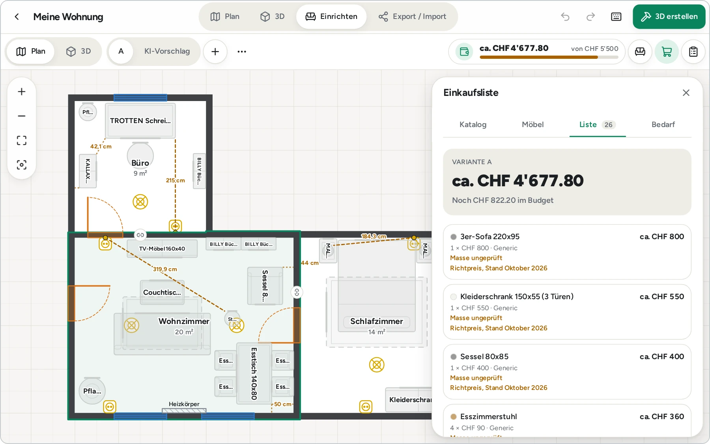
</p>

- **Budget:** Trage unter **Bedarf** dein Budget in CHF ein. Oben erscheint ein Balken mit der Summe der aktuellen Variante und dem Hinweis, wie viel noch im Budget ist oder wie viel darüber.
- **Liste (Einkaufsliste):** alle Möbel der Variante mit Menge, Preis, Marke und Link, mit der Summe. Artikel mit Richtpreis sind gekennzeichnet, Artikel ohne Preis werden gezählt. Bei geprüften Artikeln führt der Link zur Seite des Händlers. «Als CSV exportieren» speichert die Liste für Excel oder Numbers (Spalten: Artikel, Marke, Menge, Einzelpreis CHF, Summe CHF, Richtpreis, Link).
- **Bedarf:** Personen (Erwachsene, Kinder, Haustiere), Bettgrössen, Arbeitsplätze (Bildschirme, Laptop oder PC, höhenverstellbar), Stil, Budget, bevorzugte Händler und Wünsche. Der Bedarf geht ins KI-Paket und hilft dem Assistenten beim Vorschlag.

### Mit dem KI-Assistenten einrichten

Du kannst deine Räume von einem KI-Assistenten einrichten lassen. RoomX bereitet dafür ein **KI-Paket** vor und liest die Antwort des Assistenten wieder ein. Das funktioniert mit jedem KI-Assistenten, der Dateien annimmt. Du musst nichts zusätzlich installieren: Das Paket enthält bereits die Anleitung, das Plan-Schema, den Katalog und einen fertigen Startprompt.

Feste Einbauten (Bad, Küchenzeile, Klimageräte, Feuerstellen, Stützen, Hindernisse) sind für den KI-Assistenten gesperrt wie Türen und Fenster. Er plant darum herum, und der Plan-Import meldet Möbel, die hineinragen.

> [!NOTE]
> «3D erstellen» ist davon unabhängig: Damit siehst du deine Räume nur selbst in 3D. Das KI-Paket brauchst du nur, wenn ein Assistent dir einen Plan machen soll.

**Das KI-Paket enthält:**

| Datei | Inhalt |
|---|---|
| **Anleitung** (`roomx-anleitung-….md`) | Erklärt dem KI-Assistenten, wie er vorgehen und was er zurückgeben soll. |
| **PDF** (`roomx-….pdf`) | Grundrisse mit Massen, Wandansichten, 3D-Ansichten, Möbel, deine Fotos und eine Lesehilfe. |
| **Raumdaten** (`roomx-….json`) | Dieselben Angaben exakt und maschinenlesbar: Räume, Wände, Elemente, Nachbarräume, Dachschrägen, Möbel, Varianten und Bedarf. |
| **Plan-Schema** (`roomx-plan.schema.json`) | Beschreibt das Format `roomx-plan`, in dem die Antwort zurückkommen muss. |
| **Möbelkatalog** (`roomx-katalog.json`) | Die Artikel, die der Assistent verwenden kann: der kuratierte Katalog plus die Artikel der Händler aus deinem Bedarf. Ist das fürs Paket zu gross, enthält es einen gekennzeichneten Auszug. |

**Schritt für Schritt:**

1. **KI-Paket erstellen.** Öffne den Reiter «Export / Import». Wähle «Ganzes Projekt» oder «Einzelne Räume» und tippe auf «KI-Paket erstellen». RoomX zeigt vorher die geschätzte Grösse und den Hinweis **«Was du teilst»** und weist dann auf Lücken im Plan hin, etwa [unverbundene Räume](#räume-verbinden) oder fehlende Pflichtfotos. Mit «Trotzdem exportieren» geht es weiter. Danach «Teilen» oder «Herunterladen». Willst du keine Bilder deiner Wohnung weitergeben, schalte **«Ohne Fotos exportieren»** ein.
2. **Im Chat hochladen.** Öffne einen Chat mit einem KI-Assistenten deiner Wahl und lade **alle Dateien** des Pakets hoch. Tippe in RoomX auf **«Prompt kopieren»** und füge den Text in den Chat ein. Unter «So geht es weiter» zeigt dir RoomX diese Schritte und den fertigen Prompt gleich an.
3. **Fragen beantworten.** Der Assistent fragt nach, was er noch wissen muss, zum Beispiel nach Stil, Budget oder Wünschen. Beantworte die Fragen.
4. **Plan als JSON zurück.** Am Ende gibt der Assistent den Einrichtungsplan als JSON im Format `roomx-plan` aus. Kopiere die **ganze Antwort**, oder speichere den Plan als Datei.
5. **Plan importieren.** Gehe in RoomX auf «Export / Import», Bereich «Plan importieren»: Text einfügen («Aus Zwischenablage» hilft) oder die Datei wählen. RoomX ist hier tolerant: Die Antwort darf weiteren Text, einen Codeblock oder Kommentare im JSON enthalten, RoomX findet das JSON selbst.
6. **Vorschau prüfen.** RoomX zeigt je Variante die Summe und listet Konflikte (zum Beispiel «versperrt die Tür»), Hinweise und alles, was nicht übernommen werden kann.
7. **Als Variante übernehmen.** «Als neue Variante übernehmen» legt den Plan als Variante an. Nichts wird überschrieben. Wähle bei Bedarf, ob auch der Bedarf aus dem Plan übernommen wird.
8. **Anpassen und erneut exportieren.** Sieh dir die Variante in «Einrichten» an und ändere, was dir nicht gefällt. Willst du eine zweite Runde, erstelle ein neues KI-Paket: Es enthält jetzt deine angepasste Einrichtung.

<p align="center">
  
</p>

<p align="center">
  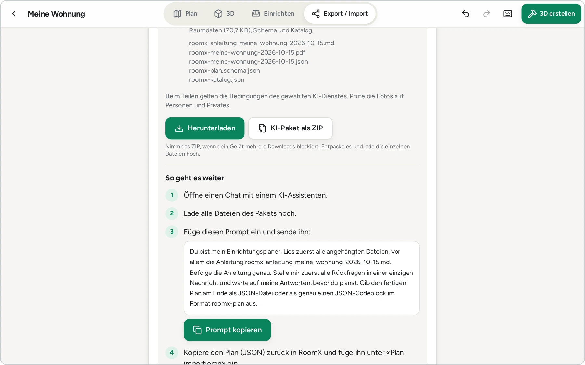
</p>

<p align="center">
  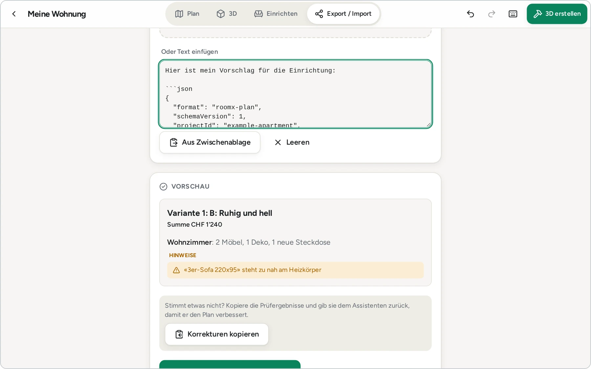
</p>

<p align="center">
  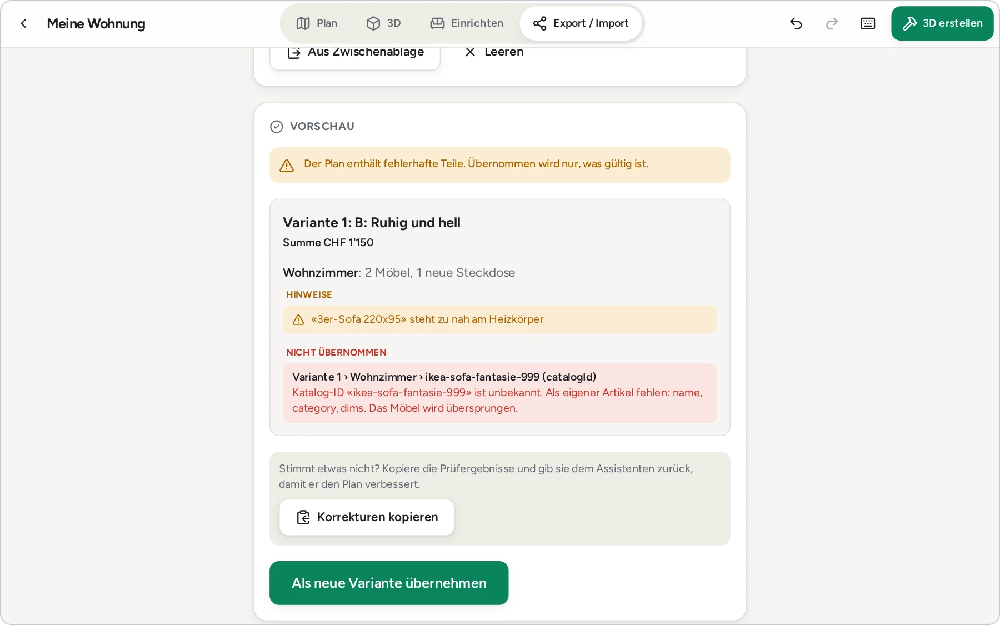
</p>

> [!TIP]
> **Blockiert dein Gerät mehrere Downloads auf einmal?** Dann nimm «KI-Paket als ZIP», entpacke die Datei und lade die einzelnen Dateien im Chat hoch.

> [!TIP]
> **Bei grossen Wohnungen** exportierst du die Räume einzeln («Einzelne Räume»). Zeigt RoomX an, dass das Paket gross wird, und nimmt der Assistent es nicht an, ist das der beste Weg.

> [!TIP]
> **Nach dem Import stimmt etwas nicht?** Unter der Vorschau kopiert «Korrekturen kopieren» einen fertigen Text für den KI-Assistenten. Er beginnt mit «Bitte korrigiere den Plan:», listet auf, was nicht übernommen werden konnte, dazu die Hinweise, und bittet um den ganzen korrigierten Plan. Füge ihn im Chat ein. Dasselbe geht, wenn das JSON fehlerhaft ist oder die Antwort mitten im JSON abbricht.

> [!IMPORTANT]
> Das KI-Paket enthält deine Raumdaten und, falls aufgenommen, deine **Fotos**. Du gibst sie selbst an den Anbieter des Assistenten weiter, und es gelten dessen Bedingungen. Prüfe die Fotos vorher auf Personen, Dokumente und Privates. Mit «Einzelne Räume» oder «Ohne Fotos exportieren» gibst du nur weiter, was nötig ist.

### Sichern und Umziehen

**Automatisch gespeichert.** RoomX speichert jede Änderung selbst, kurz nach dem Tippen oder Ziehen. Es gibt keinen Speichern-Knopf.

**Rückgängig und Wiederholen.** Die Pfeile oben (oder `Strg`/`Cmd` + `Z`) machen den letzten Schritt rückgängig. Auch das Löschen von Räumen und Möbeln lässt sich zurücknehmen. Ein Ziehen zählt als ein Schritt.

**Backup eines Projekts (ZIP).** Unter «Export / Import» oder im Menü der Projektkarte erstellst du ein Backup: das ganze Projekt in einer ZIP-Datei, mit Projektdaten und Originalfotos. Optional legst du das KI-Paket und das 3D-Modell bei.

**Ein Projekt wiederherstellen.** Wähle unter «Wiederherstellen» die ZIP-Datei. Gibt es das Projekt auf diesem Gerät schon, **überschreibt** RoomX es **nie**, sondern legt es als Kopie an. Fehlen Fotos oder sind sie beschädigt, meldet RoomX, wie viele.

**Alles sichern.** In den [Einstellungen](#einstellungen) sichert «Alles sichern» **alle Projekte mit ihren Fotos** in einer ZIP-Datei. «Alles wiederherstellen» liest eine solche Datei wieder ein. Dabei wird nie etwas überschrieben: Ein Projekt, das es schon gibt, kommt als Kopie dazu. Ein Projekt, das sich nicht öffnen lässt, geht nicht verloren: Es kommt unverändert als Rohdaten mit ins Backup. RoomX merkt sich den Zeitpunkt des letzten Backups und erinnert dich, wenn es mehr als 14 Tage her ist; auf iPhone und iPad erscheint zusätzlich eine Erinnerung, weil Safari Daten löschen kann.

<p align="center">
  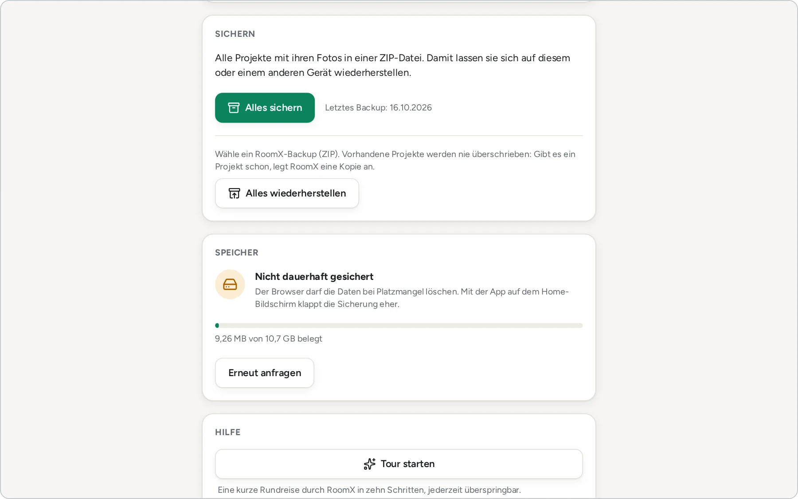
</p>

**Auf ein anderes Gerät oder in die installierte App umziehen:**

1. Erstelle am alten Ort ein Backup (ZIP).
2. Übertrage die Datei, zum Beispiel per AirDrop, Mail oder Cloud-Ordner.
3. Öffne RoomX am neuen Ort und stelle das Backup wieder her.

**Speichern und Speicherplatz.** Klappt das Speichern nicht, etwa weil der Speicher voll ist oder der Browser es verbietet, sagt RoomX das offen und bietet **«Jetzt sichern»** an; es scheitert nie still. Kurz bevor der Speicher voll ist, warnt RoomX. Öffnest du dasselbe Projekt in einem zweiten Tab oder Fenster, zeigt dieser Tab es nur an («Nur lesen») und aktualisiert sich von selbst; «Hier bearbeiten» übernimmt das Bearbeiten.

**3D-Modell (.glb).** Unter «Export / Import» exportierst du die gewählten Räume mit der aktiven Variante als `.glb`-Datei. Damit kannst du das Modell in Programmen wie Blender oder in einer AR-Ansicht öffnen.

> [!IMPORTANT]
> Deine Daten liegen nur im Browser deines Geräts. Es gibt keine Kopie bei uns, die man zurückholen könnte. Wer Website-Daten löscht, das Gerät verliert oder Safari die Daten räumen lässt, verliert die Projekte. **Erstelle regelmässig ein Backup** und bewahre es getrennt vom Gerät auf.

### Einstellungen

Du erreichst sie über das Zahnrad oben rechts in der Projektliste.

| Einstellung | Bedeutung |
|---|---|
| **Sprache** | Deutsch oder English. Standard ist die Sprache deines Browsers. |
| **Einheit für Längen** | Zentimeter oder Meter. |
| **Sichern** | «Alles sichern» und «Alles wiederherstellen», siehe [Sichern und Umziehen](#sichern-und-umziehen). Zeigt, wann du zuletzt ein Backup gemacht hast. |
| **App installieren** | In Chrome und Edge erscheint hier der Knopf «App installieren». Auf iPhone und iPad erklärt RoomX «Zum Home-Bildschirm», weil Safari die Daten von Websites löschen kann, die sieben Tage lang nicht geöffnet wurden. |
| **Speicher** | Zeigt, ob der Browser die Daten **dauerhaft sichert** («Dauerhaft gesichert») oder bei Platzmangel löschen darf, und wie viel Platz belegt ist. «Erneut anfragen» versucht die dauerhafte Sicherung noch einmal. Mit der App auf dem Home-Bildschirm klappt sie eher. |
| **Hilfe** | «Tour starten» spielt die Einführung noch einmal ab (zehn Schritte, jederzeit überspringbar, wahlweise mit einem Beispielzimmer). «Tastaturkürzel anzeigen» öffnet die Übersicht. |
| **Über RoomX** | Die Karte unter «Hilfe». Sie zeigt das volle Logo, die **Version** und das **Build-Datum** sowie die Zeile «Daten: Alles bleibt auf deinem Gerät». «Datenschutz & Haftung» öffnet eine kurze Seite mit der Datenschutzerklärung (wer verantwortlich ist, wie du Kontakt aufnimmst), dem Haftungsausschluss und der Lizenz von RoomX. «Open-Source-Lizenzen» führt zu den Lizenzen der verwendeten Bausteine (beide Seiten auch unter `/rechtliches`). Unter «Feedback» öffnest du mit «Fehler melden oder Wunsch äussern» die GitHub-Issues (Vorlagen auf Deutsch und Englisch; du brauchst ein GitHub-Konto) oder schickst mit «Per E-Mail schreiben» eine Nachricht. «Diagnose kopieren» kopiert technische Angaben zu Gerät und App, **ohne Projektdaten**, Namen oder Fotos, damit du sie in deine Meldung einfügen kannst. |
| **Alles zurücksetzen** | «Alle lokalen Daten löschen» entfernt alle Projekte, Fotos und Einstellungen von diesem Gerät. RoomX bietet vorher an, zuerst zu sichern. Das lässt sich nicht rückgängig machen. |

<p align="center">
  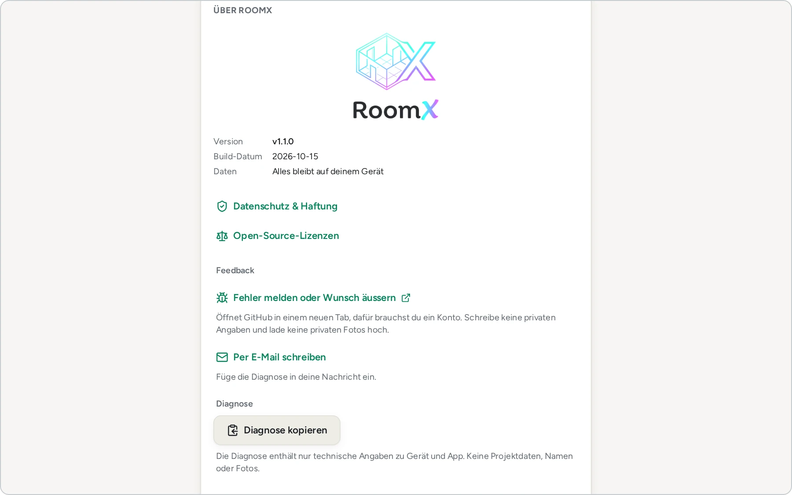
</p>

### Tastaturkürzel

Für Computer und iPad mit Tastatur. Auf dem Mac nimmst du `Cmd` statt `Strg`. In der App zeigt die Taste `?` die Übersicht.

| Taste | Wirkung |
|---|---|
| `Strg` + `Z` | Rückgängig |
| `Strg` + `Umschalt` + `Z` (oder `Strg` + `Y`) | Wiederholen |
| `Esc` | Auswahl aufheben, Fokus verlassen, Platzieren abbrechen |
| `?` | Übersicht der Kürzel ein- und ausblenden |
| Pfeiltasten | Gewählten Raum oder gewähltes Element um 1 cm verschieben |
| `Umschalt` + Pfeiltasten | Um 10 cm verschieben |
| `R` | Raum um 90° drehen |
| `Umschalt` + `R` | Raum um 90° zurückdrehen |
| `Entf` | Gewählten Raum oder gewähltes Element löschen |
| `+` und `-` | Hinein- und herauszoomen |
| `0` | Alles zeigen |

### Tipps

- **Fang mit dem grössten Raum an** und arbeite dich nach aussen. Das Verbinden der Räume geht danach am schnellsten.
- **Ecke A merken.** Alle Wände sind nummeriert und die Ecken heissen A, B, C … Notiere dir bei jedem Raum, wo Ecke A liegt, dann findest du dich in Plan, Wandansicht und PDF sofort zurecht.
- **Lieber nachmessen als schätzen.** Ein Laser-Distanzmesser lohnt sich. Die Wandansicht hilft, Höhen von Fenstern und Steckdosen genau einzutragen.
- **Vorhandene Möbel erfassen.** Leg sie als «Eigenes Möbel» an und markiere sie als fixiert. So plant der Assistent um sie herum.
- **Varianten statt Überschreiben.** Probiere Ideen in einer Kopie aus, bevor du die Hauptvariante änderst.
- **Wenige, gute Fotos** schlagen viele schlechte: Folge der Tour und fotografiere gerade, mit Licht.
- **Backup vor jeder grossen Änderung**, und vor dem Import eines KI-Plans erst recht.
- **Steckdosen eintragen**, bevor du einrichtest. Erst dann stimmen die Hinweise zur Steckdosen-Distanz.

### FAQ

<details>
<summary><b>Wo sind meine Daten?</b></summary>

Im Browser deines Geräts (IndexedDB). Die öffentliche Version spricht mit keinem Server; einzige Ausnahme ist ein offener Foto-Auftrag (siehe «Mit dem Handy fotografieren»). Es gibt kein Konto und keine Kopie in einer Cloud. Daten verlassen dein Gerät nur, wenn du selbst ein KI-Paket, ein Backup oder einen anderen Export teilst.
</details>

<details>
<summary><b>Warum sehe ich meine Projekte auf einem anderen Gerät nicht?</b></summary>

Weil jedes Gerät, jeder Browser und jede installierte App einen eigenen Speicher hat. Das gilt auch für zwei verschiedene Adressen. Zieh mit einem Backup (ZIP) um, siehe [Sichern und Umziehen](#sichern-und-umziehen).
</details>

<details>
<summary><b>Was passiert beim KI-Paket mit meinen Fotos?</b></summary>

Die Fotos stecken im PDF des Pakets. RoomX selbst sendet nichts: Du lädst die Dateien selbst bei einem KI-Assistenten hoch, und dessen Anbieter verarbeitet sie nach seinen eigenen Bedingungen. Prüfe die Fotos vorher, und wähle bei Bedarf nur einzelne Räume.
</details>

<details>
<summary><b>Ich habe ein Projekt aus Versehen gelöscht.</b></summary>

Öffne die Projektliste und unten den **Papierkorb**: Gelöschte Projekte lassen sich dort 30 Tage lang wiederherstellen. Gleich nach dem Löschen hilft auch «Rückgängig» in der Meldung.
</details>

<details>
<summary><b>Wie melde ich einen Fehler oder mache einen Vorschlag?</b></summary>

In den Einstellungen unter «Über RoomX», Abschnitt «Feedback», hast du zwei Wege. «Fehler melden oder Wunsch äussern» öffnet die Issues auf GitHub (Konto nötig). «Per E-Mail schreiben» öffnet eine Nachricht an julian-5@gmx.ch. Füge bei Bedarf das Ergebnis von «Diagnose kopieren» ein, aber keine privaten Angaben oder Fotos.
</details>

<details>
<summary><b>Kostet das etwas?</b></summary>

Nein. RoomX ist kostenlos und braucht kein Konto. Die veröffentlichte App darf jede Person nutzen, privat und beruflich (siehe [Lizenz](#lizenz)). Wenn du einen KI-Assistenten nutzt, gelten die Konditionen seines Anbieters.
</details>

<details>
<summary><b>Funktioniert es offline?</b></summary>

Ja, nach dem ersten Laden. Die App legt ihre Dateien im Browser ab und startet auch ohne Netz, am besten als installierte App. Ohne Netz geht nichts verloren, nur Links zu Möbelhäusern und das Hochladen bei einem KI-Assistenten brauchen Internet.
</details>

<details>
<summary><b>Warum kommen die Fotos nicht an?</b></summary>

Prüfe der Reihe nach: RoomX muss am PC (im Projekt mit dem offenen Auftrag) und auf dem Handy gleichzeitig offen sein, und beide müssen online sein. Der Auftrag darf nicht abgelaufen (7 Tage) oder beendet sein. Auf dem iPhone muss der Link in Safari offen sein, nicht in der installierten App. Firmennetze oder Mobilfunk können die direkte Verbindung blockieren: Nutze dann «Fotos stattdessen senden» am Handy und «Fotos aus Dateien» am PC. Mit dem eigenen Server prüfst du, ob das Handy ihn erreicht.
</details>

<details>
<summary><b>Auf dem iPhone sind meine Projekte verschwunden. Was ist passiert?</b></summary>

Safari kann die Daten von Websites löschen, die man sieben Tage lang nicht geöffnet hat. Installiere RoomX deshalb über «Zum Home-Bildschirm»: Installierte Apps sind davon ausgenommen. Auf iPhone und iPad erinnert dich RoomX auch daran. Mit einem Backup (ZIP) holst du Projekte zurück, siehe [Sichern und Umziehen](#sichern-und-umziehen). Die Einstellungen zeigen unter «Speicher», ob dein Browser die Daten dauerhaft sichert.
</details>

<details>
<summary><b>Stimmen die Möbelmasse und Preise?</b></summary>

Es sind Richtwerte. Die Preise im Katalog sind Richtpreise in CHF (Stand: der Monat beim Preis), und nicht geprüfte Artikel (zum Beispiel solche, die es nicht mehr gibt) tragen den Vermerk «Masse ungeprüft». Prüfe beides beim Händler, bevor du kaufst.
</details>

<details>
<summary><b>Der Assistent liefert einen Plan, den RoomX nicht lesen kann.</b></summary>

Tippe auf «Korrekturen kopieren» (unter der Import-Vorschau und bei jeder Fehlermeldung), füge den Text im Chat ein und bitte den Assistenten um eine korrigierte, vollständige Ausgabe. Bei sehr grossen Wohnungen hilft es, die Räume einzeln zu exportieren.
</details>

<details>
<summary><b>Ich sehe keine 3D-Ansicht.</b></summary>

Lade die Seite neu oder probiere einen anderen Browser. 3D braucht WebGL, das in sehr alten Browsern oder bei abgeschalteter Grafikbeschleunigung fehlt.
</details>

<details>
<summary><b>Kann ich mehrere Personen am gleichen Projekt arbeiten lassen?</b></summary>

Nicht gleichzeitig: Es gibt keinen Abgleich zwischen Geräten. Du kannst ein Projekt aber als Backup (ZIP) oder als PDF und `.glb`-Datei weitergeben.
</details>

---

## Datenschutz

Kurz gesagt: **Deine Daten bleiben auf deinem Gerät.**

- Keine Konten, keine Cookies, kein Tracking, keine Werbe- oder Analysedienste, keine Schriften oder Skripte von Drittanbietern.
- Projekte, Fotos und Einstellungen liegen im Browser deines Geräts (IndexedDB und localStorage). Der Betreiber hat keinen Zugriff darauf und kann sie nicht wiederherstellen.
- Abgesehen vom Fotografieren mit dem Handy (siehe unten) sendet die öffentliche Version von RoomX **keine Daten an einen Server**. Es gibt keinen Abgleich.
- Daten verlassen dein Gerät nur, wenn **du** sie weitergibst: mit einem KI-Paket, einem Backup oder einem anderen Export.
- Fotos werden beim Hinzufügen im Browser verkleinert und ohne Metadaten wie den Aufnahmeort gespeichert.
- **Mit dem Handy fotografieren** ist die einzige Ausnahme von «kein Server». Nur solange ein Foto-Auftrag offen ist und RoomX auf dem Gerät offen ist, verbinden sich PC und Handy über öffentliche Vermittlungsdienste (Nostr-Relays: nos.lol, relay.damus.io, relay.primal.net, relay.snort.social, nostr.data.haus) und öffentliche STUN-Server (stun.cloudflare.com, stun.l.google.com, stun1.l.google.com). Sonst geht keine Anfrage nach aussen. Diese Dienste sehen IP-Adressen und verschlüsselte Verbindungsdaten, nie Fotos, Raumdaten oder Projekte. Die Fotos gehen direkt zwischen deinen eigenen Geräten und sind zusätzlich Ende-zu-Ende verschlüsselt (AES-256-GCM, der Schlüssel steht nur im QR-Code und im Link). Der Link enthält Raumnamen und Grundrisse: Teile ihn nur mit Personen, denen du diese anvertraust. Ein Auftrag gilt 7 Tage, «Auftrag beenden» macht ihn sofort ungültig. Fotos, die du stattdessen über das Teilen-Menü sendest, laufen über den Dienst, den du wählst.
- Mit dem eigenen Server können Fotos zusätzlich verschlüsselt dort liegen, bis der PC sie abholt; der Server kann sie nicht lesen.
- Die Dateien der App liefert GitHub Pages aus. Beim Aufruf verarbeitet GitHub technische Zugriffsdaten wie die IP-Adresse. Der Betreiber von RoomX erhält sie nicht.
- Links zu Möbelhäusern («Beim Händler ansehen») öffnen sich nur in einem neuen Tab, wenn du sie antippst. RoomX macht keine Anfragen an die Händler, und es werden keine Projektdaten übergeben.
- Die Daten im Browser sind nicht zusätzlich verschlüsselt. Sperre dein Gerät.

Verantwortlich für die App und ihre Datenschutzseite ist xc4pr. Kontakt: julian-5@gmx.ch oder die [Issues auf GitHub](https://github.com/xc4pr/roomx/issues).

Die ausführliche Datenschutzerklärung steht in der App: unter Einstellungen, im Abschnitt «Über RoomX», auf der Seite [«Datenschutz & Haftung»](https://xc4pr.github.io/roomx/rechtliches).

## Haftungsausschluss

RoomX ist ein kostenloses Hilfsmittel und wird «wie besehen» zur Verfügung gestellt, ohne Garantie für Fehlerfreiheit oder Verfügbarkeit. Du nutzt es auf eigene Verantwortung.

- **Masse, Preise und Prüfungen sind Richtwerte.** Katalogangaben, Preise, Berechnungen und die roten Hinweise ersetzen das Nachmessen vor Ort nicht. Möbel in Plan und 3D sind vereinfacht dargestellt.
- **KI-Vorschläge sind ungeprüft.** Du entscheidest, ob du sie übernimmst. Auf den Assistenten hat RoomX keinen Einfluss.
- **Keine Fachberatung.** RoomX ersetzt keine Planung durch Fachleute, besonders bei Statik, Elektroinstallationen und Wandbefestigung.
- **Prüfe vor Kauf und Umbau** Masse, Preise und Lieferbarkeit selbst.
- **Datenverlust ist möglich**, wenn du Browserdaten löschst oder das Gerät verlierst. Mach regelmässig ein Backup.
- Marken wie IKEA, JYSK und Tchibo gehören ihren Inhabern. Es besteht keine Verbindung zu diesen Unternehmen.

Den vollständigen Wortlaut findest du in der App auf der Seite [«Datenschutz & Haftung»](https://xc4pr.github.io/roomx/rechtliches).

## Lizenz

RoomX steht unter der **PolyForm Noncommercial License 1.0.0**, mit einer Zusatzerlaubnis. Massgeblich ist der Text in der Datei [`LICENSE`](LICENSE) (auf Englisch). In einfachen Worten:

- **Quellcode:** Du darfst ihn ansehen, kopieren und für nicht kommerzielle Zwecke verändern.
- **Die veröffentlichte App:** Die App unter <https://xc4pr.github.io/roomx/> darf jede Person und jedes Unternehmen nutzen, auch beruflich, zum Beispiel um Räume für Kundschaft zu planen.
- **Nicht erlaubt:** RoomX oder den Zugang dazu verkaufen, weitergeben oder als eigenen Dienst anbieten, ausser im Rahmen der Lizenz für nicht kommerzielle Zwecke.

© 2026 xc4pr

---

## Für Entwickler

<details>
<summary><b>Stack, Ordner, Entwicklung, Tests und Veröffentlichung</b></summary>

### Stack

- **App:** SvelteKit 3 als Single-Page-App (`ssr = false`, adapter-static mit Fallback `index.html`), Svelte 5 (Runes), Vite 8, Tailwind CSS 4, TypeScript (strict), Zod 4.
- **3D:** three.js. **Daten im Browser:** Dexie (IndexedDB). **PDF:** pdf-lib, **ZIP:** fflate. **UI:** bits-ui, Lucide-Icons, Schrift Figtree.
- **PWA:** eigener Service Worker (`web/src/service-worker`), der alle Dateien vorlädt.
- **Server (optional):** FastAPI und uvicorn, nur für die selbst gehostete Version.
- **Tests:** Vitest (Unit), Playwright (E2E), pytest (Server).

### Ordnerstruktur

```text
roomx/
├─ web/                    SvelteKit-App (SPA und PWA)
│  ├─ src/lib/core         Datenmodell, Geometrie, Prüfungen, Export- und Plan-Format (ohne UI)
│  ├─ src/lib/state        Store, Speicher (IndexedDB), Einstellungen, Abgleich
│  ├─ src/lib/features     Bereiche der App: board, room, elements, photos, viewer, furnish,
│  │                       export, import, projects, settings, tour, legal
│  ├─ src/lib/three        3D: Räume, Möbelmodelle, Viewer, GLB-Export
│  ├─ src/lib/catalog      Möbelkatalog (IKEA, JYSK, Tchibo, Allgemein)
│  ├─ src/lib/ui           Basis-Komponenten und Design-Tokens
│  ├─ src/routes           Seiten (Projekte, Plan, 3D, Einrichten, Export/Import, Einstellungen)
│  ├─ src/service-worker   Service Worker
│  └─ tests                E2E-Tests (Playwright)
├─ server/                 FastAPI-Server für den optionalen Abgleich
├─ deploy/                 Dockerfile und compose.yaml
├─ catalog-index/          Skripte und Zustand des wöchentlichen Katalog-Updates
└─ .github/                Workflows (CI, GitHub Pages, Katalog-Update), Bilder für dieses README
```

### Entwicklung

Voraussetzungen: Node 24 und pnpm 12.

```bash
pnpm -C web install
pnpm -C web dev          # Dev-Server auf http://localhost:5173
pnpm -C web lint         # Prettier-Prüfung (pnpm -C web format korrigiert die Formatierung)
pnpm -C web check        # Typen und Svelte-Prüfung
pnpm -C web test         # Unit-Tests (Vitest)
pnpm -C web build        # statische Dateien in web/build (selbst gehostete Version, wenn EDITION nichts anderes sagt)
pnpm -C web build:pages  # öffentliche Version für GitHub Pages unter /roomx, inkl. 404.html
pnpm -C web build:server # selbst gehostete Version mit Abgleich
pnpm -C web preview      # gebautes Ergebnis ansehen
```

### Tests

```bash
pnpm -C web test                # Unit-Tests
pnpm -C web test:e2e            # E2E in Chromium (Desktop und iPad quer), baut vorher mit EDITION=pro
pnpm -C web test:e2e:webkit     # E2E in WebKit (iPad quer und hoch) im Docker-Image
pnpm -C web test:e2e:pages      # E2E gegen die öffentliche Version (gebaut mit EDITION=free) in Chromium, mit Netzwerk-Audit
pnpm -C web test:e2e:pages:webkit   # dasselbe in WebKit, im Docker-Image
python3 -m unittest discover -s catalog-index/test   # Tests des Katalog-Updates
cd server && python -m venv .venv && .venv/bin/pip install -e '.[dev]' && .venv/bin/pytest && .venv/bin/ruff check
```

Die E2E-Tests laufen gegen den echten Server (Port 4273, `web/tests/server.mjs`). Für WebKit nutzt `test:e2e:webkit` das Playwright-Docker-Image `mcr.microsoft.com/playwright`, es braucht also Docker.

Die E2E-Tests der Foto-Funktion laufen gegen einen lokalen Relay: Die Build-Variablen `ROOMX_MIRROR_RELAYS` (zum Beispiel `ws://127.0.0.1:4275`) und `ROOMX_MIRROR_STUN=none` ersetzen die öffentlichen Dienste, damit die Tests sie nie erreichen.

### Branches und Continuous Integration

Gearbeitet wird auf dem Branch **`dev`**; **`main` ist der veröffentlichte Stand**. Die CI (`.github/workflows/ci.yml`) läuft bei jedem Push auf `dev` und bei jedem Pull Request auf `main` und prüft Prettier, Typen, Unit-Tests, Server-Tests und Ruff, die Python-Tests des Katalog-Updates, die Builds und die E2E-Tests (Chromium, WebKit und die Pages-Version samt Netzwerk-Audit, der sicherstellt, dass die öffentliche Version keine Anfragen an andere Server schickt).

Ein zweiter Workflow, `.github/workflows/catalog-update.yml`, aktualisiert den grossen Katalog jeden Montag um 04:17 Schweizer Zeit mit den Skripten in `catalog-index/`. Er liest die Produktseiten der Händler langsam, je Händler eine Anfrage nach der anderen. Verschwundene Artikel werden markiert, nie gelöscht. Verschwinden zu viele Artikel oder ändern sich zu viele Preise auf einmal, veröffentlicht der Lauf nichts und eröffnet stattdessen ein Issue; Abweichungen bei den von Hand geprüften Möbeln meldet er ebenfalls als Issue und übernimmt sie nie selbst. Sonst testet er die App, committet ohne Versions-Tag auf `main`, startet den Pages-Workflow und mergt `main` in `dev`. Von Hand lässt er sich ebenfalls starten (`workflow_dispatch`); mit `dry_run` committet er nichts, eröffnet aber trotzdem Issues.

### Veröffentlichung über GitHub Pages

Ein Push auf `main` (ein Release, mit Versions-Tag `v*`) startet den Workflow `.github/workflows/pages.yml`. Er führt zuerst die CI aus und veröffentlicht nur, wenn sie grün ist: Abhängigkeiten installieren, dann `pnpm -C web build` mit zwei Umgebungsvariablen, anschliessend wird `index.html` als `404.html` kopiert (damit Direktlinks in der Single-Page-App funktionieren) und `web/build` veröffentlicht. Das Skript `pnpm -C web build:pages` macht denselben Build samt Kopie in einem Befehl.

| Variable | Wirkung |
|---|---|
| `EDITION=free\|pro` | `free`: öffentliche Version, Abgleich aus, keine Server-Prüfung, Server-Einstellungen ausgeblendet, alle Daten bleiben im Browser. `pro` (Standard, wenn `EDITION` fehlt): selbst gehostete Version mit Abgleich. Jeder andere Wert und der alte Schalter früherer Versionen in der Umgebung brechen den Build ab. |
| `BASE_PATH=/roomx` | Basispfad der App, hier der Name des Repositorys (die Seite liegt unter `https://<konto>.github.io/roomx/`). |

Lokal ausprobieren:

```bash
pnpm -C web build:pages && pnpm -C web preview
```

### Selbst gehostete Version mit Abgleich-Server

Die selbst gehostete Version (`pnpm -C web build:server`, also `EDITION=pro`) kann Projekte und Fotos mit einem eigenen Server abgleichen. Der Server (`server/`) liefert dann auch die App aus. Das Dockerfile baut sie mit `EDITION=pro`. Er läuft per Docker:

```bash
cp deploy/.env.example deploy/.env      # ROOMX_TOKEN setzen (Pflicht), optional ROOMX_PORT (Standard 8422) und ROOMX_BIND (Standard 127.0.0.1)
docker compose -f deploy/compose.yaml up -d --build
```

- `ROOMX_TOKEN`: Zugangs-Token. Das Compose-File bricht ohne Token ab. Dasselbe Token trägst du in der App unter Einstellungen ein, dazu die Server-Adresse.
- `ROOMX_BIND`: Adresse, an der der Port erreichbar ist. Der Standard `127.0.0.1` lässt nur diesen Rechner zu, für einen HTTPS-Proxy auf demselben Rechner; `0.0.0.0` nur, wenn der Proxy anderswo läuft.
- `ROOMX_DATA`: Datenordner im Container (Standard `/data`, als Volume `roomx-data`). `ROOMX_STATIC`: Ordner mit der gebauten App.
- `ROOMX_ALLOWED_ORIGINS`: optional, durch Kommas getrennte Origins (`schema://host[:port]`, ohne Pfad, ohne Platzhalter), die die API von einem anderen Origin aus aufrufen dürfen, zum Beispiel `http://localhost:5173` für den Dev-Server. Leer lassen, wenn dieser Server auch die App ausliefert: Anfragen vom selben Origin brauchen kein CORS. Ein ungültiger Eintrag stoppt den Server beim Start.
- Prüfen: `GET /api/health`. Die Endpunkte `/api/projects` und `/api/photos/{digest}` verlangen das Token.
- Der Foto-Briefkasten für «Mit dem Handy fotografieren» liegt unter `/api/mirror`: Der Computer nutzt dasselbe Token, das Handy lädt mit einem Geheimnis je Auftrag hoch, das aus dem Link abgeleitet ist. Grenzen: 500 Fotos und 1,5 GiB je Briefkasten (einer je Auftrag), 16 MiB je Foto, 5 GiB und 100 Briefkästen insgesamt; Aufträge laufen nach höchstens 8 Tagen ab. Das Handy löscht seine Kopie erst, wenn der Computer eine mit dem Auftragsschlüssel signierte Quittung hinterlegt hat; der Server allein kann es also nicht dazu bringen. Ein beendeter Auftrag bleibt bis zum Ablauf als kleiner Vermerk stehen, damit auch ein Handy, das offline war, vom Ende erfährt.
- Kamera, Zwischenablage und Service Worker brauchen **HTTPS**, ausser auf `localhost`. Stelle den Server hinter einen HTTPS-Proxy, wenn du ihn ausserhalb von `localhost` nutzt.

Server ohne Docker (Entwicklung):

```bash
cd server
python -m venv .venv && .venv/bin/pip install -e '.[dev]'
ROOMX_TOKEN=geheim ROOMX_DATA=./data .venv/bin/uvicorn app.main:app
```

</details>

---

<p align="center"><sub>RoomX · Räume erfassen, in 3D ansehen, einrichten · <a href="https://xc4pr.github.io/roomx/">App öffnen</a> · <a href="https://xc4pr.github.io/roomx/rechtliches">Datenschutz &amp; Haftung</a> · <a href="LICENSE">Lizenz</a></sub></p>
