<p align="center">
  <picture>
    <source media="(prefers-color-scheme: dark)" srcset=".github/assets/logo-dark.png">
    
  </picture>
</p>

<p align="center"><em>Measure your rooms, see them in 3D and furnish them with an AI assistant: runs in your browser, no account, all data stays on your device.</em></p>

<h3 align="center">Die Sims fürs echte Leben: Räume erfassen, in 3D ansehen, einrichten.</h3>

<p align="center">
  <a href="https://xc4pr.github.io/roomx/"><b>App öffnen</b></a>
  &nbsp;·&nbsp;
  <a href="#handbuch"><b>Handbuch</b></a>
  &nbsp;·&nbsp;
  <a href="https://xc4pr.github.io/roomx/rechtliches"><b>Datenschutz</b></a>
</p>

<p align="center">
  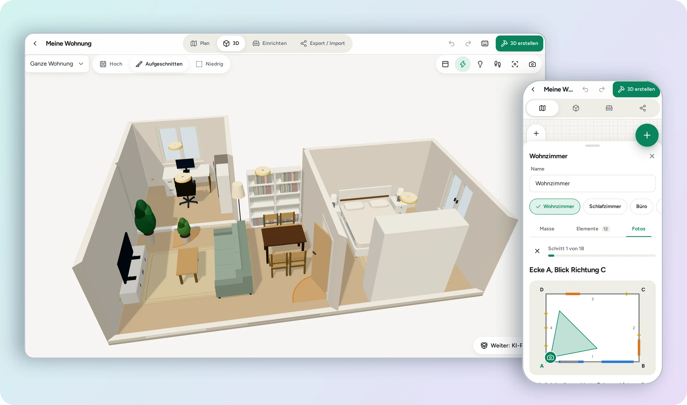
</p>

---

## Was ist roomx?

roomx ist die Sims fürs echte Leben. Du misst deine Räume ein, baust sie in 3D nach und richtest sie mit Möbeln ein. Auf Wunsch macht dir ein KI-Assistent Einrichtungsvorschläge, die roomx wieder in deinen Plan übernimmt.

Die App läuft im Browser auf Computer, Laptop, Tablet und Smartphone und lässt sich wie eine App installieren. Du brauchst kein Konto: Alle Projekte und Fotos bleiben auf deinem Gerät.

> [!NOTE]
> roomx gibt es auf Deutsch und auf Englisch. Die Sprache stellst du in den Einstellungen um. Dieses Handbuch ist auf Deutsch.

## Das kann roomx

<table>
  <tr>
    <td width="33%" valign="top">
      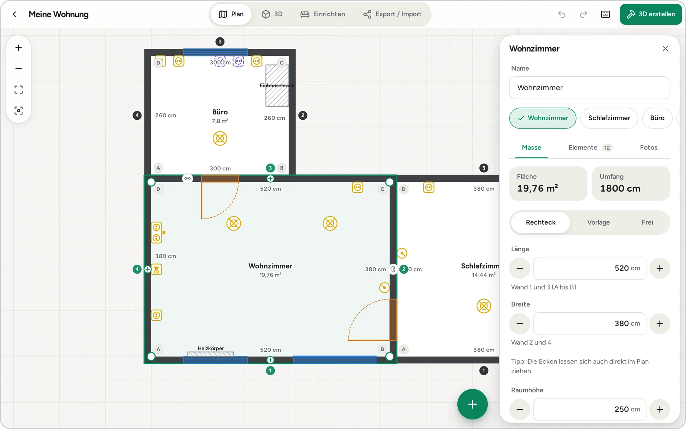<br>
      <b>Räume erfassen</b><br>
      Rechteck, Vorlagen (L, U, T, Erker, Nische), freie Formen mit Wänden und Winkeln, Dachschrägen. Räume rasten wie ein Magnet aneinander ein.
    </td>
    <td width="33%" valign="top">
      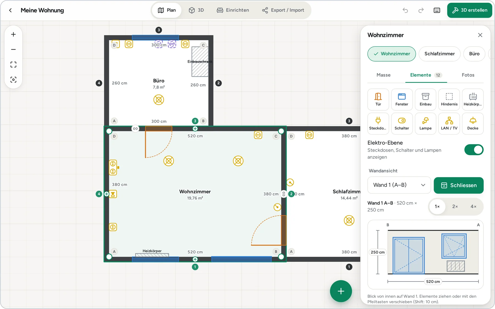<br>
      <b>Türen, Fenster, Elektro</b><br>
      Elemente aus der Palette auf die Wand setzen, in der Wandansicht auf den Zentimeter genau ausrichten, Steckdosen und Schalter einblenden.
    </td>
    <td width="33%" valign="top">
      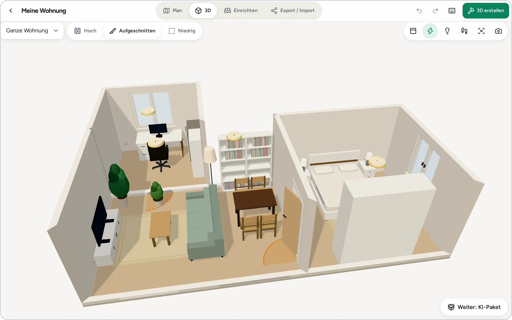<br>
      <b>Wohnung in 3D</b><br>
      Aufgeschnitten, hoch oder niedrig ansehen, Licht an und aus, durch die Räume gehen, Bild speichern.
    </td>
  </tr>
  <tr>
    <td width="33%" valign="top">
      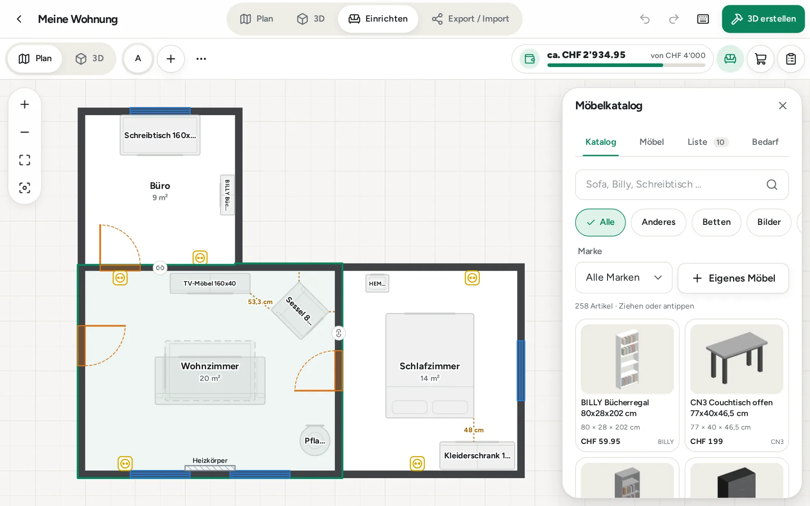<br>
      <b>Einrichten</b><br>
      Über 250 Möbel von IKEA, Tchibo und allgemeine Modelle. Ziehen, drehen, stapeln, eigene Möbel anlegen, Varianten vergleichen.
    </td>
    <td width="33%" valign="top">
      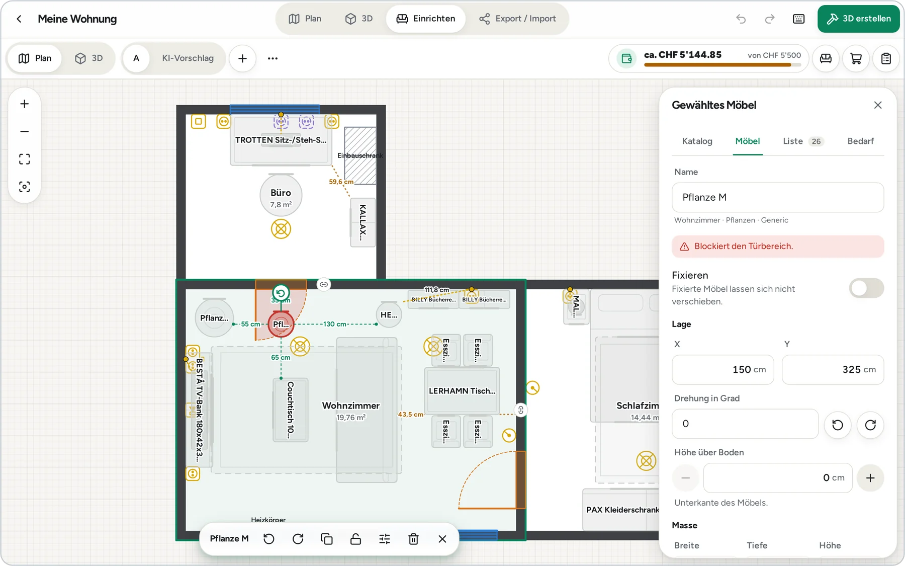<br>
      <b>Prüfungen</b><br>
      Rot markiert, was nicht passt: Kollisionen, Türbereich, Dachschräge, zu weite Wege zur Steckdose.
    </td>
    <td width="33%" valign="top">
      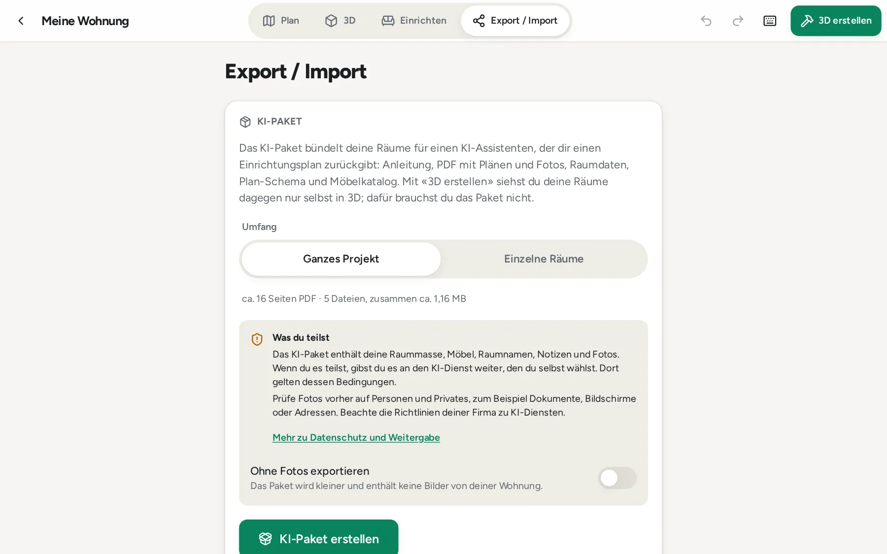<br>
      <b>Mit KI-Assistent einrichten</b><br>
      KI-Paket erstellen, im Chat hochladen, den Plan der KI als Variante importieren. Dazu Budget, Einkaufsliste und Backup.
    </td>
  </tr>
</table>

## Schnellstart

**1. App öffnen.** Gehe auf **<https://xc4pr.github.io/roomx/>**. Beim ersten Start zeigt dir eine kurze Tour die wichtigsten Stellen.

**2. Projekt anlegen.** Tippe auf «Neues Projekt» und gib einen Namen ein, zum Beispiel «Meine Wohnung».

**3. Räume erfassen.** Tippe im Plan auf das Plus. Du bekommst einen Raum mit 4 × 3 m. Trage Länge, Breite und Höhe ein und schiebe die Räume zusammen, bis sie einrasten. Setze Türen, Fenster und Steckdosen.

**4. In 3D ansehen.** Tippe oben rechts auf «3D erstellen». roomx prüft den Plan und baut deine Wohnung nach.

**5. Einrichten.** Wechsle zu «Einrichten» und zieh Möbel aus dem Katalog in die Räume. Oder lass dir von einem KI-Assistenten einen Vorschlag machen (siehe [Mit dem KI-Assistenten einrichten](#mit-dem-ki-assistenten-einrichten)).

### Als App installieren

Du kannst roomx wie eine normale App auf den Startbildschirm oder in den Programmordner legen. Sie öffnet sich dann ohne Adressleiste und läuft nach dem ersten Laden auch ohne Netz.

| Gerät | Browser | So geht es |
|---|---|---|
| iPhone, iPad | Safari | Unten (iPhone) oder oben (iPad) auf «Teilen» tippen, dann «Zum Home-Bildschirm» wählen. |
| Android | Chrome | Menü (drei Punkte) öffnen, dann «App installieren» (oder «Zum Startbildschirm hinzufügen») wählen. |
| Windows, Linux, ChromeOS, macOS | Chrome oder Edge | In der Adressleiste auf das Installieren-Symbol klicken, oder im Menü «roomx installieren» wählen. |
| macOS | Safari | Im Menü «Ablage» oder über «Teilen» den Eintrag «Zum Dock hinzufügen» wählen. |

> [!IMPORTANT]
> **iPhone und iPad:** Installiere roomx unbedingt über «Zum Home-Bildschirm». Safari löscht die Daten von Websites, die man länger nicht geöffnet hat. Bei einer installierten App passiert das viel seltener. Mach zusätzlich ab und zu ein [Backup](#sichern-und-umziehen).

> [!NOTE]
> Jede Adresse und jede installierte App hat ihren **eigenen Speicher**. Projekte, die du im Browser angelegt hast, siehst du in der installierten App nicht automatisch. Zum Umziehen dient das Backup, siehe [Sichern und Umziehen](#sichern-und-umziehen).

---

## Handbuch

- [Projekte](#projekte)
- [Räume erfassen](#räume-erfassen)
- [Räume verbinden](#räume-verbinden)
- [Türen, Fenster und Elektro](#türen-fenster-und-elektro)
- [Foto-Tour](#foto-tour)
- [3D erstellen und ansehen](#3d-erstellen-und-ansehen)
- [Einrichten](#einrichten)
- [Mit dem KI-Assistenten einrichten](#mit-dem-ki-assistenten-einrichten)
- [Sichern und Umziehen](#sichern-und-umziehen)
- [Einstellungen](#einstellungen)
- [Tastaturkürzel](#tastaturkürzel)
- [Tipps](#tipps)
- [FAQ](#faq)
- [Datenschutz](#datenschutz)
- [Haftungsausschluss](#haftungsausschluss)
- [Für Entwickler](#für-entwickler)

### Projekte

Ein Projekt ist eine Wohnung, ein Haus oder ein einzelner Raum, mit allen Räumen, Fotos, Möbeln und Varianten. Die Projektliste ist die Startseite.

<p align="center">
  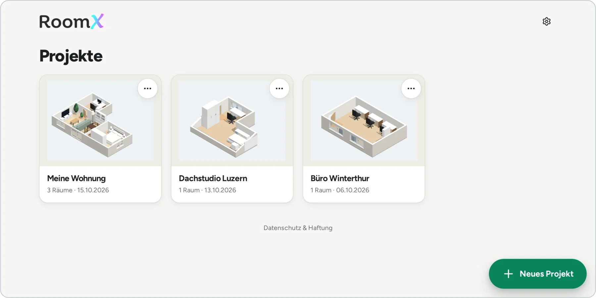
</p>

- **Neues Projekt:** Knopf unten rechts. Vergib einen Namen.
- **Öffnen:** auf die Karte tippen. Das Vorschaubild zeigt dein Projekt in 3D.
- **Menü (drei Punkte) auf der Karte:** Umbenennen, Backup (ZIP) erstellen, Löschen. Ein gelöschtes Projekt ist weg, mach vorher ein Backup, wenn du unsicher bist.
- **Oben im Projekt:** Die Reiter «Plan», «3D», «Einrichten» und «Export / Import» wechseln den Bereich. Daneben stehen «Rückgängig», «Wiederholen» und «3D erstellen».
- **Zahnrad oben rechts:** [Einstellungen](#einstellungen).

### Räume erfassen

Im Reiter **Plan** zeichnest du den Grundriss. Alles wird in Zentimetern eingegeben (oder in Metern, siehe [Einstellungen](#einstellungen)).

**Raum hinzufügen.** Tippe auf das Plus. Es erscheint ein Raum mit 4 × 3 m, den du an seinen Platz ziehst. Tippen wählt einen Raum aus und öffnet das Panel mit den drei Bereichen **Masse**, **Elemente** und **Fotos**. Doppelt tippen fokussiert den Raum, mit zwei Fingern oder dem Mausrad zoomst du, «Alles zeigen» passt den Ausschnitt an.

**Raumtyp und Name.** Wähle einen Typ (Wohnzimmer, Schlafzimmer, Büro, Küche, Bad, Kinderzimmer, Flur, Esszimmer, Abstellraum oder Andere) und gib dem Raum einen Namen.

Unter **Masse** gibt es drei Arten, die Form festzulegen:

| Form | Wofür | So geht es |
|---|---|---|
| **Rechteck** | Die meisten Räume | Länge und Breite eintippen oder mit Plus und Minus anpassen. |
| **Vorlage** | Häufige Sonderformen | Grundform wählen: L-Form, U-Form, T-Form, Schräge Ecke, Erker oder Nische. Danach stellst du die Masse auf den Zentimeter ein. Eine Vorschau zeigt den Grundriss. |
| **Frei** | Alles andere | Wand für Wand die Länge und die Winkel eingeben. Die letzte Wand schliesst sich automatisch. Wände lassen sich teilen oder entfernen, «Gleichmässig verteilen» hilft bei schiefen Eingaben. |

> [!TIP]
> Bei «Frei» kannst du die **Ecken auch direkt im Plan ziehen**. Das Plus mitten auf einer Wand fügt eine Ecke ein. Schliesst der Grundriss nicht, zeigt roomx an, wie viel fehlt.

**Höhe.** Trage die Raumhöhe ein. Sie gilt für 3D, Prüfungen und das KI-Paket.

**Dachschrägen.** Pro Wand kannst du eine Schräge einstellen: Gib die **Kniestockhöhe** (Deckenhöhe direkt an der Wand) und die **Neigung** an. roomx rechnet aus, ab welchem Abstand die volle Raumhöhe erreicht ist und wo die Stehhöhe von 2 m beginnt. Schrägen erscheinen schraffiert im Plan und in 3D, und Möbel, die nicht darunter passen, werden markiert.

**Weitere Einstellungen im Panel:**

- **Aussehen:** Farbe für Boden (z. B. Eiche hell, Beton, Fliese) und Wände (z. B. Weiss, Sand, Salbei), oder eine eigene Farbe. Sie erscheint in 3D.
- **Notizen** zum Raum, zum Beispiel «Parkett, Heizung links».
- **Duplizieren** und **Löschen.** Über «Rückgängig» holst du einen gelöschten Raum zurück.
- **Raum drehen:** im Menü des Raums «Um 90° drehen».

### Räume verbinden

Eine Wohnung besteht aus mehreren Räumen. Damit roomx weiss, wie sie zusammenhängen, schiebst du sie im Plan aneinander.

1. Ziehe einen Raum an einen Nachbarraum heran.
2. Er **rastet wie ein Magnet ein**. Zwischen den Räumen liegt dann eine gemeinsame Wand.
3. Auf der gemeinsamen Wand erscheint ein Verbindungssymbol. Im Panel zeigt der Bereich «Nachbarn», welche Wand an welchen Raum grenzt und wie lang das gemeinsame Stück ist. Mit einem Tipp wechselst du in den Nachbarraum.

**Türen und Fenster in der gemeinsamen Wand führen in beide Räume.** Setzt du eine Tür in die Wand zwischen Wohnzimmer und Schlafzimmer, erscheint sie automatisch auch im Schlafzimmer, mit gespiegeltem Anschlag. In der Elementliste des Nachbarraums steht sie mit dem Vermerk «von Wohnzimmer»; geändert wird sie im Raum, zu dem sie gehört.

> [!IMPORTANT]
> **Unverbundene Räume werden gemeldet.** Wenn in einem Projekt mit mehreren Räumen ein Raum keinen Nachbarn hat, weist dich roomx beim Erstellen der 3D-Ansicht und beim Exportieren des KI-Pakets darauf hin. Du kannst trotzdem weitermachen. Das ist sinnvoll bei Räumen, die bewusst getrennt liegen, etwa Keller oder Garage.

### Türen, Fenster und Elektro

Im Panel des Raums, Bereich **Elemente**, findest du die Palette:

| Gruppe | Elemente |
|---|---|
| Wand | Tür, Fenster, Einbau, Hindernis, Heizkörper |
| Elektro | Steckdose, Schalter, Lampe (an der Wand), LAN / TV, Decke (Deckenlampe) |

<p align="center">
  
</p>

**Platzieren.** Wähle ein Element in der Palette und tippe auf eine Wand (bei der Deckenlampe in den Raum). Zieh es danach an die richtige Stelle. «Platzieren abbrechen» oder die Taste `Esc` bricht ab.

**Eigenschaften.** Wähle ein Element in der Liste oder im Plan. Je nach Art stellst du ein:

- Wand, Abstand von der Ecke, Breite, Höhe und Unterkante ab Boden,
- **Tür:** Anschlag und Öffnungsrichtung (nach innen, nach aussen, Schiebetür). Der Schwenkbereich ist im Plan sichtbar und muss frei bleiben.
- **Fenster:** Dreh-Kipp, Schiebefenster, Festverglasung oder Balkontür,
- **Steckdose:** Anzahl Plätze und USB-Anschluss, **LAN / TV:** Netzwerk, TV oder beides,
- **Status:** «Bestehend» oder «Geplant», dazu eine Notiz.

Praktisch sind «Unter Fenster zentrieren» (zum Beispiel für den Heizkörper) und «Über Arbeitsfläche» (Mitte 115 cm) für Steckdosen in der Küche.

**Wandansicht.** Wähle eine Wand und tippe auf «Öffnen». Du siehst die Wand von innen, mit allen Elementen und ihren Höhen. Zieh Elemente an die richtige Stelle oder verschiebe sie mit den Pfeiltasten (`Umschalt` für 10 cm). Mit 1×, 2× und 4× vergrösserst du die Ansicht.

**Elektro-Ebene.** Der Schalter «Elektro-Ebene» blendet Steckdosen, Schalter und Lampen im Plan ein oder aus. Elektro-Elemente sind gelb, Fenster blau und Türen orange.

**Vorschläge annehmen.** Elektro-Elemente mit dem Status «Vorschlag» sind gestrichelt gezeichnet. Das sind zum Beispiel Steckdosen, die ein KI-Assistent in seinem Plan vorschlägt. Im Panel erscheint der Bereich «Vorschläge»: Du kannst jeden Vorschlag einzeln **annehmen** oder **ablehnen**, oder mit «Alle annehmen» alles übernehmen.

> [!NOTE]
> roomx ersetzt keine Elektroplanung. Lass Steckdosen und Leitungen von Fachleuten planen und ausführen.

### Foto-Tour

Die Foto-Tour führt dich Schritt für Schritt durch einen Raum, damit später kein Blickwinkel fehlt. Die Fotos landen im KI-Paket und helfen dem Assistenten, deinen Raum zu verstehen.

<table>
  <tr>
    <td valign="top">

1. Öffne den Raum und wechsle im Panel zu **Fotos**.
2. Tippe auf «Tour starten».
3. Folge den Schritten. Eine kleine Karte zeigt, wo du stehen sollst und wohin du fotografierst: erst die Ecken, dann Wände, Decke, Boden, Details und die Elektro-Elemente der Wand.
4. «Foto aufnehmen» öffnet die Kamera, «Aus Mediathek» nimmt ein vorhandenes Bild. Optionale Schritte kannst du **überspringen**.
5. Am Ende zeigt die Galerie die Pflichtfotos. Fehlende Fotos sind markiert, «Tour fortsetzen» holt sie nach.

Zusätzlich kannst du jederzeit ein **freies Foto** mit Notiz machen, zum Beispiel von Problemstellen.

Fotos werden direkt auf dem Gerät verkleinert und ohne Metadaten gespeichert.

    </td>
    <td valign="top" width="260">
      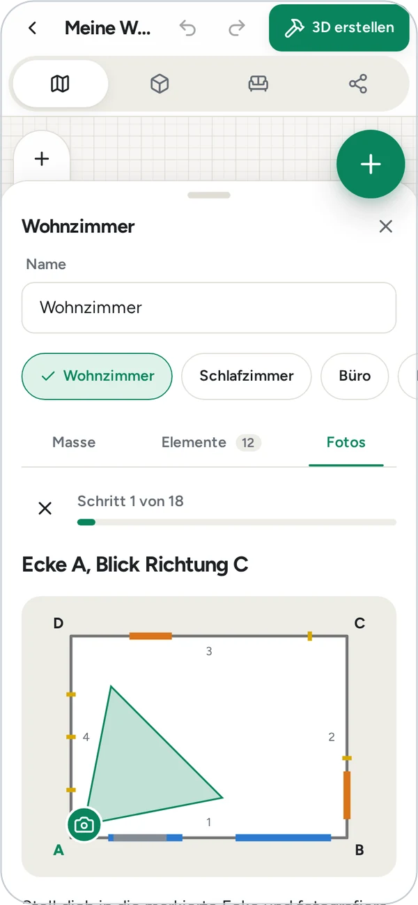
    </td>
  </tr>
</table>

> [!TIP]
> Mit der Ultraweitwinkel-Kamera (0,5×) passt mehr von den Wänden ins Bild. Bei den Ecken stellst du dich in die markierte Ecke und fotografierst schräg in den Raum.

> [!NOTE]
> Manche Browser können Bilder im HEIC-Format nicht lesen. Stelle dann die Kamera auf «Maximale Kompatibilität» (iPhone: Einstellungen, Kamera, Formate) oder wähle ein JPEG. Ein einzelnes Bild darf höchstens 80 MB gross sein.

### 3D erstellen und ansehen

Tippe oben rechts auf **«3D erstellen»**. roomx prüft zuerst deinen Plan und nennt Probleme, zum Beispiel ungültige Grundrisse, Elemente, die über die Wand hinausragen, fehlende Pflichtfotos oder [unverbundene Räume](#räume-verbinden). Mit «Trotzdem erstellen» geht es weiter, mit «Zurück zum Plan» korrigierst du zuerst.

<p align="center">
  
</p>

**Ansicht steuern.** Ziehen dreht die Ansicht, Mausrad oder zwei Finger zoomen. Oben links wählst du **Ganze Wohnung** oder einen **einzelnen Raum**.

| Bedienelement | Wirkung |
|---|---|
| **Wände: Hoch, Aufgeschnitten, Niedrig** | Wände in voller Höhe, nur die hinteren Wände hoch oder alle niedrig. Aufgeschnitten zeigt am meisten. |
| **Decke** | Decke ein- oder ausblenden. |
| **Elektro** | Steckdosen, Schalter und Lampen anzeigen. |
| **Licht** | Deckenlampen ein- und ausschalten. |
| **Begehen** | Durch den Raum gehen, siehe unten. |
| **Kamera zurücksetzen** | Zurück zur Startansicht. |
| **Bild speichern** | Die aktuelle Ansicht als Bild sichern (auf dem Handy «Bild teilen»). |

**Begehen.** In diesem Modus stehst du im Raum, auf Augenhöhe. Am Computer gehst du mit `W` `A` `S` `D`, schaust mit den Pfeiltasten oder gezogener Maus um und beendest mit `Esc`. Auf Tablet und Handy gehst du mit dem Steuerkreuz links und wischst zum Umsehen.

<p align="center">
  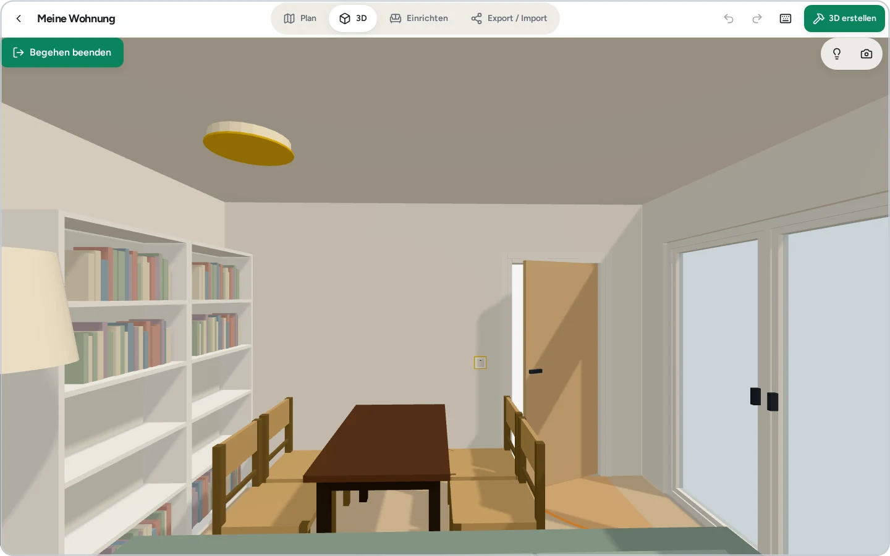
</p>

> [!NOTE]
> 3D braucht einen Browser mit WebGL. Zeigt die App «3D ist hier nicht verfügbar», lade die Seite neu oder probiere einen anderen Browser.

### Einrichten

Im Reiter **Einrichten** stellst du Möbel in deine Räume. Oben links wechselst du zwischen Plan und 3D und wählst die Variante. Über die Knöpfe oben rechts öffnest du das Panel mit den Bereichen **Katalog**, **Möbel**, **Liste** und **Bedarf**.

<p align="center">
  
</p>

**Katalog.** Er enthält über 250 Artikel in den Marken **IKEA**, **Tchibo** (Serie CN3) und **Allgemein** (neutrale Möbel, Geräte, Deko, Lampen).

- Suche oben, zum Beispiel «Billy» oder «Schreibtisch».
- Kategorien als Chips (Betten, Regale, Tische, Sofas, Lampen und mehr), dazu der Filter «Marke».
- Möbel **ziehen** oder **antippen**: Antippen stellt es in den Raum.

> [!NOTE]
> Preise im Katalog sind **Richtpreise in CHF**. Nur wenige Masse sind auf den Herstellerseiten geprüft; bei diesen Artikeln führt ein Link zur Herstellerseite. Prüfe Masse und Preis immer beim Händler, bevor du kaufst.

**Möbel bewegen.** Zieh ein Möbel an seinen Platz. Der Drehgriff dreht frei, die Knöpfe im Panel drehen um 90° oder 15°, oder du tippst die Gradzahl ein. Im Plan zeigen gepunktete Linien den Abstand zu Wänden und anderen Möbeln. Mit «Fixieren» sperrst du ein Möbel gegen versehentliches Verschieben. Duplizieren und Löschen findest du in der Leiste unter dem gewählten Möbel.

**Stapeln.** Möbel können auf anderen Möbeln stehen: ein Fernseher auf der TV-Bank, eine Lampe auf dem Nachttisch. Das Panel zeigt «Steht auf …» und die Höhe über dem Boden; mit «Herunternehmen» stellst du es wieder auf den Boden. Wird ein Möbel verschoben, wandert das Gestapelte mit.

**Eigene Möbel.** Mit «Eigenes Möbel» legst du ein Möbel mit eigenen Massen, Kategorie, Farbe und Preis an, zum Beispiel dein vorhandenes Sofa. Ein Preis ist nicht nötig. Markiere es mit «Fixieren», wenn es bleiben soll.

**Prüfungen in Rot.** roomx prüft laufend und färbt ein Möbel **rot**, wenn etwas nicht passt. Das Panel «Möbel» nennt den Grund:

<table>
  <tr>
    <td valign="top">

| Hinweis | Bedeutung |
|---|---|
| Steht nicht ganz im Raum | Das Möbel ragt über die Wand. |
| Ist höher als der Raum | Zu hoch für die Raumhöhe. |
| Passt nicht unter die Dachschräge | Die Schräge ist zu niedrig. |
| Überschneidet sich mit … | Zwei Möbel stehen ineinander. |
| Steht in einem Einbau | Kollision mit Einbau oder Vorsprung. |
| Blockiert den Türbereich | Der Schwenkbereich der Tür ist nicht frei. |
| Verstellt ein Fenster | Das Möbel steht vor dem Fenster. |
| Verdeckt einen Heizkörper | Der Heizkörper ist zugestellt. |
| Durchgang nur … breit | Zu wenig Platz zum Durchgehen. |
| Steckdose ist … entfernt | Siehe unten. |

    </td>
    <td valign="top" width="360">
      
    </td>
  </tr>
</table>

**Steckdosen-Distanz.** Möbel, die Strom brauchen (Fernseher, Monitor, Lampen, Geräte), zeigen im Plan den Weg zur nächsten Steckdose. Ist sie mehr als 1,5 m entfernt oder gibt es im Raum gar keine erfasste Steckdose, erscheint ein Hinweis.

**Varianten.** Oben stehen die Varianten deiner Einrichtung, zum Beispiel «A» und «B». Mit dem Plus legst du eine neue Variante an, leer oder als Kopie einer bestehenden. Über das Menü benennst du Varianten um oder löschst sie. So probierst du zwei Einrichtungen aus, ohne etwas zu verlieren. Ein Plan vom KI-Assistenten kommt ebenfalls als Variante.

**Budget, Liste und Bedarf.**

<p align="center">
  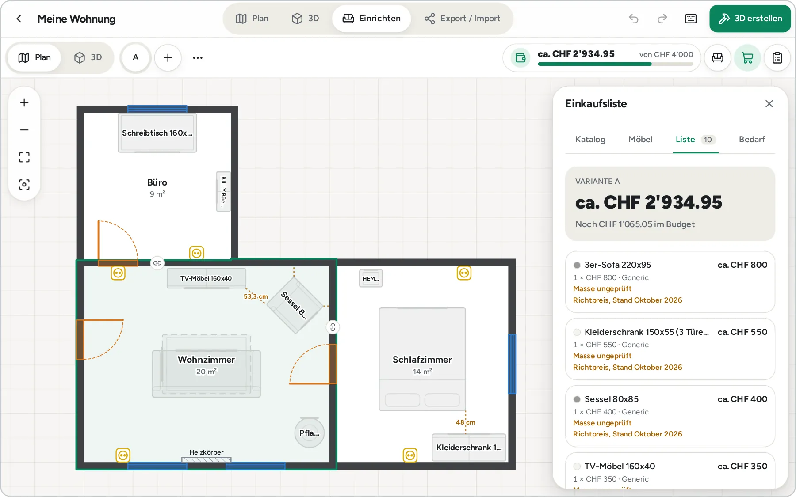
</p>

- **Budget:** Trage unter **Bedarf** dein Budget in CHF ein. Oben erscheint ein Balken mit der Summe der aktuellen Variante und dem Hinweis, wie viel noch im Budget ist oder wie viel darüber.
- **Liste (Einkaufsliste):** alle Möbel der Variante mit Menge, Preis, Marke und Link, mit der Summe. Artikel mit Richtpreis sind gekennzeichnet, Artikel ohne Preis werden gezählt. «Als CSV exportieren» speichert die Liste für Excel oder Numbers (Spalten: Artikel, Marke, Menge, Einzelpreis CHF, Summe CHF, Richtpreis, Link).
- **Bedarf:** Personen (Erwachsene, Kinder, Haustiere), Bettgrössen, Arbeitsplätze (Bildschirme, Laptop oder PC, höhenverstellbar), Stil, Budget, bevorzugte Händler und Wünsche. Der Bedarf geht ins KI-Paket und hilft dem Assistenten beim Vorschlag.

### Mit dem KI-Assistenten einrichten

Du kannst deine Räume von einem KI-Assistenten einrichten lassen. roomx bereitet dafür ein **KI-Paket** vor und liest die Antwort des Assistenten wieder ein. Das funktioniert mit jedem KI-Assistenten, der Dateien annimmt. Du musst nichts zusätzlich installieren.

> [!NOTE]
> «3D erstellen» ist davon unabhängig: Damit siehst du deine Räume nur selbst in 3D. Das KI-Paket brauchst du nur, wenn ein Assistent dir einen Plan machen soll.

**Das KI-Paket enthält:**

| Datei | Inhalt |
|---|---|
| **Anleitung** (`roomx-anleitung-….md`) | Erklärt dem KI-Assistenten, wie er vorgehen und was er zurückgeben soll. |
| **PDF** (`roomx-….pdf`) | Grundrisse mit Massen, Wandansichten, 3D-Ansichten, Möbel, deine Fotos und eine Lesehilfe. |
| **Raumdaten** (`roomx-….json`) | Dieselben Angaben exakt und maschinenlesbar: Räume, Wände, Elemente, Nachbarräume, Dachschrägen, Möbel, Varianten und Bedarf. |
| **Plan-Schema** (`roomx-plan.schema.json`) | Beschreibt das Format `roomx-plan`, in dem die Antwort zurückkommen muss. |
| **Möbelkatalog** (`roomx-katalog.json`) | Die Artikel, die der Assistent verwenden kann. |

**Schritt für Schritt:**

1. **KI-Paket erstellen.** Öffne den Reiter «Export / Import». Wähle «Ganzes Projekt» oder «Einzelne Räume» und tippe auf «KI-Paket erstellen». roomx zeigt vorher die geschätzte Grösse und weist auf Lücken im Plan hin, etwa [unverbundene Räume](#räume-verbinden) oder fehlende Pflichtfotos. Mit «Trotzdem exportieren» geht es weiter. Danach «Teilen» oder «Herunterladen».
2. **Im Chat hochladen.** Öffne einen Chat mit einem KI-Assistenten deiner Wahl und lade **alle Dateien** des Pakets hoch. Tippe in roomx auf **«Prompt kopieren»** und füge den Text in den Chat ein. Unter «So geht es weiter» zeigt dir roomx diese Schritte und den fertigen Prompt gleich an.
3. **Fragen beantworten.** Der Assistent fragt nach, was er noch wissen muss, zum Beispiel nach Stil, Budget oder Wünschen. Beantworte die Fragen.
4. **Plan als JSON zurück.** Am Ende gibt der Assistent den Einrichtungsplan als JSON im Format `roomx-plan` aus. Kopiere die **ganze Antwort**, oder speichere den Plan als Datei.
5. **Plan importieren.** Gehe in roomx auf «Export / Import», Bereich «Plan importieren»: Text einfügen («Aus Zwischenablage» hilft) oder die Datei wählen. Die Antwort darf weiteren Text enthalten, roomx findet das JSON selbst.
6. **Vorschau prüfen.** roomx zeigt pro Variante die Summe und listet Konflikte (zum Beispiel «versperrt die Tür»), Hinweise und alles, was nicht übernommen werden kann.
7. **Als Variante übernehmen.** «Als neue Variante übernehmen» legt den Plan als Variante an. Nichts wird überschrieben. Wähle bei Bedarf, ob auch der Bedarf aus dem Plan übernommen wird.
8. **Anpassen und erneut exportieren.** Sieh dir die Variante in «Einrichten» an und ändere, was dir nicht gefällt. Willst du eine zweite Runde, erstelle ein neues KI-Paket: Es enthält jetzt deine angepasste Einrichtung.

<p align="center">
  
</p>

<p align="center">
  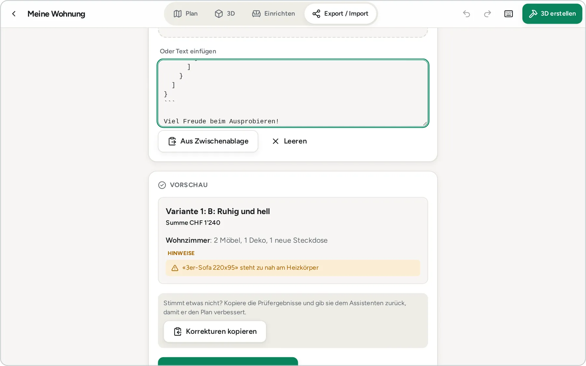
</p>

> [!TIP]
> **Blockiert dein Gerät mehrere Downloads auf einmal?** Dann nimm «KI-Paket als ZIP», entpacke die Datei und lade die einzelnen Dateien im Chat hoch.

> [!TIP]
> **Bei grossen Wohnungen** exportierst du die Räume einzeln («Einzelne Räume»). Zeigt roomx an, dass das Paket gross wird, und nimmt der Assistent es nicht an, ist das der beste Weg.

> [!TIP]
> **Fehlermeldung beim Import?** Gibt es Fehler oder bricht die Antwort mitten im JSON ab, zeigt roomx die genauen Stellen. Mit «Fehlerliste kopieren» schickst du die Liste an den Assistenten und bittest ihn um eine korrigierte, vollständige Antwort.

> [!IMPORTANT]
> Das KI-Paket enthält deine Raumdaten und, falls aufgenommen, deine **Fotos**. Du gibst sie selbst an den Anbieter des Assistenten weiter, und es gelten dessen Bedingungen. Prüfe die Fotos vorher auf Personen, Dokumente und Privates. Mit «Einzelne Räume» gibst du nur weiter, was nötig ist.

### Sichern und Umziehen

**Automatisch gespeichert.** roomx speichert jede Änderung selbst, kurz nach dem Tippen oder Ziehen. Es gibt keinen Speichern-Knopf.

**Rückgängig und Wiederholen.** Die Pfeile oben (oder `Strg`/`Cmd` + `Z`) machen den letzten Schritt rückgängig. Auch das Löschen von Räumen und Möbeln lässt sich zurücknehmen. Ein Ziehen zählt als ein Schritt.

**Backup (ZIP).** Unter «Export / Import» oder im Menü der Projektkarte erstellst du ein Backup: das ganze Projekt in einer ZIP-Datei, mit Projektdaten und Originalfotos. Optional legst du das KI-Paket und das 3D-Modell bei. roomx merkt sich den Zeitpunkt des letzten Backups und erinnert dich, wenn es mehr als 14 Tage her ist.

**Wiederherstellen.** Wähle unter «Wiederherstellen» die ZIP-Datei. Gibt es das Projekt auf diesem Gerät schon, fragt roomx, ob du es **ersetzen** oder **als Kopie anlegen** willst. Fehlen Fotos oder sind sie beschädigt, meldet roomx, wie viele.

**Auf ein anderes Gerät oder in die installierte App umziehen:**

1. Erstelle am alten Ort ein Backup (ZIP).
2. Übertrage die Datei, zum Beispiel per AirDrop, Mail oder Cloud-Ordner.
3. Öffne roomx am neuen Ort und stelle das Backup wieder her.

**3D-Modell (.glb).** Unter «Export / Import» exportierst du die gewählten Räume mit der aktiven Variante als `.glb`-Datei. Damit kannst du das Modell in Programmen wie Blender oder in einer AR-Ansicht öffnen.

> [!IMPORTANT]
> Deine Daten liegen nur im Browser deines Geräts. Es gibt keine Kopie bei uns, die man zurückholen könnte. Wer Website-Daten löscht, das Gerät verliert oder Safari die Daten räumen lässt, verliert die Projekte. **Erstelle regelmässig ein Backup** und bewahre es getrennt vom Gerät auf.

### Einstellungen

Du erreichst sie über das Zahnrad oben rechts in der Projektliste.

| Einstellung | Bedeutung |
|---|---|
| **Sprache** | Deutsch oder English. Standard ist die Sprache deines Browsers. |
| **Einheit für Längen** | Zentimeter oder Meter. |
| **Speicher** | Zeigt, ob der Browser die Daten **dauerhaft sichert** («Dauerhaft gesichert») oder bei Platzmangel löschen darf, und wie viel Platz belegt ist. «Erneut anfragen» versucht die dauerhafte Sicherung noch einmal. Mit der App auf dem Home-Bildschirm klappt sie eher. |
| **Hilfe** | «Tour starten» spielt die Einführung noch einmal ab (zehn Schritte, jederzeit überspringbar, wahlweise mit einem Beispielzimmer). «Tastaturkürzel anzeigen» öffnet die Übersicht. |
| **Datenschutz & Haftung** | Öffnet die Seite mit der Datenschutzerklärung und dem Haftungsausschluss. |

### Tastaturkürzel

Für Computer und iPad mit Tastatur. Auf dem Mac nimmst du `Cmd` statt `Strg`. In der App zeigt die Taste `?` die Übersicht.

| Taste | Wirkung |
|---|---|
| `Strg` + `Z` | Rückgängig |
| `Strg` + `Umschalt` + `Z` (oder `Strg` + `Y`) | Wiederholen |
| `Esc` | Auswahl aufheben, Fokus verlassen, Platzieren abbrechen |
| `?` | Übersicht der Kürzel ein- und ausblenden |
| Pfeiltasten | Gewählten Raum oder gewähltes Element um 1 cm verschieben |
| `Umschalt` + Pfeiltasten | Um 10 cm verschieben |
| `R` | Raum um 90° drehen |
| `Umschalt` + `R` | Raum um 90° zurückdrehen |
| `Entf` | Gewählten Raum oder gewähltes Element löschen |
| `+` und `-` | Hinein- und herauszoomen |
| `0` | Alles zeigen |

### Tipps

- **Fang mit dem grössten Raum an** und arbeite dich nach aussen. Das Verbinden der Räume geht danach am schnellsten.
- **Ecke A merken.** Alle Wände sind nummeriert und die Ecken heissen A, B, C … Notiere dir bei jedem Raum, wo Ecke A liegt, dann findest du dich in Plan, Wandansicht und PDF sofort zurecht.
- **Lieber nachmessen als schätzen.** Ein Laser-Distanzmesser lohnt sich. Die Wandansicht hilft, Höhen von Fenstern und Steckdosen genau einzutragen.
- **Vorhandene Möbel erfassen.** Leg sie als «Eigenes Möbel» an und markiere sie als fixiert. So plant der Assistent um sie herum.
- **Varianten statt Überschreiben.** Probiere Ideen in einer Kopie aus, bevor du die Hauptvariante änderst.
- **Wenige, gute Fotos** schlagen viele schlechte: Folge der Tour und fotografiere gerade, mit Licht.
- **Backup vor jeder grossen Änderung**, und vor dem Import eines KI-Plans erst recht.
- **Steckdosen eintragen**, bevor du einrichtest. Erst dann stimmen die Hinweise zur Steckdosen-Distanz.

### FAQ

<details>
<summary><b>Wo sind meine Daten?</b></summary>

Im Browser deines Geräts (IndexedDB). Die öffentliche Version spricht mit keinem Server. Es gibt kein Konto und keine Kopie in einer Cloud. Daten verlassen dein Gerät nur, wenn du selbst ein KI-Paket, ein Backup oder einen anderen Export teilst.
</details>

<details>
<summary><b>Warum sehe ich meine Projekte auf einem anderen Gerät nicht?</b></summary>

Weil jedes Gerät, jeder Browser und jede installierte App einen eigenen Speicher hat. Das gilt auch für zwei verschiedene Adressen. Zieh mit einem Backup (ZIP) um, siehe [Sichern und Umziehen](#sichern-und-umziehen).
</details>

<details>
<summary><b>Was passiert beim KI-Paket mit meinen Fotos?</b></summary>

Die Fotos stecken im PDF des Pakets. roomx selbst sendet nichts: Du lädst die Dateien selbst bei einem KI-Assistenten hoch, und dessen Anbieter verarbeitet sie nach seinen eigenen Bedingungen. Prüfe die Fotos vorher, und wähle bei Bedarf nur einzelne Räume.
</details>

<details>
<summary><b>Kostet das etwas?</b></summary>

Nein. roomx ist kostenlos und braucht kein Konto. Wenn du einen KI-Assistenten nutzt, gelten die Konditionen seines Anbieters.
</details>

<details>
<summary><b>Funktioniert es offline?</b></summary>

Ja, nach dem ersten Laden. Die App legt ihre Dateien im Browser ab und startet auch ohne Netz, am besten als installierte App. Ohne Netz geht nichts verloren, nur Links zu Möbelhäusern und das Hochladen bei einem KI-Assistenten brauchen Internet.
</details>

<details>
<summary><b>Auf dem iPhone sind meine Projekte verschwunden. Was ist passiert?</b></summary>

Safari räumt die Daten von Websites auf, die man länger nicht geöffnet hat. Installiere roomx deshalb über «Zum Home-Bildschirm», dann passiert das seltener. Mit einem Backup (ZIP) holst du Projekte zurück, siehe [Sichern und Umziehen](#sichern-und-umziehen). Die Einstellungen zeigen unter «Speicher», ob dein Browser die Daten dauerhaft sichert.
</details>

<details>
<summary><b>Stimmen die Möbelmasse und Preise?</b></summary>

Es sind Richtwerte. Die Preise im Katalog sind Richtpreise in CHF, und nur wenige Masse sind auf den Herstellerseiten geprüft. Prüfe beides beim Händler, bevor du kaufst.
</details>

<details>
<summary><b>Der Assistent liefert einen Plan, den roomx nicht lesen kann.</b></summary>

Tippe in der Fehlermeldung auf «Fehlerliste kopieren», füge sie im Chat ein und bitte den Assistenten um eine korrigierte, vollständige Ausgabe. Bei sehr grossen Wohnungen hilft es, die Räume einzeln zu exportieren.
</details>

<details>
<summary><b>Ich sehe keine 3D-Ansicht.</b></summary>

Lade die Seite neu oder probiere einen anderen Browser. 3D braucht WebGL, das in sehr alten Browsern oder bei abgeschalteter Grafikbeschleunigung fehlt.
</details>

<details>
<summary><b>Kann ich mehrere Personen am gleichen Projekt arbeiten lassen?</b></summary>

Nicht gleichzeitig: Es gibt keinen Abgleich zwischen Geräten. Du kannst ein Projekt aber als Backup (ZIP) oder als PDF und `.glb`-Datei weitergeben.
</details>

---

## Datenschutz

Kurz gesagt: **Deine Daten bleiben auf deinem Gerät.**

- Keine Konten, keine Cookies, kein Tracking, keine Werbe- oder Analysedienste, keine Schriften oder Skripte von Drittanbietern.
- Projekte, Fotos und Einstellungen liegen im Browser deines Geräts (IndexedDB und localStorage). Der Betreiber hat keinen Zugriff darauf und kann sie nicht wiederherstellen.
- Die öffentliche Version von roomx sendet **keine Daten an einen Server**. Es gibt keinen Abgleich.
- Daten verlassen dein Gerät nur, wenn **du** sie weitergibst: mit einem KI-Paket, einem Backup oder einem anderen Export.
- Fotos werden beim Hinzufügen im Browser verkleinert und ohne Metadaten wie den Aufnahmeort gespeichert.
- Die Dateien der App liefert GitHub Pages aus. Beim Aufruf verarbeitet GitHub technische Zugriffsdaten wie die IP-Adresse. Der Betreiber von roomx erhält sie nicht.
- Links zu Möbelhäusern öffnen sich nur, wenn du sie antippst. Dabei werden keine Projektdaten übergeben.
- Die Daten im Browser sind nicht zusätzlich verschlüsselt. Sperre dein Gerät.

Die ausführliche Datenschutzerklärung steht in der App: in der Projektliste unten und unter Einstellungen auf der Seite [«Datenschutz & Haftung»](https://xc4pr.github.io/roomx/rechtliches).

## Haftungsausschluss

roomx ist ein kostenloses Hilfsmittel und wird «wie besehen» zur Verfügung gestellt, ohne Garantie für Fehlerfreiheit oder Verfügbarkeit. Du nutzt es auf eigene Verantwortung.

- **Masse, Preise und Prüfungen sind Richtwerte.** Katalogangaben, Preise, Berechnungen und die roten Hinweise ersetzen das Nachmessen vor Ort nicht. Möbel in Plan und 3D sind vereinfacht dargestellt.
- **KI-Vorschläge sind ungeprüft.** Du entscheidest, ob du sie übernimmst. Auf den Assistenten hat roomx keinen Einfluss.
- **Keine Fachberatung.** roomx ersetzt keine Planung durch Fachleute, besonders bei Statik, Elektroinstallationen und Wandbefestigung.
- **Prüfe vor Kauf und Umbau** Masse, Preise und Lieferbarkeit selbst.
- **Datenverlust ist möglich**, wenn du Browserdaten löschst oder das Gerät verlierst. Mach regelmässig ein Backup.
- Marken wie IKEA und Tchibo gehören ihren Inhabern. Es besteht keine Verbindung zu diesen Unternehmen.

Den vollständigen Wortlaut findest du in der App auf der Seite [«Datenschutz & Haftung»](https://xc4pr.github.io/roomx/rechtliches).

---

## Für Entwickler

<details>
<summary><b>Stack, Ordner, Entwicklung, Tests und Veröffentlichung</b></summary>

### Stack

- **App:** SvelteKit 3 als Single-Page-App (`ssr = false`, adapter-static mit Fallback `index.html`), Svelte 5 (Runes), Vite 8, Tailwind CSS 4, TypeScript (strict), Zod 4.
- **3D:** three.js. **Daten im Browser:** Dexie (IndexedDB). **PDF:** pdf-lib, **ZIP:** fflate. **UI:** bits-ui, Lucide-Icons, Schrift Figtree.
- **PWA:** eigener Service Worker (`web/src/service-worker`), der alle Dateien vorlädt.
- **Server (optional):** FastAPI und uvicorn, nur für die selbst gehostete Version.
- **Tests:** Vitest (Unit), Playwright (E2E), pytest (Server).

### Ordnerstruktur

```text
roomx/
├─ web/                    SvelteKit-App (SPA und PWA)
│  ├─ src/lib/core         Datenmodell, Geometrie, Prüfungen, Export- und Plan-Format (ohne UI)
│  ├─ src/lib/state        Store, Speicher (IndexedDB), Einstellungen, Abgleich
│  ├─ src/lib/features     Bereiche der App: board, room, elements, photos, viewer, furnish,
│  │                       export, import, projects, settings, tour, legal
│  ├─ src/lib/three        3D: Räume, Möbelmodelle, Viewer, GLB-Export
│  ├─ src/lib/catalog      Möbelkatalog (IKEA, Tchibo, Allgemein)
│  ├─ src/lib/ui           Basis-Komponenten und Design-Tokens
│  ├─ src/routes           Seiten (Projekte, Plan, 3D, Einrichten, Export/Import, Einstellungen)
│  ├─ src/service-worker   Service Worker
│  └─ tests                E2E-Tests (Playwright)
├─ server/                 FastAPI-Server für den optionalen Abgleich
├─ deploy/                 Dockerfile und compose.yaml
└─ .github/                Workflow für GitHub Pages, Bilder für dieses README
```

### Entwicklung

Voraussetzungen: Node 24 und pnpm 12.

```bash
pnpm -C web install
pnpm -C web dev          # Dev-Server auf http://localhost:5173
pnpm -C web check        # Typen und Svelte-Prüfung
pnpm -C web test         # Unit-Tests (Vitest)
pnpm -C web build        # statische Dateien in web/build
pnpm -C web preview      # gebautes Ergebnis ansehen
```

### Tests

```bash
pnpm -C web test                # Unit-Tests
pnpm -C web test:e2e            # E2E in Chromium (Desktop und iPad quer), baut vorher
pnpm -C web test:e2e:webkit     # E2E in WebKit (iPad quer und hoch) im Docker-Image
cd server && python -m venv .venv && .venv/bin/pip install -e '.[dev]' && .venv/bin/pytest
```

Die E2E-Tests laufen gegen den echten Server (Port 4273, `web/tests/server.mjs`). Für WebKit nutzt `test:e2e:webkit` das Playwright-Docker-Image `mcr.microsoft.com/playwright`, es braucht also Docker.

### Veröffentlichung über GitHub Pages

Jeder Push auf `main` startet den Workflow `.github/workflows/pages.yml`: Abhängigkeiten installieren, `pnpm -C web test`, dann `pnpm -C web build` mit zwei Umgebungsvariablen, anschliessend wird `index.html` als `404.html` kopiert (damit Direktlinks in der Single-Page-App funktionieren) und `web/build` veröffentlicht.

| Variable | Wirkung |
|---|---|
| `LOCAL_ONLY=1` | Öffentliche Version: Abgleich aus, keine Server-Prüfung, Server-Einstellungen ausgeblendet. Alle Daten bleiben im Browser. |
| `BASE_PATH=/roomx` | Basispfad der App, hier der Name des Repositorys (die Seite liegt unter `https://<konto>.github.io/roomx/`). |

Lokal ausprobieren:

```bash
LOCAL_ONLY=1 BASE_PATH=/roomx pnpm -C web build && pnpm -C web preview
```

### Selbst gehostete Version mit Abgleich-Server

Ohne `LOCAL_ONLY` kann die App Projekte und Fotos mit einem eigenen Server abgleichen. Der Server (`server/`) liefert dann auch die App aus. Er läuft per Docker:

```bash
cp deploy/.env.example deploy/.env      # ROOMX_TOKEN setzen (Pflicht), optional ROOMX_PORT (Standard 8422)
docker compose -f deploy/compose.yaml up -d --build
```

- `ROOMX_TOKEN`: Zugangs-Token. Das Compose-File bricht ohne Token ab. Dasselbe Token trägst du in der App unter Einstellungen ein, dazu die Server-Adresse.
- `ROOMX_DATA`: Datenordner im Container (Standard `/data`, als Volume `roomx-data`). `ROOMX_STATIC`: Ordner mit der gebauten App.
- Prüfen: `GET /api/health`. Die Endpunkte `/api/projects` und `/api/photos/{digest}` verlangen das Token.
- Kamera, Zwischenablage und Service Worker brauchen **HTTPS**, ausser auf `localhost`. Stelle den Server hinter einen HTTPS-Proxy, wenn du ihn ausserhalb von `localhost` nutzt.

Server ohne Docker (Entwicklung):

```bash
cd server
python -m venv .venv && .venv/bin/pip install -e '.[dev]'
ROOMX_TOKEN=geheim ROOMX_DATA=./data .venv/bin/uvicorn app.main:app
```

</details>

---

<p align="center"><sub>roomx · Räume erfassen, in 3D ansehen, einrichten · <a href="https://xc4pr.github.io/roomx/">App öffnen</a> · <a href="https://xc4pr.github.io/roomx/rechtliches">Datenschutz &amp; Haftung</a></sub></p>
