<p align="center">
  <picture>
    <source media="(prefers-color-scheme: dark)" srcset=".github/assets/logo-dark.png">
    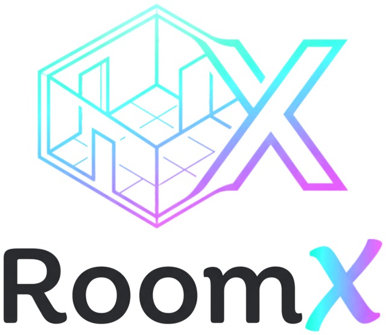
  </picture>
</p>

<p align="center"><b>English</b> &nbsp;·&nbsp; <a href="LIESMICH.md">Deutsch</a></p>

<h3 align="center">The Sims for real life: measure your rooms, see them in 3D, furnish them.</h3>

<p align="center">
  <a href="https://github.com/xc4pr/roomx/releases"></a>
  <a href="https://github.com/xc4pr/roomx/actions/workflows/ci.yml"></a>
  <a href="LICENSE"></a>
  
  
  
  
  
</p>

<p align="center">
  <a href="https://xc4pr.github.io/roomx/"><b>Open the app</b></a>
  &nbsp;·&nbsp;
  <a href="#manual"><b>Manual</b></a>
  &nbsp;·&nbsp;
  <a href="https://xc4pr.github.io/roomx/rechtliches"><b>Privacy</b></a>
</p>

<p align="center">
  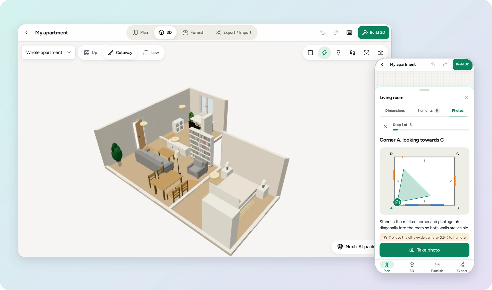
</p>

---

## What is RoomX?

RoomX is The Sims for real life. You measure your rooms, rebuild them in 3D and furnish them. If you like, an AI assistant suggests how to furnish them, and RoomX brings its suggestions back into your plan.

The app runs in the browser on a computer, laptop, tablet or smartphone, and you can install it like an app. You do not need an account: all your projects and photos stay on your device.

> [!NOTE]
> RoomX is available in German and English. You switch the language in the settings. This manual is in English; the German version is [LIESMICH.md](LIESMICH.md).

> [!NOTE]
> **Licence:** anyone may use the published app at <https://xc4pr.github.io/roomx/>, at home and at work. The source code is under the PolyForm Noncommercial License 1.0.0 with an additional permission, see [License](#license).

## What RoomX can do

<table>
  <tr>
    <td width="33%" valign="top">
      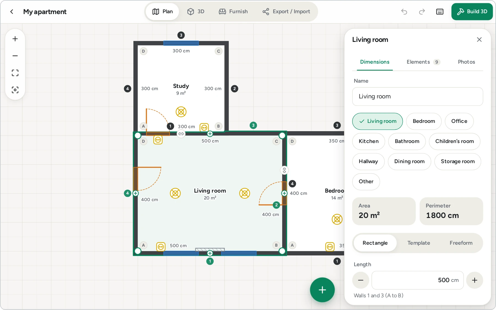<br>
      <b>Capture rooms</b><br>
      Rectangles, templates (L, U, T, bay, recess), free shapes with walls and angles, sloped ceilings. Rooms snap together like magnets.
    </td>
    <td width="33%" valign="top">
      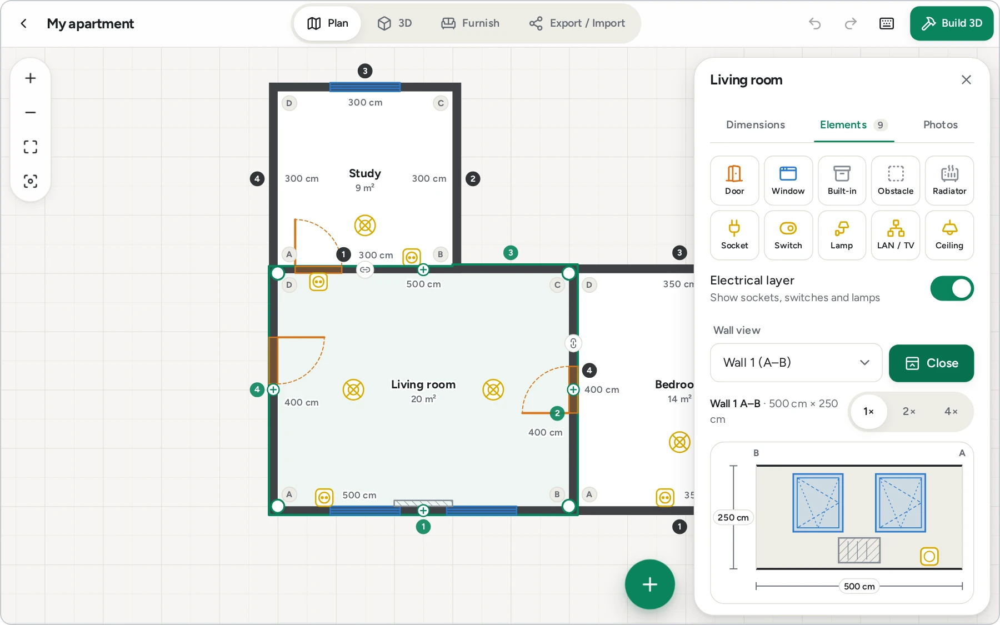<br>
      <b>Doors, windows, electrical</b><br>
      Place elements from the palette on a wall, line them up to the centimetre in the wall view, show sockets and switches.
    </td>
    <td width="33%" valign="top">
      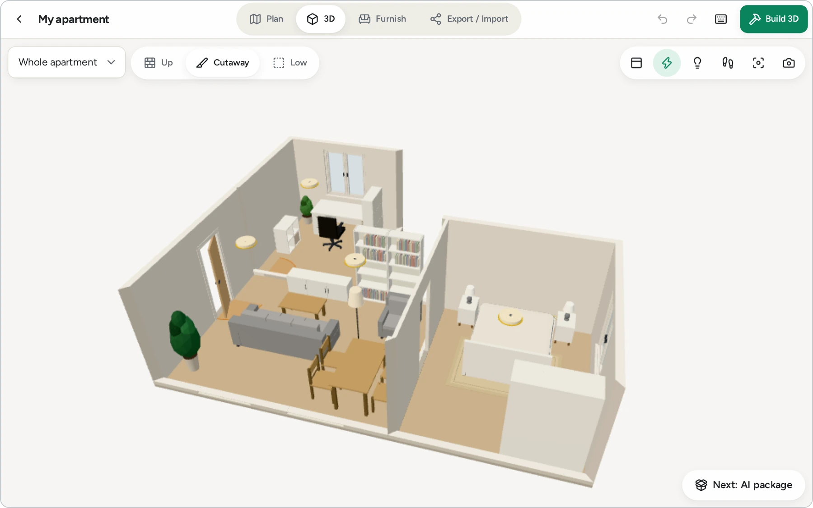<br>
      <b>Your apartment in 3D</b><br>
      Cutaway, high or low walls, lights on and off, walk through the rooms, save an image.
    </td>
  </tr>
  <tr>
    <td width="33%" valign="top">
      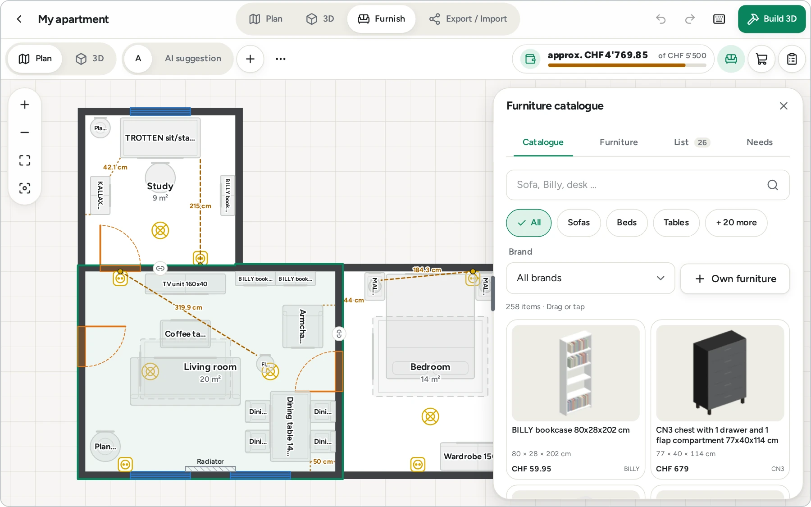<br>
      <b>Furnish</b><br>
      Over 450 pieces from IKEA, JYSK, Tchibo and generic models. Drag, rotate, stack, add your own furniture, compare variants.
    </td>
    <td width="33%" valign="top">
      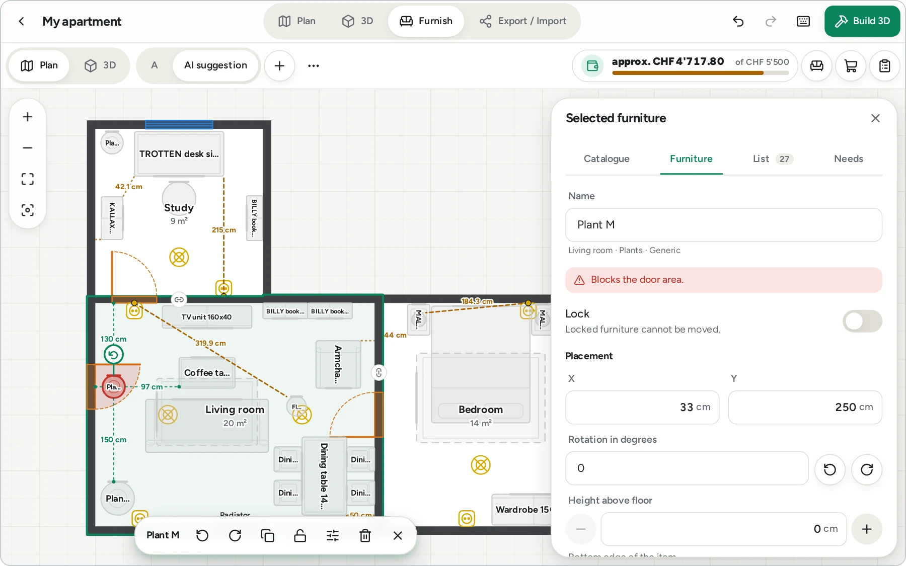<br>
      <b>Checks</b><br>
      Red shows what does not fit: collisions, door area, sloped ceiling, sockets that are too far away.
    </td>
    <td width="33%" valign="top">
      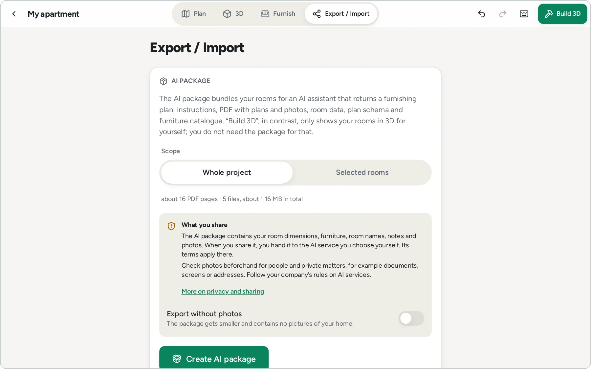<br>
      <b>Furnish with an AI assistant</b><br>
      Create an AI package, upload it in a chat, import the AI's plan as a variant. Plus budget, shopping list and backup.
    </td>
  </tr>
</table>

## Quick start

**1. Open the app.** Go to **<https://xc4pr.github.io/roomx/>**. On first launch a short tour welcomes you with the RoomX logo and shows you the key places.

**2. Create a project.** Tap “New project” and enter a name, for example “My apartment”.

**3. Capture your rooms.** Tap the plus in the plan. You get a 4 × 3 m room. Enter length, width and height, and push the rooms together until they snap. Add doors, windows and sockets.

**4. View it in 3D.** Tap “Build 3D” at the top right. RoomX checks the plan and rebuilds your apartment.

**5. Furnish.** Switch to “Furnish” and drag furniture from the catalogue into the rooms. Or let an AI assistant make a suggestion (see [Furnish with an AI assistant](#furnish-with-an-ai-assistant)).

### Install as an app

You can add RoomX to your home screen or app folder like any other app. It then opens without an address bar and, after the first load, also works without a network connection.

| Device | Browser | How |
|---|---|---|
| iPhone, iPad | Safari | Tap “Share” (at the bottom on iPhone, at the top on iPad), then choose “Add to Home Screen”. |
| Android | Chrome | Open the menu (three dots), then choose “Install app” (or “Add to Home screen”). |
| Windows, Linux, ChromeOS, macOS | Chrome or Edge | Click the install icon in the address bar, or choose “Install RoomX” in the menu. |
| macOS | Safari | In the “File” menu, or via “Share”, choose “Add to Dock”. |

> [!IMPORTANT]
> **iPhone and iPad:** Please install RoomX via “Add to Home Screen”. Safari deletes the data of websites you have not opened for a while. For an installed app this happens far less often. Also make a [backup](#back-up-and-move) every now and then.

> [!NOTE]
> Every address and every installed app has its **own storage**. Projects you created in the browser do not show up in the installed app automatically. To move them, use a backup, see [Back up and move](#back-up-and-move).

---

## Manual

- [Projects](#projects)
- [Capture rooms](#capture-rooms)
- [Connect rooms](#connect-rooms)
- [Doors, windows and electrical](#doors-windows-and-electrical)
- [Photo tour](#photo-tour)
- [Take photos with your phone](#take-photos-with-your-phone)
- [Build and view 3D](#build-and-view-3d)
- [Furnish](#furnish)
- [Furnish with an AI assistant](#furnish-with-an-ai-assistant)
- [Back up and move](#back-up-and-move)
- [Settings](#settings)
- [Keyboard shortcuts](#keyboard-shortcuts)
- [Tips](#tips)
- [FAQ](#faq)
- [Privacy](#privacy)
- [Disclaimer](#disclaimer)
- [License](#license)
- [For developers](#for-developers)

### Projects

A project is an apartment, a house or a single room, with all its rooms, photos, furniture and variants. The project list is the start page.

<p align="center">
  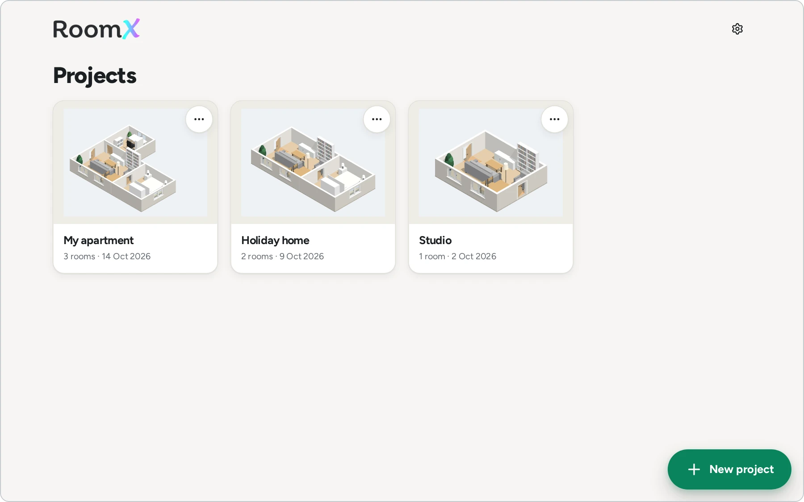
</p>

- **New project:** button at the bottom right. Give it a name. While the list is empty, you see the full RoomX logo and a large plus instead: tap it to create your first project.
- **Open:** tap the card. The preview image shows your project in 3D.
- **Menu (three dots) on the card:** Rename, Backup (ZIP), Delete.
- **Delete goes to the trash.** A deleted project is not gone: “Move to trash” puts it in the **Trash** at the bottom of the project list, where it stays for **30 days**. “Undo” in the message at the bottom brings it back right away. In the Trash, “Restore” brings it back, “Delete for good” removes it for good; after 30 days RoomX removes it by itself. The same “Undo” exists when you delete a photo.
- **At the top of a project:** the tabs “Plan”, “3D”, “Furnish” and “Export / Import” switch between areas. Next to them are “Undo”, “Redo” and “Build 3D”.
- **Gear icon at the top right:** [Settings](#settings).

<p align="center">
  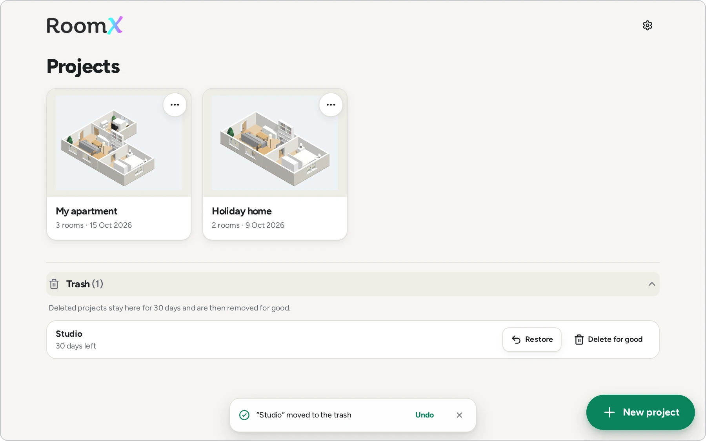
</p>

> [!NOTE]
> With the self-hosted version and syncing switched on, a deletion only reaches your other devices when you delete the project for good.

### Capture rooms

In the **Plan** tab you draw the floor plan. Everything is entered in centimetres (or in metres, see [Settings](#settings)).

**Add a room.** Tap the plus. A 4 × 3 m room appears, and you drag it into place. Tapping selects a room and opens the panel with its three sections **Dimensions**, **Elements** and **Photos**. Double-tapping focuses the room, you zoom with two fingers or the mouse wheel, and “Show everything” fits the view to your plan.

**Room type and name.** Pick a type (Living room, Bedroom, Office, Kitchen, Bathroom, Children’s room, Hallway, Dining room, Storage room or Other) and give the room a name. The types wrap onto several lines, so you see all of them at once, even on a narrow screen.

Under **Dimensions** there are three ways to set the shape:

| Shape | Use it for | How |
|---|---|---|
| **Rectangle** | Most rooms | Type in length and width, or adjust them with plus and minus. |
| **Template** | Common special shapes | Pick a basic shape: L shape, U shape, T shape, Angled corner, Bay or Recess. Then set the dimensions to the centimetre. A preview shows the floor plan. |
| **Freeform** | Everything else | Enter the length and the angles wall by wall. The last wall closes automatically. You can split or remove walls, and “Spread evenly” helps with uneven input. |

> [!TIP]
> With “Freeform” you can also **drag the corners directly on the plan**. The plus in the middle of a wall inserts a corner. If the floor plan does not close, RoomX shows how much is missing.

**Height.** Enter the ceiling height. It is used for 3D, the checks and the AI package.

**Sloped ceilings.** For each wall you can set a slope: enter the **knee wall** height (ceiling height right at the wall) and the **angle**. RoomX works out the distance from the wall at which the full room height is reached and where 2 m of headroom begins. Slopes appear hatched in the plan and in 3D, and furniture that does not fit underneath is flagged.

**More settings in the panel:**

- **Appearance:** a colour for the floor (for example light oak, concrete, tile) and the walls (for example white, sand, sage), or a custom colour. It shows up in 3D.
- **Notes** about the room, for example “parquet, radiator on the left”.
- **Duplicate** and **Delete.** “Undo” brings a deleted room back.
- **Rotate room:** “Rotate by 90°” in the room menu.

### Connect rooms

An apartment is made of several rooms. So that RoomX knows how they fit together, you push them against each other on the plan.

1. Drag a room up to a neighbouring room.
2. It **snaps in like a magnet**. The two rooms now share a wall.
3. A connection symbol appears on the shared wall. In the panel, the “Neighbours” section shows which wall borders which room and how long the shared stretch is. One tap takes you to the neighbouring room.
4. Under each neighbour, **“Wall thickness to …”** shows how thick the shared wall is. Pick 10, 12, 15, 20, 25 or 30 cm; RoomX moves the neighbouring room accordingly. 3D and the plan draw the wall with this thickness.

<p align="center">
  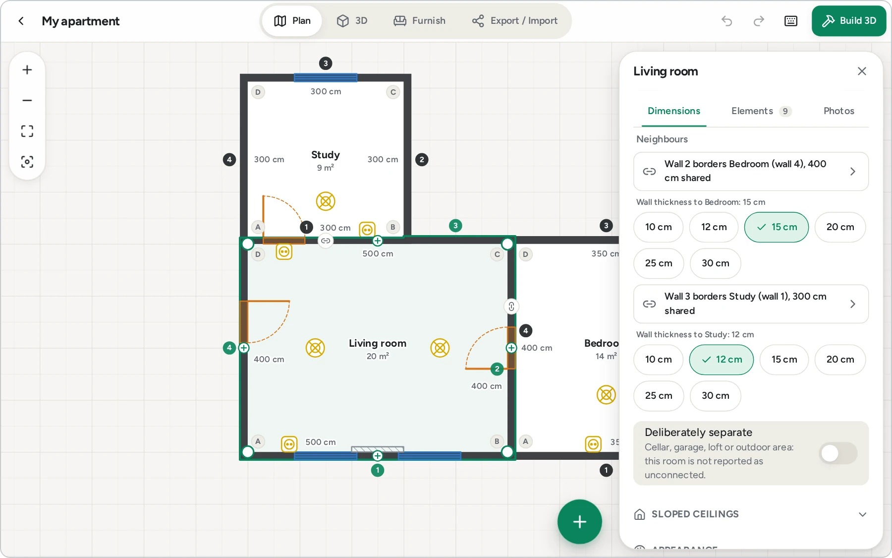
</p>

**Doors and windows in the shared wall lead into both rooms.** If you put a door in the wall between the living room and the bedroom, it automatically appears in the bedroom as well, with the hinge mirrored. In the neighbouring room’s element list it is marked “from Living room”; you edit it in the room it belongs to.

> [!IMPORTANT]
> **Unconnected rooms are reported.** If a room in a project with several rooms has no neighbour, RoomX points it out when you build the 3D view and when you export the AI package. You can carry on anyway. For rooms that are deliberately separate, such as a cellar, garage, loft or an outdoor area, switch on **“Deliberately separate”** at the bottom of the “Neighbours” section in the room panel: RoomX then no longer reports that room.

### Doors, windows and electrical

In the room panel, section **Elements**, you find the palette:

| Group | Elements |
|---|---|
| Wall | Door, Window, Built-in, Obstacle, Radiator |
| Electrical | Socket, Switch, Lamp (on the wall), LAN / TV, Ceiling (ceiling lamp) |

<p align="center">
  
</p>

**Place.** Choose an element in the palette and tap a wall (for the ceiling lamp, tap inside the room). Then drag it to the right spot. “Cancel placing” or the `Esc` key cancels.

**Properties.** Choose an element in the list or on the plan. Depending on its type you can set:

- wall, distance from the corner, width, height and bottom edge above the floor,
- **Door:** hinge side and opening direction (in, out, sliding). The swing area is visible in the plan and has to stay clear.
- **Window:** tilt and turn, sliding window, fixed pane or balcony door,
- **Socket:** number of gangs and USB port, **LAN / TV:** network, TV or both,
- **Status:** “Existing” or “Planned”, plus a note.

“Centre under window” (for example for the radiator) and “Above worktop (centre 115 cm)” for kitchen sockets are handy.

**Wall view.** Choose a wall and tap “Open”. You see the wall from the inside, with all its elements and their heights. Drag elements into place or move them with the arrow keys (`Shift` for 10 cm). 1×, 2× and 4× enlarge the view.

**Electrical layer.** The “Electrical layer” switch shows or hides sockets, switches and lamps on the plan. Electrical elements are yellow, windows blue and doors orange.

**Accept suggestions.** Electrical elements with the status “Suggestion” are drawn dashed. These are, for example, sockets that an AI assistant proposes in its plan. The panel then shows a “Suggestions” section: you can **accept** or **reject** each suggestion individually, or take them all with “Accept all”.

> [!NOTE]
> RoomX does not replace electrical planning. Have sockets and wiring planned and installed by qualified professionals.

### Photo tour

The photo tour guides you through a room step by step, so that no angle is missing later. The photos end up in the AI package and help the assistant understand your room.

<table>
  <tr>
    <td valign="top">

1. Open the room and switch to **Photos** in the panel.
2. Tap “Start tour”.
3. Follow the steps. A small map shows where to stand and where to point the camera: first the corners, then walls, ceiling, floor, details and the electrical elements of each wall.
4. “Take photo” opens the camera, “From library” picks an existing image. You can **skip** optional steps.
5. At the end the gallery shows the required photos. Missing photos are marked, and “Resume tour” fills the gaps.

On top of that you can take a **free photo** with a note at any time, for example of problem spots.

Photos are shrunk on the device and saved without metadata. If you delete a photo by mistake, “Undo” in the message at the bottom brings it back.

    </td>
    <td valign="top" width="260">
      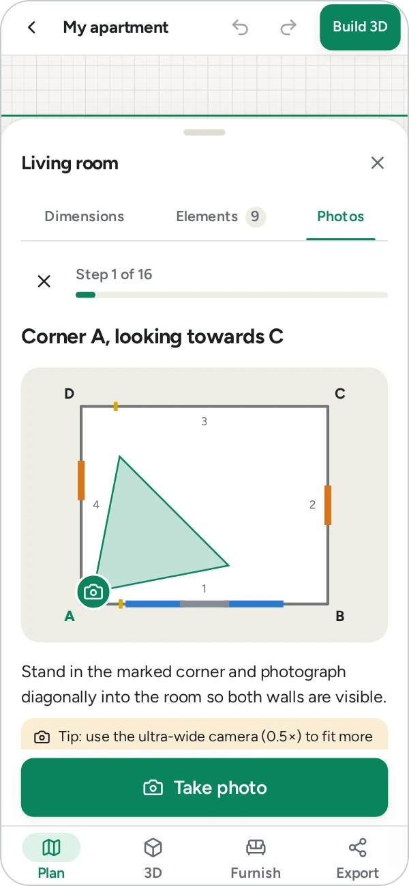
    </td>
  </tr>
</table>

> [!TIP]
> With the ultra-wide camera (0.5×) more of the walls fit into the picture. For the corners, stand in the marked corner and photograph diagonally into the room.

> [!NOTE]
> Some browsers cannot read images in HEIC format. In that case set the camera to “Most Compatible” (iPhone: Settings, Camera, Formats) or pick a JPEG. A single image can be at most 80 MB.

### Take photos with your phone

Most people plan on a PC or laptop but photograph with a phone. “Take photos with your phone” sends the photo pages of the chosen rooms to the phone. You photograph there, now or days later, and the photos come back to the right room and step on their own. No account is needed.

1. On the PC, open the **Photos** tab of a room, or the plan view for several rooms, and tap “Take photos with your phone”. A QR code and a link appear.
2. Scan the QR code with the phone’s camera. Choose “Take photos now” or “Later”. The job is stored on the phone, so taking photos also works offline.
3. The live camera opens with a small map showing where to stand and where to point. After each shot it moves on to the next step.
4. When RoomX is open on the PC and on the phone at the same time, the phone connects by itself and the photos arrive automatically. Both devices show, for example, “Connected, 7 of 14 transferred”. The phone deletes a photo only after the PC has confirmed it.

**No connection?** After about 30 seconds the phone offers “Send photos instead”. Share the JPEG files by AirDrop, Quick Share, email or cloud. On the PC, choose “Photos from files” (or drag the files into the app): RoomX sorts them into the right rooms and steps and skips duplicates.

**Duration and ending:** A job is valid for 7 days. “End job” on the PC makes it invalid at once; photos still on the phone can then no longer be transferred. Open jobs stay visible in the project, with their QR code and status.

**iPhone and iPad:** The link opens in Safari, not in the installed app, and the two keep separate storage. To continue later, open the same link again (scan the QR code again) or open RoomX in Safari and choose “Open photo jobs”. Safari deletes website data after 7 days without a visit, so transfer the photos soon.

**Limits:** Both devices must be open at the same time; a transfer in the background is not possible. Company networks or mobile data can prevent the direct connection. Then use “Send photos instead”. Which services help the devices find each other is described under [Privacy](#privacy).

### Build and view 3D

Tap **“Build 3D”** at the top right. RoomX first checks your plan and lists any problems, for example invalid floor plans, elements that stick out past the wall, missing required photos or [unconnected rooms](#connect-rooms). “Build 3D anyway” carries on, and “Back to the plan” lets you fix things first.

<p align="center">
  
</p>

**Controlling the view.** Dragging rotates the view, the mouse wheel or two fingers zoom. At the top left you choose **Whole apartment** or a **single room**.

| Control | What it does |
|---|---|
| **Walls: Up, Cutaway, Low** | Walls at full height, only the rear walls high, or all low. Cutaway shows the most. |
| **Ceiling** | Show or hide the ceiling. |
| **Electrical** | Show sockets, switches and lamps. |
| **Lights** | Turn ceiling lamps on and off. |
| **Walk** | Walk through the room, see below. |
| **Reset camera** | Back to the starting view. |
| **Save image** | Save the current view as an image (“Share image” on a phone). |

**Walk.** In this mode you stand in the room at eye level. On a computer you walk with `W` `A` `S` `D`, look around with the arrow keys or by dragging the mouse, and stop with `Esc`. On a tablet or phone you walk with the joystick on the left and swipe to look around.

<p align="center">
  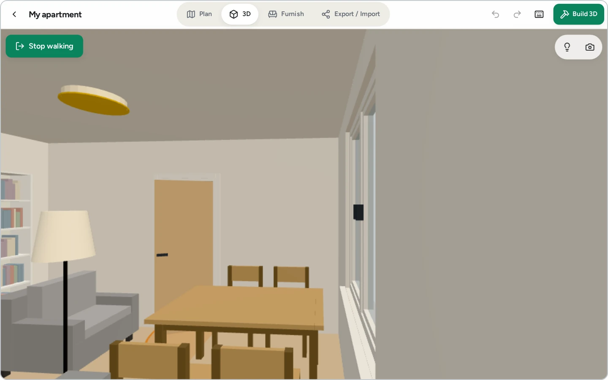
</p>

> [!NOTE]
> 3D needs a browser with WebGL. If the app shows “3D is not available here”, reload the page or try another browser.

### Furnish

In the **Furnish** tab you place furniture in your rooms. At the top left you switch between Plan and 3D and choose the variant. The buttons at the top right open the panel with the sections **Catalogue**, **Furniture**, **List** and **Needs**.

<p align="center">
  
</p>

**Catalogue.** It holds over 450 items from the brands **IKEA**, **JYSK**, **Tchibo** (series CN3, all variants: shelves, chests of drawers, sideboards, low boards, cabinets, tables and desks) and **Generic** (neutral furniture, appliances, decor, lamps). The IKEA, JYSK and Tchibo items are **checked**: dimensions, article number and regular price come from the Swiss online shop (as of October 2026). Beds come in the Swiss sizes 90, 140, 160 and 180 × 200 cm, and PAX combinations include doors. Besides these curated items there is a **large catalogue** with several thousand items from the three retailers. It loads as a separate file the first time you need it and is then available offline. The list stays fast however long it is. Search and the filters for brand, category and width cover all items. Storage furniture (chests of drawers, bedside tables, shelves, cabinets, sideboards, TV units and the CN3 series) is drawn like the original in the plan and in 3D, with plinth, feet or legs, handles, door and drawer layout, frame fronts, top panel and books. Tables and desks show their frame and drawers, sofas and armchairs their arms, back and seat cushions, beds their headboard and storage drawers, mirrors their shape and frame, lamps their shade and stand. The catalogue picture is the same 3D model.

- Search at the top by name, series or article number, for example “Billy”, “desk” or an article number from the retailer.
- Categories as chips: the most common ones (for example Beds, Shelves, Tables, Sofas) come first, and “+ n more” shows the rest (“Less” folds them again). The “Brand” filter narrows the list by retailer or manufacturer, and the “Width” filter by the width of the piece.
- **Drag** or **tap** furniture: tapping puts it into the room.
- **No longer available:** a card with the note “No longer available” marks an item the retailer no longer sells online. It stays in the catalogue so that older projects still load.
- **View at retailer:** every catalogue card of a checked item has a “View at retailer” link. It opens the retailer’s page in a new tab; RoomX itself makes no requests when you do so.

> [!NOTE]
> Catalogue dimensions are **guide values**. Items that are no longer sold stay in the catalogue, so that older projects still load; they are marked **“No longer available”**, and unchecked items carry the note **“Dimensions unverified”**. Older catalogue IDs are redirected to the new item automatically. Prices are **guide prices in Swiss francs (CHF)** from the Swiss market, shown as “Guide price, as of October 2026”. Always check dimensions and price with the retailer before you buy.

**Move furniture.** Drag a piece into place. The rotation handle turns it freely, the buttons in the panel turn it by 90° or 15°, or you type in the angle. On the plan, dotted lines show the distance to walls and other furniture. “Lock” protects a piece from being moved by accident. Duplicate and Delete are in the bar under the selected piece.

**Stacking.** Furniture can stand on other furniture: a TV on the TV unit, a lamp on the bedside table. The panel shows “Stands on …” and the height above the floor; “Take off” puts it back on the floor. When you move a piece, whatever stands on it moves along.

**Own furniture.** “Own furniture” lets you add a piece with your own dimensions, category, colour and price, for example the sofa you already have. A price is optional. Use “Lock” if it is meant to stay put.

**Checks in red.** RoomX checks continuously and turns a piece **red** when something does not fit. The “Furniture” panel gives the reason:

<table>
  <tr>
    <td valign="top">

| Hint | Meaning |
|---|---|
| Does not fit inside the room | The piece extends beyond a wall. |
| Taller than the room | Too tall for the ceiling height. |
| Does not fit under the sloped ceiling | The slope is too low. |
| Overlaps with … | Two pieces stand inside each other. |
| Stands inside a built-in or projection | Collision with a built-in or projection. |
| Blocks the door area | The door’s swing area is not clear. |
| Blocks a window | The piece stands in front of the window. |
| Covers a radiator | The radiator is blocked. |
| Passage is only … wide | Not enough room to walk through. |
| Nearest socket is … away | See below. |

    </td>
    <td valign="top" width="360">
      
    </td>
  </tr>
</table>

**Socket distance.** Furniture that needs power (TV, monitor, lamps, appliances) shows the way to the nearest socket on the plan. If it is more than 1.5 m away, or if no socket has been recorded in the room at all, you get a hint.

**Variants.** At the top you find the variants of your furnishing, for example “A” and “B”. The plus creates a new variant, either empty or as a copy of an existing one. The menu lets you rename or delete variants. This way you can try two furnishings without losing anything. A plan from the AI assistant also arrives as a variant.

**Budget, list and needs.**

<p align="center">
  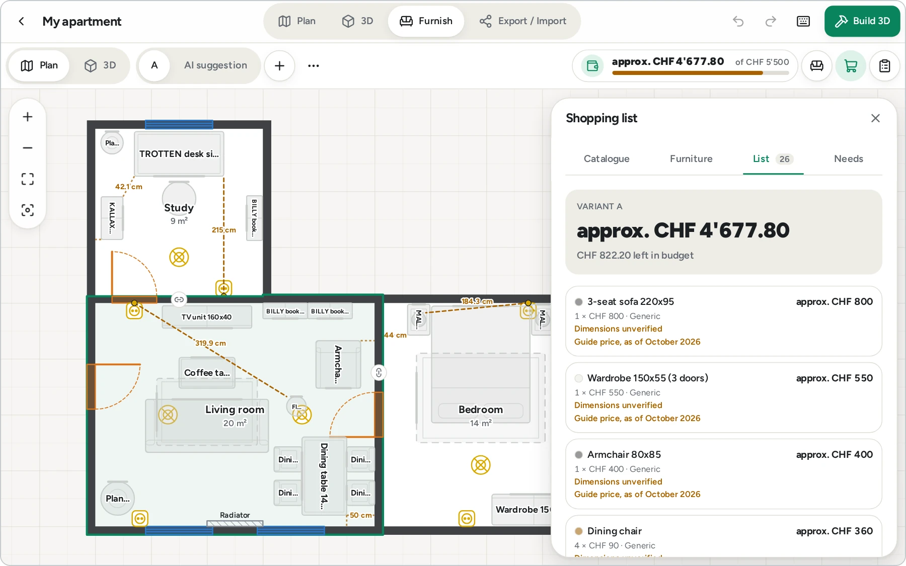
</p>

- **Budget:** enter your budget in CHF under **Needs**. A bar at the top shows the total of the current variant and how much is left in the budget or how far over it you are.
- **List (shopping list):** all furniture in the variant with quantity, price, brand and link, plus the total. Items with a guide price are marked, and items without a price are counted. For checked items the link leads to the retailer’s page. “Export as CSV” saves the list for Excel or Numbers (columns: Item, Brand, Quantity, Unit price CHF, Total CHF, Estimate, Link).
- **Needs:** people (adults, children, pets), bed sizes, workstations (monitors, laptop or PC, height-adjustable), style, budget, preferred retailers and wishes. The needs go into the AI package and help the assistant make its suggestion.

### Furnish with an AI assistant

You can have an AI assistant furnish your rooms. For this, RoomX prepares an **AI package** and reads the assistant’s answer back in. It works with any AI assistant that accepts files. You do not need to install anything extra: the package already contains the instructions, the plan schema, the catalogue and a ready-made start prompt.

> [!NOTE]
> “Build 3D” is independent of this: it only shows your rooms in 3D for yourself. You only need the AI package if you want an assistant to make a plan for you.

**The AI package contains:**

| File | Contents |
|---|---|
| **Instructions** (`roomx-instructions-….md`) | Explains to the AI assistant how to proceed and what to return. |
| **PDF** (`roomx-….pdf`) | Floor plans with dimensions, wall views, 3D views, furniture, your photos and a reading guide. |
| **Room data** (`roomx-….json`) | The same information, exact and machine-readable: rooms, walls, elements, neighbouring rooms, sloped ceilings, furniture, variants and needs. |
| **Plan schema** (`roomx-plan.schema.json`) | Describes the `roomx-plan` format in which the answer has to come back. |
| **Furniture catalogue** (`roomx-katalog.json`) | The items the assistant can use: the curated catalogue plus the items of the retailers named in your needs. If that is too large for the package, it contains a marked excerpt. |

**Step by step:**

1. **Create the AI package.** Open the “Export / Import” tab. Choose “Whole project” or “Selected rooms” and tap “Create AI package”. Beforehand RoomX shows the estimated size and a notice **“What you share”**, and then points out gaps in the plan, such as [unconnected rooms](#connect-rooms) or missing required photos. “Export anyway” carries on. Then “Share” or “Download”. If you do not want to hand over any pictures of your home, switch on **“Export without photos”**.
2. **Upload it in a chat.** Open a chat with an AI assistant of your choice and upload **all files** of the package. In RoomX, tap **“Copy prompt”** and paste the text into the chat. Under “What to do next”, RoomX shows these steps and the ready-made prompt right away.
3. **Answer the questions.** The assistant asks what else it needs to know, for example about style, budget or wishes. Answer them.
4. **Get the plan back as JSON.** At the end the assistant outputs the furnishing plan as JSON in the `roomx-plan` format. Copy the **whole reply**, or save the plan as a file.
5. **Import the plan.** In RoomX go to “Export / Import”, section “Import plan”: paste the text (“From clipboard” helps) or choose the file. RoomX is tolerant here: the reply may contain other text, a code block or comments in the JSON; RoomX finds the JSON by itself.
6. **Check the preview.** For each variant RoomX shows the total and lists conflicts (for example “blocks the door”), notes and anything that cannot be imported.
7. **Import as a variant.** “Import as new variant” adds the plan as a variant. Nothing is overwritten. If you like, choose whether the needs from the plan are taken over as well.
8. **Adjust and export again.** Look at the variant in “Furnish” and change what you do not like. For a second round, create a new AI package: it now contains your adjusted furnishing.

<p align="center">
  
</p>

<p align="center">
  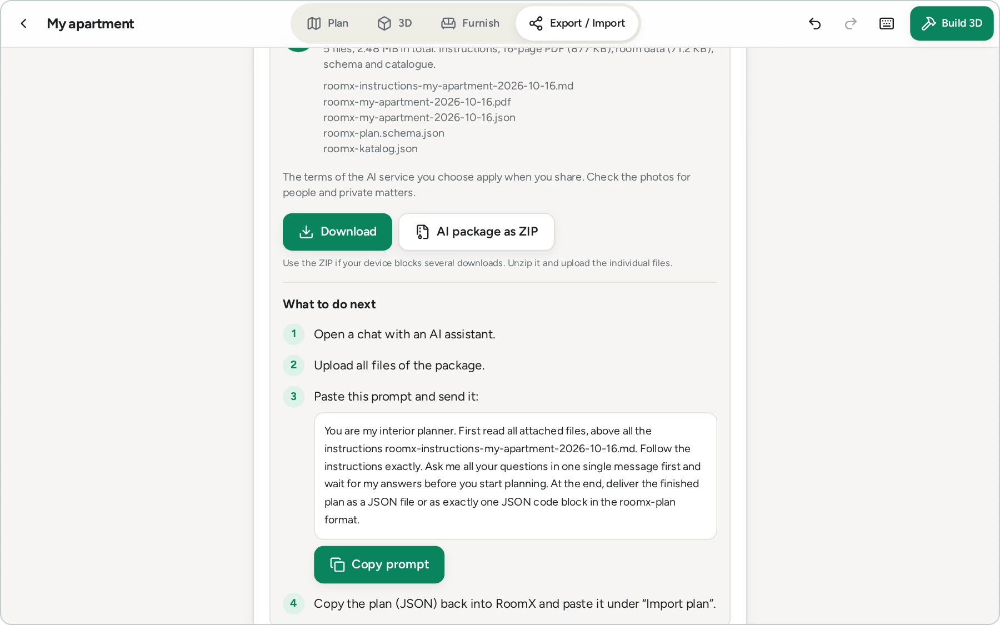
</p>

<p align="center">
  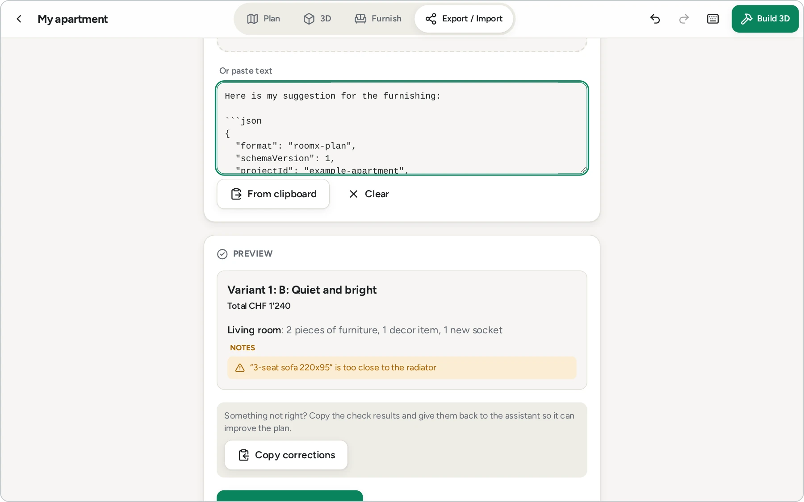
</p>

<p align="center">
  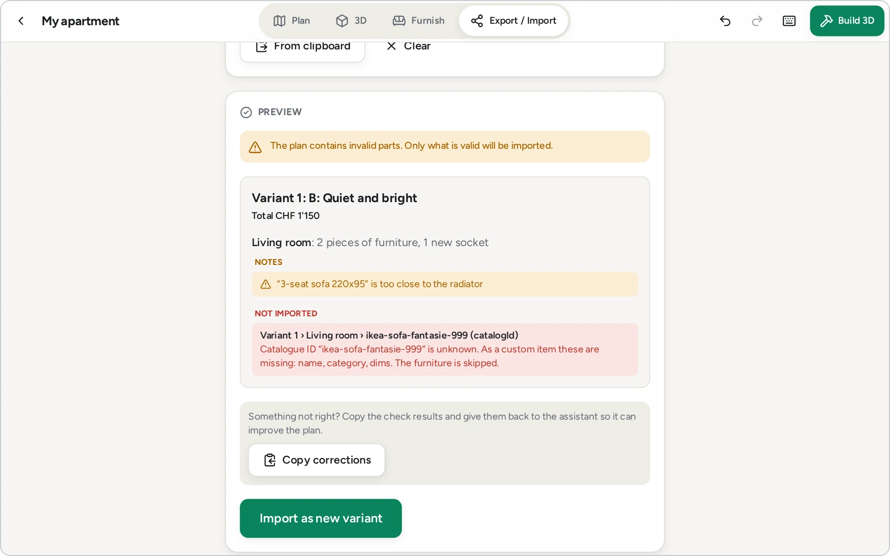
</p>

> [!TIP]
> **Does your device block several downloads at once?** Then use “AI package as ZIP”, unzip the file and upload the individual files in the chat.

> [!TIP]
> **For large apartments**, export the rooms one at a time (“Selected rooms”). If RoomX says the package is getting large and the assistant will not accept it, this is the best way.

> [!TIP]
> **Something not right after the import?** Under the preview, “Copy corrections” copies a ready-made text for the AI assistant. It starts with “Please correct the plan:”, lists what could not be imported and the notes, and asks for the whole corrected plan. Paste it into the chat. The same works if the JSON is faulty or the reply breaks off in the middle.

> [!IMPORTANT]
> The AI package contains your room data and, if included, your **photos**. You pass them on yourself to the assistant’s provider, and its terms apply. Check the photos beforehand for people, documents and anything private. With “Selected rooms” or “Export without photos” you only share what is needed.

### Back up and move

**Saved automatically.** RoomX saves every change by itself, shortly after you type or drag. There is no Save button.

**Undo and Redo.** The arrows at the top (or `Ctrl`/`Cmd` + `Z`) undo the last step. Deleting rooms and furniture can be undone too. One drag counts as one step.

**Backup of one project (ZIP).** Under “Export / Import” or in the menu of the project card you create a backup: the whole project in one ZIP file, with project data and original photos. Optionally you add the AI package and the 3D model.

**Restore one project.** Under “Restore” choose the ZIP file. If the project already exists on this device, RoomX **never overwrites** it but creates it as a copy. If photos are missing or damaged, RoomX tells you how many.

**Back up everything.** In the [settings](#settings), “Back up everything” saves **all projects with their photos** in one ZIP file. “Restore everything” reads such a file back in. It never overwrites anything: a project that already exists is added as a copy. A project that cannot be opened is not lost: it goes into the backup unchanged as raw data. RoomX remembers when you last made a backup and reminds you when it is more than 14 days ago; on iPhone and iPad it also shows a reminder, because Safari can delete data.

<p align="center">
  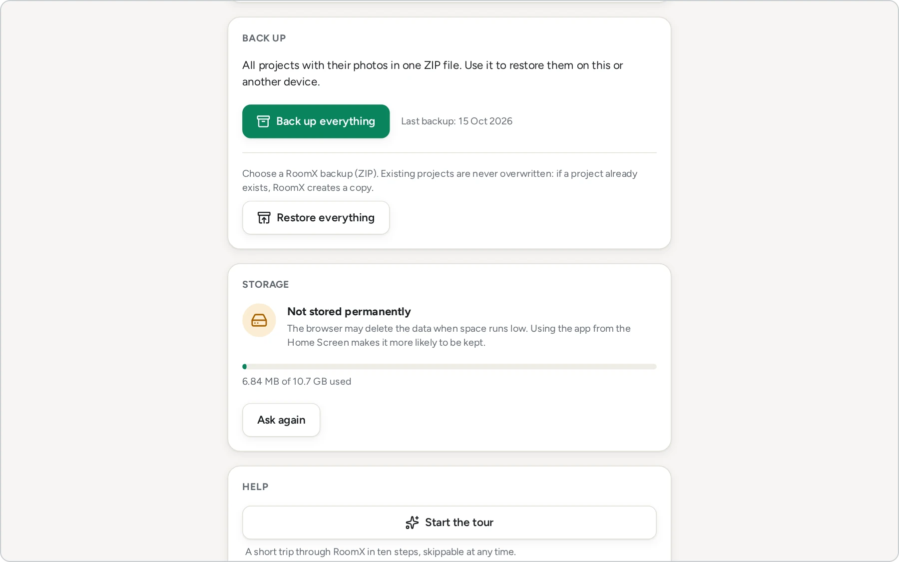
</p>

**Moving to another device or to the installed app:**

1. Create a backup (ZIP) in the old place.
2. Transfer the file, for example by AirDrop, email or a cloud folder.
3. Open RoomX in the new place and restore the backup.

**Storage and saving.** If saving fails, for example because the storage is full or the browser forbids it, RoomX says so openly and offers **“Back up now”**; it never fails silently. Shortly before the storage is full it warns you. If you open the same project in a second tab or window, that tab only shows it (“Read only”) and updates by itself; “Edit here” takes over editing.

**3D model (.glb).** Under “Export / Import” you export the selected rooms with the active variant as a `.glb` file. You can open the model in programs such as Blender or in an AR viewer.

> [!IMPORTANT]
> Your data lives only in your device’s browser. There is no copy with us that could be recovered. If you clear website data, lose the device or let Safari clean up the data, the projects are gone. **Make a backup regularly** and keep it apart from the device.

### Settings

You reach them with the gear icon at the top right of the project list.

| Setting | What it does |
|---|---|
| **Language** | Deutsch or English. The default is your browser’s language. |
| **Length unit** | Centimetres or metres. |
| **Back up** | “Back up everything” and “Restore everything”, see [Back up and move](#back-up-and-move). Shows when you last made a backup. |
| **Install the app** | In Chrome and Edge, an “Install app” button appears here. On iPhone and iPad, RoomX explains how to use “Add to Home Screen”, because Safari can delete the data of websites that have not been opened for seven days. |
| **Storage** | Shows whether the browser **keeps the data permanently** (“Stored permanently”) or may delete it when space runs low, and how much space is used. “Ask again” tries to get permanent storage once more. It is more likely to work with the app on your home screen. |
| **Help** | “Start the tour” plays the introduction again (ten steps, skippable at any time, optionally with a sample room). “Show keyboard shortcuts” opens the overview. |
| **About RoomX** | The card below “Help”. It shows the full logo, the **version** and the **build date**, and the line “Data: Everything stays on your device”. “Privacy & liability” opens a short page with the privacy policy (who is responsible, how to get in touch), the disclaimer and the licence of RoomX. “Open-source licences” leads to the licences of the parts RoomX uses (both pages are also at `/rechtliches`). Under “Feedback” you open the GitHub issues with “Report a bug or suggest an idea” (templates in German and English; you need a GitHub account) or send a message with “Write an email”. “Copy diagnostics” copies technical details about device and app, **without project data**, names or photos, so you can paste them into your report. |
| **Reset everything** | “Delete all local data” removes all projects, photos and settings from this device. Beforehand RoomX offers to back up first. This cannot be undone. |

<p align="center">
  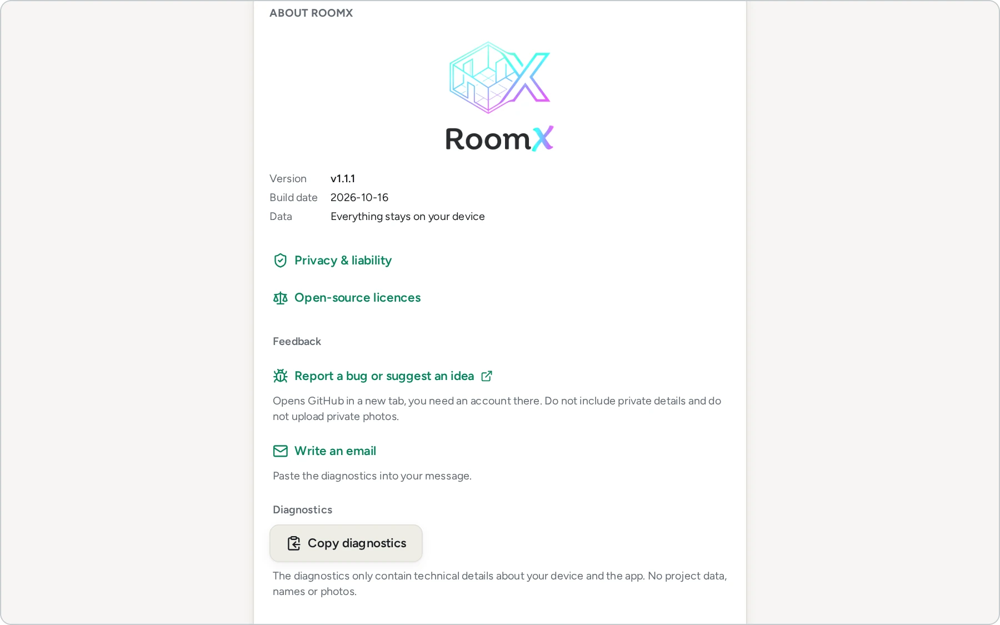
</p>

### Keyboard shortcuts

For computers and iPads with a keyboard. On a Mac, use `Cmd` instead of `Ctrl`. In the app, the `?` key shows the overview.

| Key | What it does |
|---|---|
| `Ctrl` + `Z` | Undo |
| `Ctrl` + `Shift` + `Z` (or `Ctrl` + `Y`) | Redo |
| `Esc` | Clear selection, leave focus, cancel placing |
| `?` | Show or hide the overview of shortcuts |
| Arrow keys | Move the selected room or element by 1 cm |
| `Shift` + arrow keys | Move by 10 cm |
| `R` | Rotate room by 90° |
| `Shift` + `R` | Rotate room back by 90° |
| `Del` | Delete the selected room or element |
| `+` and `-` | Zoom in and out |
| `0` | Show everything |

### Tips

- **Start with the biggest room** and work outwards. Connecting the rooms is then quickest.
- **Remember corner A.** All walls are numbered and the corners are called A, B, C … For each room, note where corner A is, and you will find your way around the plan, the wall view and the PDF straight away.
- **Measure rather than guess.** A laser distance meter is worth it. The wall view helps you enter the heights of windows and sockets exactly.
- **Record the furniture you already have.** Add it as “Own furniture” and lock it. That way the assistant plans around it.
- **Variants instead of overwriting.** Try ideas in a copy before you change the main variant.
- **A few good photos** beat many bad ones: follow the tour and photograph straight on, with good light.
- **Back up before every big change**, and especially before importing an AI plan.
- **Record sockets** before you furnish. Only then are the socket-distance hints correct.

### FAQ

<details>
<summary><b>Where is my data?</b></summary>

In your device’s browser (IndexedDB). The public version talks to no server; the only exception is an open photo job (see “Take photos with your phone”). There is no account and no copy in a cloud. Data only leaves your device when you yourself share an AI package, a backup or another export.
</details>

<details>
<summary><b>Why can’t I see my projects on another device?</b></summary>

Because every device, every browser and every installed app has its own storage. That also applies to two different addresses. Move your projects with a backup (ZIP), see [Back up and move](#back-up-and-move).
</details>

<details>
<summary><b>What happens to my photos in the AI package?</b></summary>

The photos are inside the package’s PDF. RoomX itself sends nothing: you upload the files to an AI assistant yourself, and its provider processes them under its own terms. Check the photos beforehand, and choose individual rooms if you want.
</details>

<details>
<summary><b>I deleted a project by mistake.</b></summary>

Open the project list and the **Trash** at the bottom: deleted projects can be restored there for 30 days. Right after deleting, “Undo” in the message also helps.
</details>

<details>
<summary><b>How do I report a mistake or suggest something?</b></summary>

In the settings, under “About RoomX”, section “Feedback”, you have two ways. “Report a bug or suggest an idea” opens the issues on GitHub (account needed). “Write an email” opens a message to julian-5@gmx.ch. Paste the result of “Copy diagnostics” if it helps, but no private details or photos.
</details>

<details>
<summary><b>Does it cost anything?</b></summary>

No. RoomX is free and needs no account. Anyone may use the published app, privately and at work (see [License](#license)). If you use an AI assistant, its provider’s terms apply.
</details>

<details>
<summary><b>Does it work offline?</b></summary>

Yes, after the first load. The app stores its files in the browser and also starts without a network, best as an installed app. Nothing is lost offline; only links to furniture stores and uploading to an AI assistant need the internet.
</details>

<details>
<summary><b>Why don’t the photos arrive?</b></summary>

Check, in this order: RoomX must be open on the PC (in the project with the open job) and on the phone at the same time, and both must be online. The job must not have expired (7 days) or been ended. On an iPhone, the link must be open in Safari, not in the installed app. Company networks or mobile data can block the direct connection: then use “Send photos instead” on the phone and “Photos from files” on the PC.
</details>

<details>
<summary><b>My projects disappeared on my iPhone. What happened?</b></summary>

Safari can delete the data of websites you have not opened for seven days. Install RoomX via “Add to Home Screen”, because installed apps are exempt from this. RoomX also reminds you to do so on iPhone and iPad. A backup (ZIP) brings projects back, see [Back up and move](#back-up-and-move). Under “Storage”, the settings show whether your browser keeps the data permanently.
</details>

<details>
<summary><b>Are the furniture dimensions and prices correct?</b></summary>

They are guide values. Catalogue prices are guide prices in CHF (as of October 2026), and entries that are not checked (for example items that are no longer sold) are marked “Dimensions unverified”. Check both with the retailer before you buy.
</details>

<details>
<summary><b>The assistant gives me a plan that RoomX cannot read.</b></summary>

Tap “Copy corrections” (it appears under the import preview and with every error message), paste the text into the chat and ask the assistant for a corrected, complete output. For very large apartments it helps to export the rooms one at a time.
</details>

<details>
<summary><b>I do not see a 3D view.</b></summary>

Reload the page or try another browser. 3D needs WebGL, which is missing in very old browsers or when graphics acceleration is switched off.
</details>

<details>
<summary><b>Can several people work on the same project?</b></summary>

Not at the same time: there is no syncing between devices. But you can pass a project on as a backup (ZIP), or as a PDF and a `.glb` file.
</details>

---

## Privacy

In short: **your data stays on your device.**

- No accounts, no cookies, no tracking, no advertising or analytics services, no third-party fonts or scripts.
- Projects, photos and settings live in your device’s browser (IndexedDB and localStorage). The operator has no access to them and cannot restore them.
- Apart from taking photos with your phone (see below), the public version of RoomX sends **no data to any server**. There is no syncing.
- Data only leaves your device when **you** pass it on: with an AI package, a backup or another export.
- When you add photos, they are shrunk in the browser and saved without metadata such as the location where they were taken.
- **Taking photos with your phone** is the one exception to “no server”. Only while a photo job is open and RoomX is open on the device, PC and phone connect through public relay services (Nostr relays: nos.lol, relay.damus.io, relay.primal.net, relay.snort.social, nostr.data.haus) and public STUN servers (Cloudflare, Google). Otherwise no request goes out. These services see IP addresses and encrypted connection data, never photos, room data or projects. Photos travel directly between your own devices and are additionally end-to-end encrypted (AES-256-GCM, the key is only in the QR code and the link). The link contains the room names and floor plans: share it only with people you trust with them. A job is valid for 7 days, and “End job” invalidates it at once. Photos you send through the share menu instead travel through the service you choose.
- GitHub Pages serves the app’s files. When you open the app, GitHub processes technical access data such as your IP address. The operator of RoomX does not receive it.
- Links to furniture stores (“View at retailer”) only open, in a new tab, when you tap them. RoomX makes no requests to the stores, and no project data is passed on.
- The data in the browser is not additionally encrypted. Lock your device.

Responsible for the app and its privacy page is xc4pr. Contact: julian-5@gmx.ch, or the [issues on GitHub](https://github.com/xc4pr/roomx/issues).

The full privacy policy is in the app: under Settings, in the section “About RoomX”, on the page [“Privacy & liability”](https://xc4pr.github.io/roomx/rechtliches).

## Disclaimer

RoomX is a free tool and is provided “as is”, without any guarantee that it is free of errors or always available. You use it at your own risk.

- **Dimensions, prices and checks are guide values.** Catalogue data, prices, calculations and the red hints do not replace measuring on site. Furniture in the plan and in 3D is shown in simplified form.
- **AI suggestions are unchecked.** You decide whether to accept them. RoomX has no influence on the assistant.
- **No professional advice.** RoomX does not replace planning by professionals, especially for structural work, electrical installations and wall fixings.
- **Check before buying and building:** dimensions, prices and availability are yours to verify.
- **Data loss is possible** if you clear browser data or lose your device. Make a backup regularly.
- Brands such as IKEA, JYSK and Tchibo belong to their owners. There is no connection to these companies.

The full wording is in the app on the page [“Privacy & liability”](https://xc4pr.github.io/roomx/rechtliches).

## License

RoomX is licensed under the **PolyForm Noncommercial License 1.0.0**, with an additional permission. The binding text is the file [`LICENSE`](LICENSE). In plain words:

- **Source code:** you may look at it, copy it and change it for noncommercial purposes.
- **The published app:** the app at <https://xc4pr.github.io/roomx/> may be used by any person and any company, including at work, for example to plan rooms for clients.
- **Not allowed:** selling RoomX or access to it, passing it on, or offering it as a service of your own, except within the licence for noncommercial purposes.

© 2026 xc4pr

---

## For developers

<details>
<summary><b>Stack, folders, development, tests and publishing</b></summary>

### Stack

- **App:** SvelteKit 3 as a single-page app (`ssr = false`, adapter-static with fallback `index.html`), Svelte 5 (runes), Vite 8, Tailwind CSS 4, TypeScript (strict), Zod 4.
- **3D:** three.js. **Data in the browser:** Dexie (IndexedDB). **PDF:** pdf-lib, **ZIP:** fflate. **UI:** bits-ui, Lucide icons, Figtree typeface.
- **PWA:** custom service worker (`web/src/service-worker`) that precaches all files.
- **Server (optional):** FastAPI and uvicorn, only for the self-hosted version.
- **Tests:** Vitest (unit), Playwright (E2E), pytest (server).

### Folder structure

```text
roomx/
├─ web/                    SvelteKit app (SPA and PWA)
│  ├─ src/lib/core         Data model, geometry, checks, export and plan format (no UI)
│  ├─ src/lib/state        Store, storage (IndexedDB), settings, sync
│  ├─ src/lib/features     App areas: board, room, elements, photos, viewer, furnish,
│  │                       export, import, projects, settings, tour, legal
│  ├─ src/lib/three        3D: rooms, furniture models, viewer, GLB export
│  ├─ src/lib/catalog      Furniture catalogue (IKEA, JYSK, Tchibo, Generic)
│  ├─ src/lib/ui           Base components and design tokens
│  ├─ src/routes           Pages (projects, plan, 3D, furnish, export/import, settings)
│  ├─ src/service-worker   Service worker
│  └─ tests                E2E tests (Playwright)
├─ server/                 FastAPI server for the optional sync
├─ deploy/                 Dockerfile and compose.yaml
└─ .github/                Workflow for GitHub Pages, images for this README
```

### Development

Requirements: Node 24 and pnpm 12.

```bash
pnpm -C web install
pnpm -C web dev          # dev server on http://localhost:5173
pnpm -C web check        # type and Svelte checks
pnpm -C web test         # unit tests (Vitest)
pnpm -C web build        # static files in web/build (self-hosted version unless EDITION says otherwise)
pnpm -C web build:pages  # public version for GitHub Pages under /roomx, incl. 404.html
pnpm -C web build:server # self-hosted version with sync
pnpm -C web preview      # preview the built result
```

### Tests

```bash
pnpm -C web test                # unit tests
pnpm -C web test:e2e            # E2E in Chromium (desktop and iPad landscape), builds first with EDITION=pro
pnpm -C web test:e2e:webkit     # E2E in WebKit (iPad landscape and portrait) in a Docker image
pnpm -C web test:e2e:pages      # E2E against the public version (built with EDITION=free) in Chromium, with network audit
pnpm -C web test:e2e:pages:webkit   # the same in WebKit, in a Docker image
cd server && python -m venv .venv && .venv/bin/pip install -e '.[dev]' && .venv/bin/pytest
```

The E2E tests run against the real server (port 4273, `web/tests/server.mjs`). For WebKit, `test:e2e:webkit` uses the Playwright Docker image `mcr.microsoft.com/playwright`, so it needs Docker.

### Branches and continuous integration

Work happens on the branch **`dev`**; **`main` is the published state**. The CI (`.github/workflows/ci.yml`) runs on every push and checks Prettier, types, unit tests, server tests, the builds and the E2E tests (Chromium, WebKit, and the Pages edition including a network audit that makes sure the public version sends no requests to other servers).

### Publishing via GitHub Pages

A push to `main` (a release, marked with a version tag `v*`) starts the workflow `.github/workflows/pages.yml`. It runs the CI first and only deploys if it is green: install dependencies, then `pnpm -C web build` with two environment variables. After that `index.html` is copied to `404.html` (so that direct links work in the single-page app) and `web/build` is published. The script `pnpm -C web build:pages` does the same build and the copy in one command.

| Variable | What it does |
|---|---|
| `EDITION=free\|pro` | `free`: public version, sync off, no server check, server settings hidden, all data stays in the browser. `pro` (the default if `EDITION` is not set): self-hosted version with sync. Any other value, or the old switch of earlier versions still being set in the environment, aborts the build. |
| `BASE_PATH=/roomx` | Base path of the app, here the name of the repository (the site lives at `https://<account>.github.io/roomx/`). |

Try it locally:

```bash
pnpm -C web build:pages && pnpm -C web preview
```

### Self-hosted version with sync server

The self-hosted version (`pnpm -C web build:server`, that is `EDITION=pro`) can sync projects and photos with your own server. The server (`server/`) then also serves the app. The Dockerfile builds it with `EDITION=pro`. It runs with Docker:

```bash
cp deploy/.env.example deploy/.env      # set ROOMX_TOKEN (required), optionally ROOMX_PORT (default 8422)
docker compose -f deploy/compose.yaml up -d --build
```

- `ROOMX_TOKEN`: access token. The compose file aborts without a token. You enter the same token in the app under Settings, together with the server address.
- `ROOMX_DATA`: data folder inside the container (default `/data`, as the volume `roomx-data`). `ROOMX_STATIC`: folder with the built app.
- Check with `GET /api/health`. The endpoints `/api/projects` and `/api/photos/{digest}` require the token.
- Camera, clipboard and service worker need **HTTPS**, except on `localhost`. Put the server behind an HTTPS proxy if you use it anywhere other than `localhost`.

Server without Docker (development):

```bash
cd server
python -m venv .venv && .venv/bin/pip install -e '.[dev]'
ROOMX_TOKEN=secret ROOMX_DATA=./data .venv/bin/uvicorn app.main:app
```

</details>

---

<p align="center"><sub>RoomX · Measure rooms, view them in 3D, furnish them · <a href="https://xc4pr.github.io/roomx/">Open the app</a> · <a href="https://xc4pr.github.io/roomx/rechtliches">Privacy &amp; liability</a> · <a href="LICENSE">License</a></sub></p>
